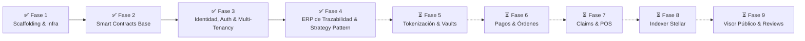
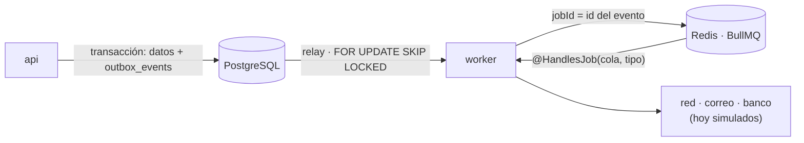
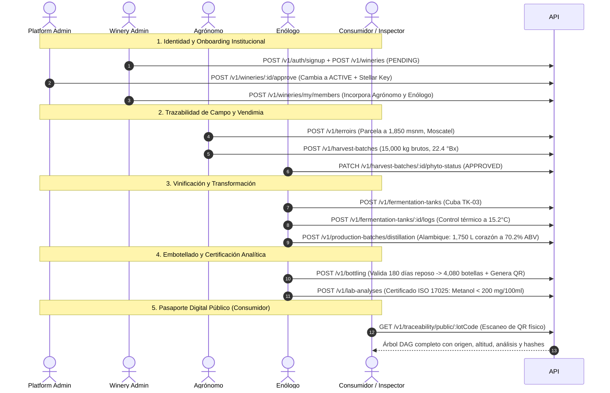

# 🍷 Drinks on Chain — Backend API

> **Plataforma Integral de Trazabilidad Agroalimentaria B2B, Tokenización RWA (Real World Assets) y Comercio Electrónico Web3 sobre la Blockchain Stellar.**

[](https://www.typescriptlang.org/)
[](https://nestjs.com/)
[](https://www.prisma.io/)
[](https://stellar.org/)
[](https://www.postgresql.org/)
[]()

---

## 📖 1. Idea General del Proyecto

**Drinks on Chain** es un ecosistema tecnológico diseñado para digitalizar, certificar y tokenizar la cadena de valor de la industria vitivinícola, destilerías de altura (**Singani Boliviano con Denominación de Origen**) y cervecerías artesanales.

### 🌟 Pilares Fundamentales

1. **ERP de Trazabilidad Agroalimentaria B2B:** Registro granular y encadenado de la custodia desde la parcela agrícola, recepción en báscula con pesaje neto, fermentación con control térmico, destilación en alambique o crianza en barrica, hasta el fraccionamiento y embotellado final.
2. **Cumplimiento Normativo y Enológico Automatizado:** Reglas de validación estrictas basadas en normativas bolivianas e internacionales (SENASAG, ISO 17025, Denominación de Origen Singani con altitud $\ge 1,600$ msnm, 100% uva Moscatel de Alejandría y reposo inerte obligatorio de 180 días).
3. **Pasaporte Digital de Producto (Acceso QR):** Generación automática de códigos QR físicos vinculados a un árbol genealógico DAG (*Directed Acyclic Graph*) que permite a consumidores, inspectores y distribuidores auditar el origen exacto del producto.
4. **Anclaje Criptográfico y Tokenización RWA (Fases 5+):** Estructuración de datos y hashes SHA-256 compatibles con los contratos inteligentes Soroban ([`docs/contratos/trazabillidad.rs`](docs/contratos/trazabillidad.rs)) para emisión de NFTs de custodia, compras anticipadas (*en primeur*), redención física y liquidación en Stellar USDC.

---

## 📊 2. Estado Actual del Proyecto

El desarrollo del backend se estructura en **9 fases progresivas**. Actualmente se han completado al 100% las **Fases 1 a 4**:



### 📈 Métricas de Calidad Actuales
- **Pruebas Unitarias:** `301/301` tests pasando (42 suites).
- **Pruebas E2E:** `109/109` tests pasando (8 suites completas).
- **Compilación TypeScript:** modo estricto (`strict: true`) sin errores; ESLint 9 sin errores (CI en cada push y PR).
- **Base de Datos:** 18 modelos relacionales y 21 enums migrados y sincronizados en PostgreSQL (incluidos el outbox, las organizaciones, las membresías y las sesiones).

---

## 🏗️ 3. Estructura del Repositorio

```
drinks-on-chain-backend/
├── docs/                               # Documentación de arquitectura y especificaciones
│   ├── architecture/                   # Diagramas y flujos de trazabilidad / Stellar
│   ├── bd/                             # Diccionario de datos y catálogo de tablas
│   ├── contratos/                      # Contratos inteligentes Soroban (Rust)
│   ├── demo/                           # Guías de pruebas manuales y payloads de ejemplo
│   ├── endpoints/                      # Catálogo exhaustivo de endpoints de la API
│   └── implementation/                 # Planes y UTs ejecutadas por fase
├── prisma/                             # Esquema y migraciones de base de datos
│   ├── migrations/                     # Historial de migraciones PostgreSQL
│   └── schema.prisma                   # Definición de modelos, enums y relaciones
├── src/                                # Código fuente de la aplicación NestJS
│   ├── config/                         # Validación de variables de entorno (Joi)
│   ├── modules/                        # Módulos de dominio de la aplicación
│   │   ├── auth/                       # Sesiones (acceso + doc_rt), guards globales, límites
│   │   ├── organizations/              # Organizaciones y membresías (roles por organización)
│   │   ├── harvest-batches/            # Lotes de vendimia, pesaje neto y fitosanitario
│   │   ├── health/                     # Healthcheck y diagnóstico de base de datos / Redis
│   │   ├── terroirs/                   # Parcelas agrícolas, GeoJSON y altitud msnm
│   │   ├── traceability/               # Núcleo ERP: Fermentación, Crianza, Destilación,
│   │   │   │                           # Embotellado, Laboratorio, DAG Builder & Strategies
│   │   │   ├── controllers/            # Controladores REST API
│   │   │   ├── dto/                    # DTOs tipados con class-validator y Swagger
│   │   │   ├── hooks/                  # Hooks desacoplados para simulación on-chain
│   │   │   ├── services/               # Lógica de negocio y persistencia Prisma
│   │   │   └── strategies/             # Strategy Pattern (Vino, Singani, Cerveza)
│   │   ├── uploads/                    # Subida multiparte de imágenes y PDFs con validación MIME
│   │   ├── users/                      # Perfiles de usuario y gestión de cuenta
│   │   ├── wallets/                    # Provisión de billeteras custodiales en Stellar
│   │   └── wineries/                   # Onboarding institucional y membresías
│   │       └── jobs/                   # Procesadores del worker (winery.created, member.added)
│   ├── worker/                         # Proceso worker: relay del outbox, colas BullMQ,
│   │                                   # tareas programadas, latido (healthcheck)
│   ├── main.ts                         # Proceso api (HTTP)
│   ├── worker.ts                       # Proceso worker (sin HTTP)
│   └── shared/                         # Utilidades transversales e interceptores
│       ├── decorators/                 # @CurrentUser(), @TenantId(), @Public()
│       ├── filters/                    # GlobalExceptionFilter (estándar de error API)
│       ├── interceptors/               # ResponseTransformInterceptor (envelope { success: true })
│       ├── logging/                    # Logger JSON con correlationId
│       ├── outbox/                     # OutboxService.add(tx, evento): outbox transaccional
│       ├── prisma/                     # PrismaService singleton
│       ├── queue/                      # Colas nombradas, @HandlesJob, @ScheduledTask
│       ├── storage/                    # IStorageService agnóstico (Local, S3, Supabase)
│       └── utils/                      # Criptografía SHA-256, utilitarios de QR y sanitización
└── test/                               # Suite de pruebas de integración End-to-End (E2E)
    ├── app.e2e-spec.ts
    ├── auth-multi-tenancy.e2e-spec.ts
    └── traceability.e2e-spec.ts
```

---

## 📐 4. Estándares y Patrones de Arquitectura

1. **Clean Architecture & Modular Monolith:** Cada módulo es autónomo, delimitado por dominios y expone interfaces claras.
2. **Strategy Pattern para Bebidas (`ITraceabilityStrategy`):** Motor de validación polimórfico que desacopla las reglas agronómicas y de madurez según la categoría:
   - `WineTraceabilityStrategy`: Control de °Bx, crianza en barrica con bloqueo de fecha `lockUntilDate`.
   - `SinganiTraceabilityStrategy`: Restricción estricta de altitud $\ge 1,600$ msnm, 100% Moscatel de Alejandría, balance de masa en alambiques y **180 días obligatorios de reposo inerte**.
   - `BeerTraceabilityStrategy`: Control de densidades y atenuación de levaduras cerveceras.
3. **Multi-Tenancy Estricto (`TenantGuard` & `@TenantId()`):** Aislamiento de datos a nivel de base de datos (`wineryId`) garantizando que ningún usuario acceda o vincule recursos de otra bodega (seguridad por oscuridad con respuesta `404 Not Found`).
4. **Sesiones seguras y roles por membresía** (Ola 0 · 0.5–0.6, detalle en [`docs/arquitectura/identidad.md`](docs/arquitectura/identidad.md)):
   - **Sesión**: acceso JWT de 15 min con `sid` y organización activa (`org`, `orgType`, `role`); renovación **rotativa** en la cookie `HttpOnly` `doc_rt` (7 días el personal, 30 los consumidores, deslizante), con **detección de reutilización** (revoca la sesión) y un periodo de gracia de 20 s para pestañas concurrentes; `logout` y `logout-all`; revocación inmediata al bloquear una persona o una membresía (lista de `sid` en Redis + sesión en la base).
   - **Organizaciones y membresías**: una persona puede estar en varias organizaciones (`PLATFORM`, `WINERY`, `PICKUP_POINT`) con un rol en cada una: plataforma `SUPERADMIN`/`ADMIN`/`OPERATIONS`/`SUPPORT`; bodega `OWNER`/`ENOLOGIST`/`AGRONOMIST`/`OPERATOR`/`ACCOUNTANT`. La organización activa se elige con `POST /v1/auth/switch-organization`; `GET /v1/users/me` devuelve `{ user, memberships, activeOrganizationId }`.
   - **Autorización**: guards globales (límite por IP real → acceso y sesión viva → `@Audience`/`@OrgType`/`@Roles` contra la organización activa → bodega de la petición). El personal de plataforma opera sobre una bodega con `?wineryId=` (obligatorio en escrituras). Una bodega solo puede añadir o reactivar membresías **de sí misma** (SE-01).
   - `users.user_role` (`PLATFORM_ADMIN`, `WINERY_ADMIN`…) y `winery_members` quedan **obsoletos** hasta H1: solo alimentan los campos de compatibilidad (`user.userRole`, `wineryId`, `memberRole`).
   > 🔒 El endpoint público `POST /v1/auth/signup` solo crea cuentas `CONSUMER` o `WINERY_ADMIN`; el superadministrador sale de la semilla (`SUPERADMIN_*`, membresía `SUPERADMIN` de la organización de plataforma) y el personal de bodega lo incorpora su dueño. Login con bloqueo progresivo por correo e IP (429 `AUTH_TOO_MANY_ATTEMPTS`).
5. **Grafo DAG de Trazabilidad:** Reconstrucción de linaje acíclico (`Stage::Plot` $\rightarrow$ `Stage::Harvest` $\rightarrow$ `Stage::Vinification` $\rightarrow$ `Stage::Distillation` / `Aging` $\rightarrow$ `Stage::Bottling`) con métricas escaladas ($\times 100$) y hashes `BytesN<32>` listos para el smart contract Soroban.
6. **Formato Estándar de Respuesta API:**
   ```json
   // Respuesta Exitosa
   {
     "success": true,
     "statusCode": 200,
     "timestamp": "2026-09-07T12:00:00.000Z",
     "path": "/v1/...",
     "data": { ... }
   }

   // Colección (toda lista, con ?limit=1..100 (20) y ?offset>=0)
   { "success": true, "...": "...", "data": { "items": [ ... ], "total": 47, "limit": 20, "offset": 0 } }

   // Respuesta de Error (validación → 422 con un detalle por campo)
   {
     "success": false,
     "statusCode": 422,
     "timestamp": "2026-09-07T12:00:00.000Z",
     "path": "/v1/...",
     "error": {
       "code": "VALIDATION_ERROR",
       "message": "Validation failed",
       "details": [{ "field": "grossWeightKg", "message": "..." }]
     }
   }
   ```
   Estándares completos (A-33: listas, errores, `Idempotency-Key`, 429 con `Retry-After`) en [`docs/rules/03-formato-respuestas.md`](docs/rules/03-formato-respuestas.md).

   Los `Decimal` de Prisma salen como **números JSON** (`"surfaceHectares": 5`, no `"5"`), como declara `openapi.json`: los convierte `ResponseTransformInterceptor` (`src/shared/utils/decimal-json.util.ts`). La bitácora (`before`/`after`) guarda los decimales como texto exacto, igual que antes. Para comprobar una respuesta contra el contrato en un e2e: `loadOpenApiValidator().expectResponse('get', path, res)` (`test/helpers/openapi-validator.ts`).

---

## ⚙️ 5. Pasos para Levantar el Proyecto

### 📋 Prerrequisitos
- **Node.js 22** (`.nvmrc`; `nvm use`) y **pnpm 10.28** (`corepack enable`: toma la versión de `package.json#packageManager`).
- **Docker** con el plugin `compose`.

### 🚀 Desarrollo local

```bash
pnpm install
cp .env.example .env              # cambia cada change-me (openssl rand -hex 32)
docker compose up -d              # Postgres 5435, Redis 6379, Mailpit 1025/8025, MinIO 9000/9001
pnpm prisma:deploy                # aplica las migraciones (o pnpm prisma:migrate al crear una nueva)
pnpm seed                         # superusuario y datos de demostración (idempotente; ver "Datos de demostración")
pnpm start:dev                    # API en http://localhost:4000/v1 · Swagger en /docs
pnpm start:worker:dev             # worker (otra terminal): outbox, colas y tareas programadas
```

- Todos los puertos de `docker-compose.yml` se publican solo en `127.0.0.1`; las contraseñas salen del `.env` (`POSTGRES_PASSWORD`, `REDIS_PASSWORD`, `MINIO_ROOT_PASSWORD`) y deben coincidir con `DATABASE_URL` y `REDIS_URL`.
- La API usa el puerto **4000** en local (el 3000 es del sitio de bodegas y el 3002 del ERP).
- La API y el worker también pueden correr en contenedor: `docker compose --profile app up -d --build` (la API migra al arrancar; el worker arranca cuando la API está sana).
- Mailpit: <http://localhost:8025> (ahí llegan los correos del worker). MinIO: consola en <http://localhost:9001>; la API guarda los archivos en el bucket `S3_BUCKET` (lo crea al arrancar).

#### Variables de entorno

`.env.example` documenta cada variable; la validación está en `src/config/env.validation.ts`. Solo son obligatorias `DATABASE_URL`, `REDIS_URL`, `JWT_SECRET` y `JWT_REFRESH_SECRET` (y `CORS_ALLOWED_ORIGINS` en producción). Detrás de un proxy, `TRUST_PROXY=1` (el servidor de desarrollo ya lo fija en `deploy/dev/compose.yml`); `JWT_REFRESH_EXPIRES_IN` ya no se usa. Stellar y el indexador son opcionales hasta la Ola 3; las variables de Dynamic, Supabase, pasarela bancaria y los contratos `CONTRACT_*` antiguos ya no se leen.

Variables nuevas de la Ola 0 · 0.7–0.9 (todas con valores por defecto de desarrollo, ver [`docs/arquitectura/correo-y-archivos.md`](docs/arquitectura/correo-y-archivos.md)):

| Variable | Proceso | Uso |
|---|---|---|
| `STORAGE_DRIVER` | api | `s3` (MinIO) o `local` (pruebas); por defecto `local` |
| `S3_ENDPOINT`, `S3_PUBLIC_ENDPOINT`, `S3_REGION`, `S3_BUCKET`, `S3_ACCESS_KEY`, `S3_SECRET_KEY`, `S3_FORCE_PATH_STYLE` | api | Almacenamiento S3 compatible; obligatorias `S3_BUCKET`, `S3_ACCESS_KEY` y `S3_SECRET_KEY` con `STORAGE_DRIVER=s3` |
| `STORAGE_SIGNED_URL_TTL_SECONDS` | api | Vida de las URL firmadas (900 s) |
| `STORAGE_LOCAL_PATH`, `STORAGE_BASE_URL`, `STORAGE_SIGNING_SECRET` | api | Driver local: carpeta, origen público de la API y secreto de las URL firmadas |
| `SMTP_HOST`, `SMTP_PORT`, `SMTP_SECURE`, `SMTP_USER`, `SMTP_PASSWORD`, `MAIL_FROM`, `MAIL_REPLY_TO` | worker | Correo; por defecto Mailpit en `localhost:1025` |
| `LOG_FORMAT` | api, worker | `json` (por defecto) o `text` |
| `SWAGGER_ENABLED` | api | Sin definir: activo fuera de producción, apagado en producción |

Variables nuevas de la Ola 1 · 1.1–1.2 (cuenta, segundo factor e invitaciones; ver [`docs/arquitectura/identidad.md`](docs/arquitectura/identidad.md)):

| Variable | Proceso | Uso |
|---|---|---|
| `MFA_ENCRYPTION_KEY` | api | Clave (≥ 32 caracteres, `openssl rand -base64 32`) con la que se cifran los secretos TOTP en la base (AES-256-GCM). Sin ella la API arranca con una clave derivada de `JWT_SECRET` y lo avisa en el log; lo cifrado así se sigue leyendo cuando se define |
| `TURNSTILE_SECRET_KEY` | api | Captcha de los formularios públicos (Cloudflare Turnstile). Obligatoria en producción; fuera de ella, y por defecto en `deploy/dev/compose.yml`, la clave de prueba que siempre valida (`1x0000000000000000000000000000000AA`, sin llamar a Cloudflare) |
| `APP_URL_ERP`, `APP_URL_BACKOFFICE`, `APP_URL_POS`, `APP_URL_MARKETPLACE` | api | URL base de cada app en los enlaces de los correos. Por defecto `http://localhost:3002`, `3003`, `3004`, `3005`; en el servidor de desarrollo, las de Vercel del ERP y el Backoffice |
| `SEED_DEMO_TOTP_SECRET` | semilla | Secreto TOTP (base32) del personal interno de demostración (`DRINKSONCHAINDEMOTOTPKEY` = el de los mocks). Sin él, lo inscriben al entrar |

**CORS**: `CORS_ALLOWED_ORIGINS` es una lista de orígenes exactos separada por comas (`https://erp.ejemplo.com,http://localhost:3002`). No se admiten comodines ni se refleja el origen de la petición; vacía fuera de producción equivale a `http://localhost:3002,http://localhost:3009`. Cabeceras permitidas: `Authorization`, `Content-Type`, `X-Correlation-ID`, `Idempotency-Key`, `Accept-Language`, `X-Client-App`; expuestas: `X-Correlation-ID`, `Retry-After`.

### ✅ Puertas de calidad

Se ejecutan en la CI (`.github/workflows/ci.yml`) en cada push y PR a `dev` y `main`, y en local antes de integrar:

```bash
pnpm lint            # ESLint 9 (flat config) + Prettier, sin --fix (pnpm lint:fix para corregir)
pnpm typecheck       # tsc --noEmit en modo estricto
pnpm test            # unitarias (incluye la prueba del contrato OpenAPI)
pnpm test:e2e        # e2e contra Postgres, Redis y Mailpit reales (docker compose up -d y el .env; S3_E2E=true añade MinIO)
                     # incluye el contrato: las respuestas del ERP validan contra openapi.json (tipos incluidos)
pnpm build
pnpm openapi:generate   # si cambió la API: regenera openapi.json y se versiona en el mismo commit
docker build .       # imagen de producción
pnpm audit --prod --audit-level high
```

La CI además aplica las migraciones sobre una base vacía (`prisma migrate deploy`) y falla si `schema.prisma` tiene cambios sin migración (`prisma migrate diff --exit-code`), y regenera el OpenAPI y falla si `openapi.json` no coincide con el código (ver más abajo).

**Auditoría de dependencias**: bloquea avisos altos o críticos de producción. Excepciones sin arreglo dentro de la versión mayor actual, en `package.json#pnpm.auditConfig.ignoreGhsas`:

| Aviso | Paquete (ruta) | Motivo |
|---|---|---|
| GHSA-ggr8-5vv4-36mx | `deepmerge-ts` (`prisma` → `@prisma/config`) | Solo lo usa la CLI de Prisma al leer su configuración; se va con Prisma 7 |
| GHSA-82x6-q7mm-w9cf, GHSA-v5mp-jgw5-2x6j | `toml` (`@stellar/stellar-sdk` 13) | Solo para resolver `stellar.toml`, que el backend no usa; el SDK se actualiza en la Ola 3 (SE-02) |

### 🧵 Procesos: `api` y `worker`

Una sola imagen, dos procesos (docs-back/03 §2 y §4):

| Proceso | Comando | Qué hace |
|---|---|---|
| `api` | `node dist/main.js` (`pnpm start:prod`) | HTTP `/v1`: valida, autoriza, escribe en PostgreSQL y en el **outbox** en la misma transacción y responde. Nunca espera a la red ni al correo |
| `worker` | `node dist/worker.js` (`pnpm start:worker`) | Sin HTTP. Publica el outbox en BullMQ, procesa las colas `chain`, `email`, `scheduled` y `default`, ejecuta las tareas programadas y escribe un latido para su healthcheck (`node dist/worker-healthcheck.js`) y en Redis (`<QUEUE_PREFIX>:worker:heartbeat`, lo lee `/v1/health/ready` → `worker: up \| down`) |



**Añadir un procesador** (detalle y garantías en [`docs/arquitectura/outbox.md`](docs/arquitectura/outbox.md)):

1. En el servicio, dentro de `prisma.$transaction(async (tx) => …)`: `await this.outbox.add(tx, { type: 'order.paid', aggregateType: 'order', aggregateId, queue: QUEUE_CHAIN, payload })` (importa `OutboxModule`).
2. En `src/modules/<modulo>/jobs/`: una clase `@Injectable()` + `@HandlesJob(QUEUE_CHAIN, 'order.paid')` que implemente `JobHandler<OutboxJobData<Payload>>`. **Idempotente**: la entrega es "al menos una vez".
3. Regístrala en un `<modulo>-jobs.module.ts` y añade ese módulo a `JOB_MODULES` en `src/worker/worker.module.ts`.
4. Tareas programadas: igual, con `@ScheduledTask({ name, pattern: '0 3 * * *' })` (cron UTC) o `{ name, every: ms }`.

Variables del worker (todas opcionales salvo `DATABASE_URL` y `REDIS_URL`) en `.env.example`, bloque "Worker".

### 🐳 Imagen y despliegue

- `Dockerfile` multi-etapa (`node:22-alpine`, pnpm por corepack, solo dependencias de producción, usuario `node`, `HEALTHCHECK` a `/v1/health`; también `/v1/health/live` y `/v1/health/ready`). Con `RUN_MIGRATIONS=true`, `docker/entrypoint.sh` ejecuta `prisma migrate deploy` antes de arrancar.
- **Desarrollo**: cada push a `dev` con la CI en verde se despliega solo en el servidor de desarrollo (`deploy-dev.yml` → `git archive` → `scp` → `deploy.sh`), con rollback automático si la API o el worker no quedan sanos. Detalles, puesta en marcha y secretos en [`deploy/README.md`](deploy/README.md).
- Ramas: trabajo en `dev` (o ramas `feat/…` integradas en `dev`); `main` solo por PR `dev → main`.

### 📚 OpenAPI como contrato (OPS-12)

`openapi.json` (raíz del repo, versionado) es el contrato con el frontend: `@drinks-on-chain/mocks` lo importa con `pnpm openapi:pull` y valida sus datos de prueba contra él (plan/03 §2).

1. Cambias controladores o DTO (colecciones con `@ApiPaginatedResponse(Dto)`, altas con `@Idempotent()`, rutas sin sesión con `@Public()`).
2. `pnpm openapi:generate` compila y genera el documento **sin base de datos ni Redis** (Nest en modo `preview`, `src/openapi/generate.ts`), con rutas y componentes ordenados para que el diff sea estable. `pnpm openapi:check` solo comprueba.
3. Versionas `openapi.json` en el mismo commit. `pnpm test` también falla si no está al día (`src/openapi/__tests__/openapi.spec.ts`, que además comprueba que toda colección declara `{ items, total, limit, offset }`, que las rutas `@Public` van sin candado y el resto con `bearer`).
4. CI (`ci.yml`, job *check*): regenera y falla si `git diff --exit-code openapi.json` no está limpio.
5. CI (`openapi.yml`): [`oasdiff`](https://github.com/oasdiff/oasdiff) en Docker compara con la versión anterior y publica en el resumen de la ejecución los cambios incompatibles y el changelog. En `dev` (push o PR) **solo avisa**; en un **PR a `main` falla** salvo que el PR tenga la etiqueta `breaking-change` o una línea `BREAKING CHANGE:` en la descripción (cambio coordinado con el frontend y anotado en `drinks-on-chain-mocks`).

Con la API levantada:
- **Swagger UI:** <http://localhost:4000/docs>
- **JSON OpenAPI Spec:** <http://localhost:4000/docs-json> (mismo documento que `openapi.json`)
- Sin `SWAGGER_ENABLED`, ambos quedan apagados en producción (SE-08); `SWAGGER_ENABLED=true` los activa. En desarrollo quedan activos: <https://136.243.223.39.sslip.io/docs>.

### 🌱 Datos de demostración (0.10, OPS-09)

La semilla (`src/seed.ts` y `src/seed/`) es **determinista e idempotente**: se puede ejecutar las veces que haga falta sin duplicar nada. Escribe cada fila con `upsert` por su id fijo (o por su clave natural: correo, persona + organización) y las lecturas de fermentación con `createMany({ skipDuplicates })`; volver a ejecutarla devuelve los datos de demostración a su estado inicial y no toca lo creado aparte. Va compilada en la imagen (`dist/seed.js` y los fixtures en `dist/seed/fixtures/`), así que no necesita `ts-node`.

| Dónde | Comando |
|---|---|
| Local (lee `.env`) | `pnpm seed` (también `pnpm prisma:seed`) |
| Imagen | `node dist/seed.js` |
| Servidor de desarrollo | `cd ~/doc-dev/current && docker compose -p doc-dev -f deploy/dev/compose.yml --env-file ~/doc-dev/.env exec api node dist/seed.js` |

| Variable | Uso |
|---|---|
| `SUPERADMIN_EMAIL`, `SUPERADMIN_PASSWORD`, `SUPERADMIN_NAME` | Superusuario (membresía `SUPERADMIN` de la plataforma). Si falta el correo o la contraseña, **no se crea** y se avisa: no hay contraseña por defecto. Si ya existe, se actualizan su nombre y su contraseña (la del entorno manda) |
| `SEED_DEMO` | `true`: personal interno, bodegas y trazabilidad de los mocks. Por defecto `false` (solo plataforma y superusuario). Nunca en producción |
| `SEED_DEMO_PASSWORD` | Contraseña de **todas** las personas de demostración; obligatoria con `SEED_DEMO=true` |
| `SEED_DEMO_TOTP_SECRET` | Secreto TOTP (base32) del personal interno inscrito en los mocks (administración, operaciones, soporte); se cifra como en la API (necesita `JWT_SECRET` y, si la API la usa, `MFA_ENCRYPTION_KEY`). Sin él quedan sin inscribir y lo inscriben en su primer inicio de sesión |

Las contraseñas deben tener al menos 10 caracteres y la semilla rechaza los `change-me` de los `.env.example`. En el servidor, las variables pasan al contenedor `api` desde `~/doc-dev/.env` (`deploy/dev/compose.yml`; la API no las lee): tras editarlas, `docker compose … up -d api` (o el siguiente despliegue) antes del `exec`.

**Contenido** (con `SEED_DEMO=true`): los fixtures de `@drinks-on-chain/mocks` copiados en `src/seed/fixtures/` (versión en `source.json`; se actualizan con `pnpm seed:sync [-- ruta/a/drinks-on-chain-mocks]`), con los **mismos ids (UUID v5 con el espacio de nombres de los mocks), nombres, códigos y fechas**, para que una pantalla muestre lo mismo con los mocks y con el backend:

- Personal interno: `administracion@drinksonchain.test` (`ADMIN`), `operaciones@drinksonchain.test` y `analista@drinksonchain.test` (`OPERATIONS`), `soporte@drinksonchain.test` (`SUPPORT`).
- Seis bodegas en todos los estados: Altos de Calamuchita y Cinti Viejo `ACTIVE`, Viñedos del Guadalquivir y Sol de Padcaya `INVITED`, Casa Uriondo `SUSPENDED`, Valle Escondido `REVOKED`, cada una con su organización (mismo id).
- Personas de bodega con sus membresías: dueños, enólogas, agrónomos, operarios y una contadora bloqueada por la plataforma; Sofía Aramayo (`sofia@aramayo.test`) es enóloga en Altos y dueña de Casa Uriondo; Inés Salazar, agrónoma en Cinti Viejo y operaria bloqueada por el dueño en Altos.
- Trazabilidad: 11 parcelas → 12 vendimias → 14 tanques con 228 lecturas y 16 tratamientos → 4 crianzas y 5 destilaciones → 4 embotellados (`ALT-2026-WINE-001`, `CVJ-2026-SINGANI-001`…) → 3 análisis de laboratorio.
- Fechas fijas de los mocks (día de referencia 2026-09-25): no se desplazan al día en que se ejecuta.

**Diferencias con los mocks** (lo que el modelo actual aún no tiene o resuelve de otra forma):

| Mocks | Semilla |
|---|---|
| `gestor@drinksonchain.test` (`SUPERADMIN`) | No se crea: el superusuario es el de `SUPERADMIN_*` |
| Consumidores (`maria@`, `carlos@tribu.test`) y cajero del POS | No se crean hasta el Marketplace y el POS |
| Contraseña `demo1234` | La de `SEED_DEMO_PASSWORD` |
| Organización de plataforma `uid('organization:platform')` | `00000000-0000-4000-8000-000000000001` (la de la migración) |
| `lotPrefix`, `slug`, historia pública, sitio web e historial de estados de las bodegas | Sin columna todavía (Ola 1). Los códigos de lote de los fixtures se guardan tal cual, pero un embotellado nuevo usa aún las tres primeras letras del nombre comercial |
| Invitaciones (`demo-invitacion-…`) | Mismos ids, correos, roles y estados, con las fechas desplazadas del día de referencia a hoy (las pendientes siguen vigentes). El token no es el legible de los mocks (público): es un HMAC con `SEED_DEMO_PASSWORD`; la semilla escribe en su log la ruta `/invitacion/<token>` de cada pendiente o caducada |
| TOTP del personal interno | Con `SEED_DEMO_TOTP_SECRET`, sin códigos de recuperación |
| Solicitudes, ajustes por bodega, bitácora y buzón de la Ola 1 | Llegan con sus endpoints (Ola 1) |
| Tratamientos sin autor | `authorizedByMemberId` obligatorio: la enóloga activa de la bodega (si no, el dueño) |
| Lecturas con `recordedByMemberId` | `recordedByUserId`: la persona de ese miembro |
| Billeteras sin bóveda | `dynamicVaultId` simulado `demo-vault-<id>` (billeteras y bodegas con cuenta Stellar) |
| Archivos `/mocks/uploads/…` | Las mismas rutas, sin archivo en el almacenamiento |

---

## 🔄 6. Flujos de Negocio (Actuales y Futuros)

### 🍇 A. Flujos Actuales (Fases 1 a 4)



1. **Gestión de Identidad & Multi-Tenancy:** Registro de usuarios, asignación de billeteras custodiales en Stellar y aislamiento de bodegas.
2. **Registro de Terroirs & Lotes de Cosecha:** Alta de viñedos con coordenadas GPS, altitud msnm y recepción en báscula con cálculo de peso neto.
3. **Control Fitosanitario & Vinificación:** Aprobación enológica con informe PDF, cubas de acero inoxidable y bitácoras térmicas *append-only*.
4. **Transformación Especializada:** Destilación de Singani con balance de masa y regla de 180 días de reposo inerte, o crianza de vinos en barricas de roble francés con bloqueo de fecha `lockUntilDate`.
5. **Fraccionamiento & Embotellado:** Validación D.O., código internacional `{WINERY}-{YEAR}-{TYPE}-{SEQ}`, URL QR y hash canónico SHA-256.
6. **Certificación de Laboratorio Acreditado:** Validación bromatológica oficial (ISO 17025 / SENASAG) verificando límites toxicológicos de metanol y metales pesados.
7. **Pasaporte Digital Público:** Consulta sin autenticación del linaje agroalimentario y verificación de autenticidad.
8. **Exportación Opcional:** Marcado de acreditación para bodegas y lotes con destino a mercados internacionales (la trazabilidad se preserva para el 100% de la producción sin importar si se exporta o no).

---

### 🚀 B. Flujos Futuros (Fases 5 a 9)

1. **Fase 5 — Tokenización RWA & Colecciones:**
   - Emisión de NFTs de botellas y barricas sobre Stellar Soroban vinculadas al `blockchainDataHash` de trazabilidad.
   - Bóvedas de custodia digital (*Smart Vaults*) para preventas *en primeur*.
2. **Fase 6 — Pasarela de Pagos & Órdenes:**
   - Procesamiento de pagos mixtos (Stellar USDC, XLM, pasarelas fiat locales con QR Simple boliviano).
   - Carrito de compras y liquidación directa a las billeteras de las bodegas.
3. **Fase 7 — Sistema POS & Redención Física (Claims):**
   - Retiro físico de botellas en bodegas, cavas turísticas y puntos autorizados mediante códigos QR de un solo uso (*Claim Passes*).
   - Quema (*burn*) o actualización de estado del NFT al momento de la entrega física.
4. **Fase 8 — Indexador de Eventos Stellar:**
   - Indexación en tiempo real de transacciones y eventos emitidos por los contratos Soroban mediante colas BullMQ.
5. **Fase 9 — Visor Público, Reseñas & Auditoría:**
   - Sistema de valoraciones y reseñas verificadas para consumidores con comprobante de compra.
   - Auditoría legal de trazabilidad para entidades reguladoras y certificadoras internacionales.

---

## 📄 7. Documentación Complementaria

- 🍸 **[Guía de Pruebas Manuales — Flujo Singani D.O.](docs/demo/guia_pruebas_manuales_trazabilidad.md):** Flujo completo con comandos `curl`, altitud $\ge 1,600$ msnm, destilación y 180 días de reposo inerte.
- 🍷 **[Guía de Pruebas Manuales — Flujo Vino de Altura](docs/demo/guia_pruebas_manuales_vino.md):** Flujo vitivinícola con maceración, crianza en barricas de roble (190 días) y embotellado.
- 🧾 **[Bitácora](docs/arquitectura/bitacora.md):** entradas en la misma transacción, solo inserción, cadena de hashes y cómo registrar una acción; consulta, exportación CSV y verificación del back office, bitácora del dueño, motivo obligatorio (`@RequiresReason()`) y tablero (`/v1/platform/dashboard`).
- ⚙️ **[Configuración en dos niveles](docs/arquitectura/configuracion.md):** catálogo de parámetros, valor efectivo con caché, mínimos legales e instantánea del lote; edición desde el back office (`/v1/platform/settings/*`).
- ✉️ **[Correo, archivos y operación](docs/arquitectura/correo-y-archivos.md):** correo por la cola, almacenamiento privado con URL firmadas, salud, logs y Swagger.
- 🔐 **[Identidad, sesiones y membresías](docs/arquitectura/identidad.md):** modelo, cookie `doc_rt`, rotación y reutilización, organización activa, revocación, matriz de roles y límites.
- 📋 **[Catálogo de Endpoints de la API](docs/endpoints/endpoints.md):** Referencia detallada de todos los endpoints, DTOs y respuestas.
- 🗄️ **[Registro de Base de Datos](docs/bd/base_de_datos.md):** Estructura de tablas, atributos y relaciones Prisma.
- 📜 **[Contrato de Trazabilidad Soroban](docs/contratos/trazabillidad.rs):** Smart contract en Rust de referencia para el anclaje on-chain.

---

## 👥 Equipo y Licencia
Desarrollado para el ecosistema vitivinícola y agroindustrial de Bolivia sobre **Stellar Soroban**.  
Licencia: Propiedad privada — Drinks on Chain Team.
