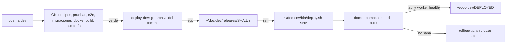

# Despliegue del backend

Por ahora solo existe el entorno de **desarrollo** (servidor compartido). Staging y producción llegan en la Ola 6.

| Archivo | Qué es |
|---|---|
| `dev/compose.yml` | Pila de desarrollo: `api` (construida desde la propia release), `worker` (misma imagen, `node dist/worker.js`), Postgres 16, Redis 7 con contraseña, Mailpit y MinIO en una red interna |
| `dev/.env.example` | Plantilla de `~/doc-dev/.env` en el servidor (secretos, orígenes CORS, nombres de volúmenes) |
| `dev/deploy.sh` | Script de despliegue idempotente con rollback; en el servidor vive en `~/doc-dev/bin/deploy.sh` |
| `dev/generar-claves-cadena.sh` | Genera en el servidor las claves de la cadena (custodio `ENV`, solo testnet) y las añade a `~/doc-dev/.env` sin imprimirlas; ver [§5](#5-cuentas-de-la-plataforma-en-testnet-pasos-31-y-32) |

## Cómo llega un cambio a desarrollo



1. Un push a `dev` ejecuta `.github/workflows/ci.yml`. Si todo pasa, el job `deploy-dev` llama a `.github/workflows/deploy-dev.yml` (también se puede lanzar a mano con *Run workflow*).
2. `deploy-dev` empaqueta el commit con `git archive` (el servidor no necesita acceso git al repo privado), lo sube por `scp` a `~/doc-dev/releases/<sha>.tgz` y ejecuta `~/doc-dev/bin/deploy.sh <sha>` por SSH. Un grupo de `concurrency` impide dos despliegues a la vez (y `deploy.sh` usa además un candado `flock`).
3. `deploy.sh`:
   - extrae la release en `~/doc-dev/src-<sha>` (si ya existe, la reutiliza);
   - cambia el enlace `~/doc-dev/current` a esa carpeta (cambio atómico);
   - ejecuta `docker compose -p doc-dev -f current/deploy/dev/compose.yml --env-file ~/doc-dev/.env up -d --build --remove-orphans`;
   - espera a que los contenedores `api` y `worker` estén *healthy* (`DEPLOY_HEALTH_SERVICES`; la API por el `HEALTHCHECK` de la imagen, que llama a `/v1/health` y exige Postgres y Redis; el worker por `node dist/worker-healthcheck.js`, que exige un latido reciente, que solo se escribe con Postgres, Redis, el relay del outbox y las colas en marcha). Un servicio que no exista en el compose de la release (una release antigua sin worker) se omite. Falla antes si alguno se reinicia 3 veces;
   - si queda sana, escribe `~/doc-dev/DEPLOYED` (sha, fecha, anterior), conserva las 3 últimas releases y borra las demás (carpeta, tarball e imagen `drinks-on-chain-back:dev-<sha>`), y si la release trae otro `deploy/dev/deploy.sh` lo instala en `~/doc-dev/bin/deploy.sh`;
   - si no, muestra los logs de la API y del worker, vuelve el enlace a la release anterior, la relanza y sale con error (el job de GitHub queda en rojo).

> El worker arranca cuando la API está sana (la API aplica las migraciones; el worker no) y tiene 30 s de gracia al parar para terminar los trabajos en curso. Ver [`docs/arquitectura/outbox.md`](../docs/arquitectura/outbox.md).

Si la secret `DEV_SSH_HOST` no existe, el job de despliegue se salta sin fallar (la CI sigue en verde hasta la puesta en marcha).

### Estructura en el servidor

```text
~/doc-dev/
├── .env                 # secretos del entorno (chmod 600), fuera del código
├── bin/deploy.sh        # copia de deploy/dev/deploy.sh
├── releases/<sha>.tgz   # paquetes subidos por GitHub Actions
├── src-<sha>/           # releases extraídas (se conservan 3)
├── current -> src-<sha> # la release en marcha
├── DEPLOYED             # sha y fecha del último despliegue sano
└── .deploy.lock         # candado de flock
```

## Puesta en marcha (una vez; la hace la coordinación)

> Nada de esto lo ejecuta la CI. Los secretos se generan en el propio servidor (`openssl rand -hex 32`) y no se imprimen ni se copian al chat.

1. **Docker**: Docker Engine con el plugin `compose` y el usuario de despliegue en el grupo `docker`. `flock` viene con `util-linux` en Ubuntu.
2. **Carpetas y script**:
   ```bash
   mkdir -p ~/doc-dev/bin ~/doc-dev/releases
   # deploy.sh desde una copia del repo (o del primer tarball)
   install -m 700 deploy/dev/deploy.sh ~/doc-dev/bin/deploy.sh
   ```
   Solo hace falta la primera vez: al terminar cada despliegue sano, si la release trae un `deploy/dev/deploy.sh` distinto, `deploy.sh` lo instala en `~/doc-dev/bin/deploy.sh` (`install -m 700`) para el siguiente despliegue.
3. **`.env`**: `cp deploy/dev/.env.example ~/doc-dev/.env && chmod 600 ~/doc-dev/.env` y rellenar cada `change-me`. Valores hexadecimales: van dentro de `DATABASE_URL` y `REDIS_URL`.
4. **Volúmenes existentes**: el servidor ya tiene `drinks-on-chain-back_postgres_data` y `drinks-on-chain-back_redis_data` (de la pila anterior). El `.env.example` ya los declara como `external`. Antes del primer despliegue:
   - para la pila anterior **sin borrar volúmenes** (`docker compose down`, nunca `down -v`) y el proceso `pm2` de la API (libera el puerto 3000). Dos Postgres no pueden usar el mismo volumen a la vez;
   - `POSTGRES_PASSWORD` debe ser la contraseña con la que se creó ese volumen, o cámbiala antes con `ALTER USER postgres PASSWORD '…'` desde `psql` dentro del contenedor antiguo;
   - haz una copia (`pg_dump`) antes de nada.
5. **Archivos subidos**: la API usa ahora el volumen `doc-dev_uploads` (montado en `/app/uploads`, usuario `node`, uid 1000). Para conservar los de la instalación anterior:
   ```bash
   docker volume create doc-dev_uploads
   docker run --rm -v doc-dev_uploads:/dst -v /ruta/anterior/uploads:/src:ro alpine \
     sh -c 'cp -a /src/. /dst/ && chown -R 1000:1000 /dst'
   ```
6. **nginx**: sin cambios si ya hace *proxy* a `127.0.0.1:3000`. La UI de Mailpit queda en `127.0.0.1:8025` (acceso con `ssh -L 8025:127.0.0.1:8025 …`). Postgres, Redis, SMTP y MinIO no se publican. Para que el navegador abra las URL firmadas de los archivos hace falta un `server` de nginx con *proxy* a `minio:9000` (p. ej. publicando MinIO en `127.0.0.1:9000`) y `S3_PUBLIC_ENDPOINT` con ese host en `~/doc-dev/.env`; mientras tanto, la API guarda y firma, pero las URL solo sirven dentro de la red interna.
7. **Llave de despliegue** (propia, solo para GitHub Actions):
   ```bash
   ssh-keygen -t ed25519 -N '' -C 'github-actions doc-dev' -f doc-dev-deploy
   # la pública, en ~/.ssh/authorized_keys del usuario de despliegue
   ssh-keyscan -t ed25519 <host>   # salida para DEV_SSH_KNOWN_HOSTS
   ```
8. **Secretos del repo en GitHub** (*Settings → Secrets and variables → Actions*):

   | Secreto | Valor |
   |---|---|
   | `DEV_SSH_HOST` | IP o nombre del servidor |
   | `DEV_SSH_USER` | usuario de despliegue |
   | `DEV_SSH_KEY` | llave privada `doc-dev-deploy` completa |
   | `DEV_SSH_KNOWN_HOSTS` | línea(s) de `ssh-keyscan` del servidor |

9. **Primer despliegue**: *Actions → Deploy dev → Run workflow* sobre `dev` (o un push a `dev`). Comprueba `cat ~/doc-dev/DEPLOYED` y `curl -s 127.0.0.1:3000/v1/health`.

## Operación

```bash
cat ~/doc-dev/DEPLOYED                                   # qué está desplegado
cd ~/doc-dev/current
docker compose -p doc-dev -f deploy/dev/compose.yml --env-file ~/doc-dev/.env ps
docker compose -p doc-dev -f deploy/dev/compose.yml --env-file ~/doc-dev/.env logs -f api
docker compose -p doc-dev -f deploy/dev/compose.yml --env-file ~/doc-dev/.env logs -f worker   # JSON con correlationId
~/doc-dev/bin/deploy.sh <sha-anterior>                   # volver a una release conservada
```

- **Migraciones**: con `RUN_MIGRATIONS=true` la API aplica `prisma migrate deploy` al arrancar. Un rollback **no** revierte migraciones: escríbelas compatibles hacia atrás (añadir antes de quitar).
- **Semilla** (superusuario y datos de demostración, idempotente; detalle en el README, "Datos de demostración"): va compilada en la imagen. Con `SUPERADMIN_*`, `SEED_DEMO` y `SEED_DEMO_PASSWORD` definidos en `~/doc-dev/.env` (y el contenedor `api` recreado después de editarlos: `docker compose … up -d api` o el siguiente despliegue):
  ```bash
  cd ~/doc-dev/current
  docker compose -p doc-dev -f deploy/dev/compose.yml --env-file ~/doc-dev/.env exec api node dist/seed.js
  ```
- **Copias**: pendientes (`pg_dump` diario fuera del servidor, O0-OPS-2); no forman parte de este script.

## Cierre H2 (`v0.2.0`): antes y después del despliegue

Detalle en [`docs/arquitectura/trazabilidad.md`](../docs/arquitectura/trazabilidad.md#cierre-h2-contracción-v020). Nada de esto lo ejecuta la CI ni la aplicación: lo decide y lo aplica la coordinación.

### 1. Antes de desplegar: comprobar la base (solo lectura)

La migración `20261002180000_o2_contraer_h2` falla con un mensaje claro, sin aplicar nada, si queda algún registro de la cadena sin lote o alguna serie de botella con dos códigos activos. Una migración fallida queda marcada en `_prisma_migrations` y **ninguna versión de la API arranca** (tampoco la anterior, en el rollback) hasta resolverla, así que compruébalo antes:

```sql
SELECT (SELECT count(*) FROM fermentation_tanks WHERE lot_id IS NULL) AS tanques,
       (SELECT count(*) FROM wine_aging_batches WHERE lot_id IS NULL) AS crianzas,
       (SELECT count(*) FROM production_batches WHERE lot_id IS NULL) AS destilaciones,
       (SELECT count(*) FROM bottling_batches WHERE lot_id IS NULL) AS embotellados,
       (SELECT count(*) FROM batch_lab_analyses WHERE lot_id IS NULL) AS analisis,
       (SELECT count(*) FROM (SELECT 1 FROM bottle_units WHERE status = 'ACTIVE'
          GROUP BY lot_id, serial HAVING count(*) > 1) d) AS series_duplicadas;
```

Todo en cero → se puede desplegar. Si no, no despliegues: hay que asignar un lote a esos registros (o anular los códigos duplicados) primero. Si aun así la migración falla en un despliegue: corrige los datos y, con la conexión del dueño,

```bash
docker compose -p doc-dev -f deploy/dev/compose.yml --env-file ~/doc-dev/.env run --rm --no-deps \
  --entrypoint ./node_modules/.bin/prisma api migrate resolve --rolled-back 20261002180000_o2_contraer_h2
```

y vuelve a desplegar.

### 2. Usuario de base sin `DELETE` en la trazabilidad (opcional, preparado)

Hoy la API se conecta con el dueño de la base, al que no se le pueden quitar permisos. Para cumplir el contrato (§1) hace falta un rol aparte:

1. Copia de la base (`pg_dump`).
2. Una contraseña nueva para el rol en `~/doc-dev/.env` (`APP_DB_USER=doc_app`, `APP_DB_PASSWORD=…`, generada con `openssl rand -hex 32`), sin imprimirla.
3. [`dev/sql/rol-app-sin-delete.sql`](dev/sql/rol-app-sin-delete.sql) como el dueño, con la contraseña en el entorno (`DOC_APP_PASSWORD`), nunca como argumento. El script es idempotente y lleva el comando en su cabecera.
4. Un despliegue: la API y el worker se conectan con `APP_DB_USER`; las migraciones siguen yendo con el dueño (`MIGRATE_DATABASE_URL`, que el `compose.yml` ya define).

La semilla también funciona con ese rol (`exec api node dist/seed.js`). Para deshacerlo, quita las dos variables y despliega. Una tabla nueva de trazabilidad en una migración futura hay que añadirla a la lista del script y repetirlo.

### 3. Lotes de demostración ya sembrados (opcional)

La semilla es de solo inserción: los lotes de demostración que ya existen en el servidor **no se reescriben** (conservan los datos de los fixtures 0.3.x, con sus incidencias de migración) y solo se crean los que faltan. Para tener los 21 lotes coherentes hay que retirar antes la trazabilidad de las tres bodegas de demostración con [`dev/sql/reiniciar-trazabilidad-demo.sql`](dev/sql/reiniciar-trazabilidad-demo.sql) (borra datos: copia antes, `-v confirmar=si`) y volver a sembrar. Se pierde lo registrado a mano en esas bodegas.

## Apertura de la Ola 3 (`0.3.0-rc.0`): antes y después del despliegue

### 4. Migración de la apertura de la Ola 3

La migración `20261008120000_o3_cadena_expand` es aditiva (19 tablas y columnas nulas) y **no borra nada**, pero mueve datos (SE-02): copia los valores simulados de `wineries` (`stellar_public_key`, `dynamic_vault_id`, `onchain_producer_id`, `onchain_register_tx_hash`) a `legacy_simulated_address` y `legacy_simulated_data` y los pone a `NULL`, y marca `user_wallets` entera como `INVALID_SIMULATED`.

1. **Copia de la base** (`pg_dump`), como en cada migración con datos.
2. **Comprobación previa, solo lectura** (lo que la migración va a mover; anota el resultado):

   ```sql
   SELECT (SELECT count(*) FROM wineries) AS bodegas,
          (SELECT count(*) FROM wineries
            WHERE stellar_public_key IS NOT NULL OR dynamic_vault_id IS NOT NULL
               OR onchain_producer_id IS NOT NULL OR onchain_register_tx_hash IS NOT NULL) AS bodegas_con_valores_simulados,
          (SELECT count(*) FROM user_wallets) AS billeteras,
          (SELECT count(*) FROM users) AS personas,
          (SELECT count(*) FROM lots) AS lotes,
          (SELECT count(*) FROM audit_events) AS bitacora,
          (SELECT count(*) FROM information_schema.tables
            WHERE table_schema = 'public'
              AND table_name IN ('chain_accounts', 'collections', 'tokens', 'tokenization_requests')) AS tablas_o3_ya_existentes,
          (SELECT count(*) FROM information_schema.columns
            WHERE table_schema = 'public'
              AND ((table_name = 'wineries' AND column_name IN ('chain_account_id', 'legacy_simulated_address', 'legacy_simulated_data'))
                OR (table_name = 'user_wallets' AND column_name = 'status'))) AS columnas_o3_ya_existentes;
   ```

   `tablas_o3_ya_existentes` y `columnas_o3_ya_existentes` deben ser **0** (si no, la migración ya se aplicó o hay restos: no despliegues y avisa).
3. **Después de desplegar** (solo lectura): `bodegas`, `billeteras`, `personas` y `lotes` no cambian; `bitacora` sube en 1 (la entrada `CHAIN_SIMULATED_WALLETS_INVALIDATED`, que la API escribe al arrancar, con el número de filas); y

   ```sql
   SELECT (SELECT count(*) FROM wineries WHERE legacy_simulated_data IS NOT NULL) AS bodegas_con_legado,
          (SELECT count(*) FROM wineries WHERE stellar_public_key IS NOT NULL OR dynamic_vault_id IS NOT NULL
               OR onchain_producer_id IS NOT NULL OR onchain_register_tx_hash IS NOT NULL) AS bodegas_con_valores_simulados,
          (SELECT count(*) FROM user_wallets WHERE status <> 'INVALID_SIMULATED') AS billeteras_sin_marcar,
          (SELECT after FROM audit_events WHERE action = 'CHAIN_SIMULATED_WALLETS_INVALIDATED') AS anotado;
   ```

   `bodegas_con_legado` = el `bodegas_con_valores_simulados` de antes; los otros dos, 0.

Para deshacerla sin restaurar la copia (los datos siguen en las columnas `legacy_*`): `UPDATE wineries SET stellar_public_key = legacy_simulated_data->>'stellarPublicKey', dynamic_vault_id = legacy_simulated_data->>'dynamicVaultId', onchain_producer_id = legacy_simulated_data->>'onchainProducerId', onchain_register_tx_hash = legacy_simulated_data->>'onchainRegisterTxHash' WHERE legacy_simulated_data IS NOT NULL;` y desplegar la versión anterior (que ignora las tablas y columnas nuevas).

### 5. Cuentas de la plataforma en testnet (pasos 3.1 y 3.2)

Sin las variables de la cadena todo arranca con la cadena **deshabilitada**: no se crea ninguna identidad, el alta de bodegas no cambia y las rutas de acción responden 409 `CHN_DISABLED`. Para habilitarla en testnet (nunca en la red pública: el custodio `ENV` la rechaza), en este orden:

1. **Desplegar esta versión con la cadena aún sin configurar** (`~/doc-dev/bin/deploy.sh <sha>`): la imagen trae el generador de claves (`dist/scripts/chain-keys.js`).
2. **Generar las claves en el servidor, sin imprimirlas**:

   ```bash
   ~/doc-dev/current/deploy/dev/generar-claves-cadena.sh
   ```

   El script ([`dev/generar-claves-cadena.sh`](dev/generar-claves-cadena.sh)):
   - hace antes una copia `~/doc-dev/.env.bak-<fecha>` (permisos `600`);
   - añade a `~/doc-dev/.env` **solo las que falten** de `CHAIN_SECRET_OPERATIONS`, `CHAIN_SECRET_ANCHOR`, `CHAIN_DEV_WINERY_SEED`, `CHAIN_CONSUMER_MASTER_SEED` y la dirección pública `CHAIN_CONSUMER_SEED_CHECK_ADDRESS`. Una variable que ya tiene valor no se toca: regenerarla cambiaría las cuentas y dejaría huérfanas las de las bodegas;
   - genera los valores dentro de un contenedor de la release en marcha, **sin red ni volúmenes**; van al `.env` por un archivo temporal `600` y nunca pasan por la pantalla, por argumentos ni por variables de entorno;
   - muestra solo **direcciones públicas** (`G…`): operaciones, anclaje, la primera bodega (`m/44'/148'/0'`) y la de comprobación de la semilla de consumidores. Repetirlo es inocuo: vuelve a mostrarlas sin cambiar nada;
   - se niega si `STELLAR_NETWORK` es `PUBLIC`.

   Formato de cada secreto (lo valida `src/modules/chain/chain.config.ts`; ningún mensaje de error repite el valor):

   | Variable | Formato | Qué es |
   |---|---|---|
   | `CHAIN_SECRET_OPERATIONS` | Semilla Stellar `S…` de 56 caracteres (StrKey Ed25519) | Cuenta que paga comisiones y renta, opera cada contrato, crea las cuentas de las bodegas y despliega sus contratos |
   | `CHAIN_SECRET_ANCHOR` | Semilla Stellar `S…` de 56 caracteres | Cuenta de anclaje de expedientes (paso 3.5) |
   | `CHAIN_DEV_WINERY_SEED` | 64 caracteres hexadecimales (32 bytes; se admiten hasta 64 bytes o una frase de 12–24 palabras) | Semilla maestra SEP-0005: la clave de cada bodega es `m/44'/148'/{chain_accounts.derivation_index}'` |
   | `CHAIN_CONSUMER_MASTER_SEED` | Igual que la anterior | Semilla maestra de las direcciones de consumidor (Ola 4); nunca firma en el MVP |
   | `CHAIN_CONSUMER_SEED_CHECK_ADDRESS` | Dirección `G…` de 56 caracteres (**no es secreto**) | Índice 0 de la semilla de consumidores: si no coincide, el worker no arranca |

3. **Variables no secretas** que hay que definir a mano en `~/doc-dev/.env` (plantilla en [`dev/.env.example`](dev/.env.example)):

   | Variable | Valor en desarrollo (testnet) |
   |---|---|
   | `STELLAR_NETWORK` | `TESTNET` |
   | `STELLAR_RPC_URL` | `https://soroban-testnet.stellar.org` |
   | `CHAIN_CUSTODY_DRIVER` | `ENV` |
   | `STELLAR_HOME_DOMAIN` | El host de la API de desarrollo, sin esquema (publica `/.well-known/stellar.toml`; nginx ya lo entrega al backend) |
   | `WINERY_NFT_WASM_HASH` | `wasm.hash` de `deployments/testnet.json` del repo de contratos (el código ya está subido en testnet) |
   | `API_PUBLIC_URL` | Origen público de la API (con `https://`): URI base de los contratos, `{API}/v1/public/nft/{slug}/`. **Queda escrita en cada contrato al desplegarlo** |
   | `CHAIN_MINT_ENABLED` | `false` hasta que la coordinación lo active (ADR-011) |
   | `CHAIN_ENVIRONMENT` | Opcional: etiqueta del entorno en la sal de los contratos (`dev`). Por defecto, la red (`testnet`). **No cambiarla después**: la dirección de cada contrato depende de ella |
   | `STELLAR_EXPLORER_BASE_URL`, `STELLAR_FRIENDBOT_URL`, `CHAIN_TX_MAX_FEE_STROOPS` (10 XLM), `CHAIN_DEPLOY_MAX_FEE_STROOPS` (50 XLM), `CHAIN_OPERATIONS_MIN_BALANCE_XLM` (50), `CHAIN_ANCHOR_MIN_BALANCE_XLM` (5), `CHAIN_WINERY_STARTING_BALANCE_XLM` (2) | Opcionales: sus valores por defecto sirven en testnet |

4. **Desplegar otra vez** (`~/doc-dev/bin/deploy.sh <sha>`, el mismo `<sha>` vale): la API y el worker solo leen el `.env` al recrearse. Al arrancar, el worker:
   - registra las direcciones de operaciones y de anclaje en `chain_accounts` (la API nunca tiene claves);
   - pide **Friendbot** para las que falten o estén bajo el mínimo (`FUND_ACCOUNT`, solo `TESTNET`/`LOCAL`, una vez al día por cuenta);
   - lanza el relleno `chain.identity.backfill`: crea, **de una en una**, la cuenta y el contrato de cada bodega `ACTIVE` que no los tenga.
5. **Comprobar** (solo lectura): `GET /v1/platform/chain/accounts` (saldos `OK`), `GET /v1/public/chain/registry`, `GET /.well-known/stellar.toml` y, en el back office o con `GET /v1/platform/chain/transactions`, las transacciones `CREATE_WINERY_ACCOUNT` y `DEPLOY_WINERY_CONTRACT` en `CONFIRMED`. Una identidad `FAILED` se relanza con `POST /v1/platform/wineries/{id}/chain/provision`.

Para **deshabilitar** la cadena sin perder nada: vaciar `CHAIN_CUSTODY_DRIVER` (o `STELLAR_RPC_URL`) y desplegar; las intenciones pendientes se quedan `PENDING` y siguen al volver a habilitarla. Las claves no se borran del `.env`.

Las tablas de la Ola 3 están en la lista de [`dev/sql/rol-app-sin-delete.sql`](dev/sql/rol-app-sin-delete.sql): si el rol de la aplicación ya se creó, repite el script.

> Si testnet se reinicia (S-22), las cuentas y los contratos desaparecen de la red: es un procedimiento manual de desarrollo (limpiar `chain_accounts`, `nft_contracts` y `chain_transactions` de esa red y dejar que el relleno los regenere); avisa a la coordinación antes.

### 6. Emisión y anclaje (pasos 3.4 y 3.5)

Al desplegar esta versión (la coordinación, con `~/doc-dev/bin/deploy.sh <sha>`):

1. **Migración `20261009120000_o3_emision_anclaje`** (aditiva; la aplica el arranque de la API como las demás). Mueve los anclajes **simulados** de `bottling_batches` a `legacy_simulated_anchor_tx_hash` y deja `is_anchored_on_chain = false`; cambia el índice único de `collections.slug` por `(winery_id, slug)`. No borra nada. Comprobación previa opcional (solo lectura): `SELECT count(*) FROM bottling_batches WHERE is_anchored_on_chain OR blockchain_anchor_tx_hash IS NOT NULL;` (son los que se moverán).
2. **Relleno de anclajes**: con la cadena habilitada, al arrancar el worker la tarea `chain.anchor.backfill` registra `ANCHOR_DOSSIER` para cada expediente cerrado sin anclaje (p. ej. «Singani Gran Reserva 2026»). Cada anclaje cuesta 100 stroops a la cuenta de anclaje. Se ve en `GET /v1/platform/chain/transactions?kind=ANCHOR_DOSSIER`.
3. **`CHAIN_MINT_ENABLED`**: sigue en `false` hasta que la coordinación lo decida (ADR-011). Mientras tanto, aprobar una solicitud deja su emisión `PENDING` con `CHN_MINT_DISABLED`; al ponerla a `true` en `~/doc-dev/.env` y volver a desplegar, las pendientes se emiten solas. El anclaje **no** depende de esta variable.
4. Sin variables nuevas. Costes observados en la red local (comisión cobrada a operaciones): primer `mint_batch` de 100 ≈ 0,04 XLM; siguientes ≈ 0,04 XLM; 32 000 NFT ≈ 0,014 XLM; anclaje, 100 stroops (cuenta de anclaje). En testnet la renta puede diferir: `feeChargedStroops` de cada transacción guarda lo real.
