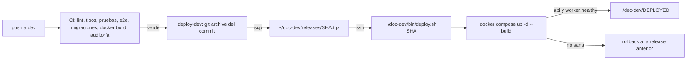

# Despliegue del backend

Por ahora solo existe el entorno de **desarrollo** (servidor compartido). Staging y producción llegan en la Ola 6.

| Archivo | Qué es |
|---|---|
| `dev/compose.yml` | Pila de desarrollo: `api` (construida desde la propia release), `worker` (misma imagen, `node dist/worker.js`), Postgres 16, Redis 7 con contraseña, Mailpit y MinIO en una red interna |
| `dev/.env.example` | Plantilla de `~/doc-dev/.env` en el servidor (secretos, orígenes CORS, nombres de volúmenes) |
| `dev/deploy.sh` | Script de despliegue idempotente con rollback; en el servidor vive en `~/doc-dev/bin/deploy.sh` |

## Cómo llega un cambio a desarrollo



1. Un push a `dev` ejecuta `.github/workflows/ci.yml`. Si todo pasa, el job `deploy-dev` llama a `.github/workflows/deploy-dev.yml` (también se puede lanzar a mano con *Run workflow*).
2. `deploy-dev` empaqueta el commit con `git archive` (el servidor no necesita acceso git al repo privado), lo sube por `scp` a `~/doc-dev/releases/<sha>.tgz` y ejecuta `~/doc-dev/bin/deploy.sh <sha>` por SSH. Un grupo de `concurrency` impide dos despliegues a la vez (y `deploy.sh` usa además un candado `flock`).
3. `deploy.sh`:
   - extrae la release en `~/doc-dev/src-<sha>` (si ya existe, la reutiliza);
   - cambia el enlace `~/doc-dev/current` a esa carpeta (cambio atómico);
   - ejecuta `docker compose -p doc-dev -f current/deploy/dev/compose.yml --env-file ~/doc-dev/.env up -d --build --remove-orphans`;
   - espera a que los contenedores `api` y `worker` estén *healthy* (`DEPLOY_HEALTH_SERVICES`; la API por el `HEALTHCHECK` de la imagen, que llama a `/v1/health` y exige Postgres y Redis; el worker por `node dist/worker-healthcheck.js`, que exige un latido reciente, que solo se escribe con Postgres, Redis, el relay del outbox y las colas en marcha). Un servicio que no exista en el compose de la release (una release antigua sin worker) se omite. Falla antes si alguno se reinicia 3 veces;
   - si queda sana, escribe `~/doc-dev/DEPLOYED` (sha, fecha, anterior), conserva las 3 últimas releases y borra las demás (carpeta, tarball e imagen `drinks-on-chain-back:dev-<sha>`), y si la release trae otro `deploy/dev/deploy.sh` lo instala en `~/doc-dev/bin/deploy.sh`;
   - si no, muestra los logs de la API y del worker, vuelve el enlace a la release anterior, la relanza y sale con error (el job de GitHub queda en rojo).

> El worker arranca cuando la API está sana (la API aplica las migraciones; el worker no) y tiene 30 s de gracia al parar para terminar los trabajos en curso. Ver [`docs/arquitectura/outbox.md`](../docs/arquitectura/outbox.md).

Si la secret `DEV_SSH_HOST` no existe, el job de despliegue se salta sin fallar (la CI sigue en verde hasta la puesta en marcha).

### Estructura en el servidor

```text
~/doc-dev/
├── .env                 # secretos del entorno (chmod 600), fuera del código
├── bin/deploy.sh        # copia de deploy/dev/deploy.sh
├── releases/<sha>.tgz   # paquetes subidos por GitHub Actions
├── src-<sha>/           # releases extraídas (se conservan 3)
├── current -> src-<sha> # la release en marcha
├── DEPLOYED             # sha y fecha del último despliegue sano
└── .deploy.lock         # candado de flock
```

## Puesta en marcha (una vez; la hace la coordinación)

> Nada de esto lo ejecuta la CI. Los secretos se generan en el propio servidor (`openssl rand -hex 32`) y no se imprimen ni se copian al chat.

1. **Docker**: Docker Engine con el plugin `compose` y el usuario de despliegue en el grupo `docker`. `flock` viene con `util-linux` en Ubuntu.
2. **Carpetas y script**:
   ```bash
   mkdir -p ~/doc-dev/bin ~/doc-dev/releases
   # deploy.sh desde una copia del repo (o del primer tarball)
   install -m 700 deploy/dev/deploy.sh ~/doc-dev/bin/deploy.sh
   ```
   Solo hace falta la primera vez: al terminar cada despliegue sano, si la release trae un `deploy/dev/deploy.sh` distinto, `deploy.sh` lo instala en `~/doc-dev/bin/deploy.sh` (`install -m 700`) para el siguiente despliegue.
3. **`.env`**: `cp deploy/dev/.env.example ~/doc-dev/.env && chmod 600 ~/doc-dev/.env` y rellenar cada `change-me`. Valores hexadecimales: van dentro de `DATABASE_URL` y `REDIS_URL`.
4. **Volúmenes existentes**: el servidor ya tiene `drinks-on-chain-back_postgres_data` y `drinks-on-chain-back_redis_data` (de la pila anterior). El `.env.example` ya los declara como `external`. Antes del primer despliegue:
   - para la pila anterior **sin borrar volúmenes** (`docker compose down`, nunca `down -v`) y el proceso `pm2` de la API (libera el puerto 3000). Dos Postgres no pueden usar el mismo volumen a la vez;
   - `POSTGRES_PASSWORD` debe ser la contraseña con la que se creó ese volumen, o cámbiala antes con `ALTER USER postgres PASSWORD '…'` desde `psql` dentro del contenedor antiguo;
   - haz una copia (`pg_dump`) antes de nada.
5. **Archivos subidos**: la API usa ahora el volumen `doc-dev_uploads` (montado en `/app/uploads`, usuario `node`, uid 1000). Para conservar los de la instalación anterior:
   ```bash
   docker volume create doc-dev_uploads
   docker run --rm -v doc-dev_uploads:/dst -v /ruta/anterior/uploads:/src:ro alpine \
     sh -c 'cp -a /src/. /dst/ && chown -R 1000:1000 /dst'
   ```
6. **nginx**: sin cambios si ya hace *proxy* a `127.0.0.1:3000`. La UI de Mailpit queda en `127.0.0.1:8025` (acceso con `ssh -L 8025:127.0.0.1:8025 …`). Postgres, Redis, SMTP y MinIO no se publican. Para que el navegador abra las URL firmadas de los archivos hace falta un `server` de nginx con *proxy* a `minio:9000` (p. ej. publicando MinIO en `127.0.0.1:9000`) y `S3_PUBLIC_ENDPOINT` con ese host en `~/doc-dev/.env`; mientras tanto, la API guarda y firma, pero las URL solo sirven dentro de la red interna.
7. **Llave de despliegue** (propia, solo para GitHub Actions):
   ```bash
   ssh-keygen -t ed25519 -N '' -C 'github-actions doc-dev' -f doc-dev-deploy
   # la pública, en ~/.ssh/authorized_keys del usuario de despliegue
   ssh-keyscan -t ed25519 <host>   # salida para DEV_SSH_KNOWN_HOSTS
   ```
8. **Secretos del repo en GitHub** (*Settings → Secrets and variables → Actions*):

   | Secreto | Valor |
   |---|---|
   | `DEV_SSH_HOST` | IP o nombre del servidor |
   | `DEV_SSH_USER` | usuario de despliegue |
   | `DEV_SSH_KEY` | llave privada `doc-dev-deploy` completa |
   | `DEV_SSH_KNOWN_HOSTS` | línea(s) de `ssh-keyscan` del servidor |

9. **Primer despliegue**: *Actions → Deploy dev → Run workflow* sobre `dev` (o un push a `dev`). Comprueba `cat ~/doc-dev/DEPLOYED` y `curl -s 127.0.0.1:3000/v1/health`.

## Operación

```bash
cat ~/doc-dev/DEPLOYED                                   # qué está desplegado
cd ~/doc-dev/current
docker compose -p doc-dev -f deploy/dev/compose.yml --env-file ~/doc-dev/.env ps
docker compose -p doc-dev -f deploy/dev/compose.yml --env-file ~/doc-dev/.env logs -f api
docker compose -p doc-dev -f deploy/dev/compose.yml --env-file ~/doc-dev/.env logs -f worker   # JSON con correlationId
~/doc-dev/bin/deploy.sh <sha-anterior>                   # volver a una release conservada
```

- **Migraciones**: con `RUN_MIGRATIONS=true` la API aplica `prisma migrate deploy` al arrancar. Un rollback **no** revierte migraciones: escríbelas compatibles hacia atrás (añadir antes de quitar).
- **Semilla**: la imagen no incluye `ts-node`; el superadministrador inicial se crea con `pnpm prisma:seed` desde una copia del repo apuntando a la base (o con la semilla determinista de la Ola 0 · 0.10).
- **Copias**: pendientes (`pg_dump` diario fuera del servidor, O0-OPS-2); no forman parte de este script.
