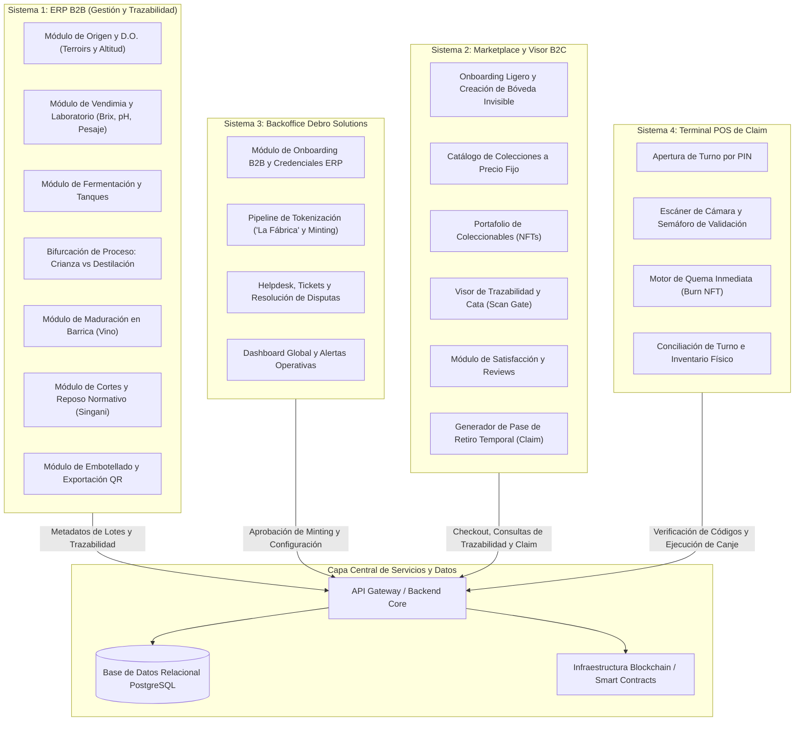

### Diagrama de Arquitectura Modular del Ecosistema

El ecosistema de **Drinks on Chain** se organiza en cuatro sistemas operativos independientes pero interconectados a través de una capa central de servicios, persistencia y contratos de tokenización:

---

### Diagrama Entidad-Relación (Base de Datos Relacional)

El siguiente modelo entidad-relación abarca todo el ciclo de vida del producto: trazabilidad agronómica e industrial, bifurcación vino/singani, comercialización, tokenización, soporte y canje físico en punto de venta.

```mermaid
erDiagram
    USERS ||--o{ WINERY_MEMBERS : belongs_to
    USERS ||--o{ USER_WALLETS : owns
    USERS ||--o{ ORDERS : places
    USERS ||--o{ PRODUCT_REVIEWS : writes
    USERS ||--o{ SUPPORT_TICKETS : opens

    WINERIES ||--o{ WINERY_MEMBERS : employs
    WINERIES ||--o{ TERROIRS : owns
    WINERIES ||--o{ HARVEST_BATCHES : receives
    WINERIES ||--o{ BOTTLING_BATCHES : produces
    WINERIES ||--o{ COLLECTIONS : releases

    TERROIRS ||--o{ HARVEST_BATCHES : yields
    HARVEST_BATCHES ||--o{ FERMENTATION_TANKS : fills
    FERMENTATION_TANKS ||--o{ FERMENTATION_LOGS : records
    FERMENTATION_TANKS ||--o| WINE_AGING_BATCHES : bifurcates_to_wine
    FERMENTATION_TANKS ||--o| SINGANI_DISTILLATION_BATCHES : bifurcates_to_singani

    WINE_AGING_BATCHES ||--o{ BOTTLING_BATCHES : bottles
    SINGANI_DISTILLATION_BATCHES ||--o{ BOTTLING_BATCHES : bottles

    BOTTLING_BATCHES ||--o| COLLECTIONS : backs
    COLLECTIONS ||--o{ TOKENIZED_ITEMS : mints
    COLLECTIONS ||--o{ ORDERS : sold_in

    ORDERS ||--o{ ORDER_ITEMS : contains
    ORDER_ITEMS ||--|| TOKENIZED_ITEMS : assigns

    TOKENIZED_ITEMS ||--o{ CLAIM_PASSES : generates
    CLAIM_PASSES ||--o| CLAIM_REDEMPTIONS : redeems

    PICKUP_LOCATIONS ||--o{ POS_SHIFTS : hosts
    POS_SHIFTS ||--o{ CLAIM_REDEMPTIONS : validates
    USERS ||--o{ POS_SHIFTS : operates

    USERS {
        uuid id PK
        string email UK
        string phone_number UK
        string password_hash
        enum user_role
        boolean is_active
        timestamp created_at
    }

    WINERIES {
        uuid id PK
        string legal_name
        string commercial_name
        string region
        text description
        boolean is_verified
        timestamp created_at
    }

    WINERY_MEMBERS {
        uuid id PK
        uuid user_id FK
        uuid winery_id FK
        enum member_role
        boolean is_active
    }

    TERROIRS {
        uuid id PK
        uuid winery_id FK
        string parcel_name
        decimal surface_hectares
        decimal altitude_masl
        string grape_variety
        string soil_type
        string geographic_region
        boolean is_singani_do_eligible
        timestamp created_at
    }

    HARVEST_BATCHES {
        uuid id PK
        uuid terroir_id FK
        uuid winery_id FK
        string internal_batch_code UK
        timestamp intake_date
        decimal gross_weight_kg
        decimal tare_weight_kg
        decimal net_weight_kg
        decimal brix_degrees
        decimal ph_level
        decimal total_acidity
        enum quality_status
        uuid reviewed_by_user_id FK
        timestamp created_at
    }

    FERMENTATION_TANKS {
        uuid id PK
        uuid harvest_batch_id FK
        string tank_identifier
        enum tank_status
        timestamp start_date
        timestamp end_date
        enum destination_bifurcation
    }

    FERMENTATION_LOGS {
        uuid id PK
        uuid fermentation_tank_id FK
        decimal recorded_temperature
        decimal recorded_density
        timestamp recorded_at
        uuid recorded_by_user_id FK
    }

    WINE_AGING_BATCHES {
        uuid id PK
        uuid fermentation_tank_id FK
        string wood_type
        integer aging_months_planned
        timestamp aging_started_at
        timestamp aging_lock_until
        enum aging_status
    }

    SINGANI_DISTILLATION_BATCHES {
        uuid id PK
        uuid fermentation_tank_id FK
        decimal head_volume_liters
        decimal heart_volume_liters
        decimal tail_volume_liters
        decimal initial_alcohol_grade
        timestamp rest_started_at
        timestamp mandatory_rest_lock_until
        enum rest_status
    }

    BOTTLING_BATCHES {
        uuid id PK
        uuid winery_id FK
        uuid wine_aging_batch_id FK
        uuid singani_batch_id FK
        string lot_code UK
        decimal water_dilution_liters
        decimal final_alcohol_grade
        integer total_bottles_produced
        string qr_manifest_url
        timestamp bottled_at
        uuid certified_by_user_id FK
    }

    COLLECTIONS {
        uuid id PK
        uuid winery_id FK
        uuid bottling_batch_id FK
        string name
        text story
        text tasting_notes
        text pairing_recommendations
        decimal fixed_distributor_price
        integer total_supply
        string smart_contract_address
        enum publication_status
        timestamp approved_at
        uuid approved_by_user_id FK
    }

    USER_WALLETS {
        uuid id PK
        uuid user_id FK
        string public_address UK
        string custodial_vault_id
        timestamp created_at
    }

    TOKENIZED_ITEMS {
        uuid id PK
        uuid collection_id FK
        uuid current_owner_user_id FK
        integer serial_number
        string onchain_token_id UK
        string token_uri
        enum token_status
        timestamp minted_at
        timestamp burned_at
    }

    ORDERS {
        uuid id PK
        uuid user_id FK
        uuid collection_id FK
        decimal total_amount
        string currency
        enum payment_status
        string payment_gateway_reference
        timestamp created_at
    }

    ORDER_ITEMS {
        uuid id PK
        uuid order_id FK
        uuid tokenized_item_id FK
        decimal unit_price
    }

    PICKUP_LOCATIONS {
        uuid id PK
        string location_name
        string address
        string city
        string pin_hash
        boolean is_active
    }

    POS_SHIFTS {
        uuid id PK
        uuid pickup_location_id FK
        uuid cashier_user_id FK
        timestamp shift_opened_at
        timestamp shift_closed_at
        integer total_claims_processed
    }

    CLAIM_PASSES {
        uuid id PK
        uuid tokenized_item_id FK
        uuid user_id FK
        string ephemeral_qr_code UK
        timestamp expires_at
        enum pass_status
    }

    CLAIM_REDEMPTIONS {
        uuid id PK
        uuid claim_pass_id FK
        uuid tokenized_item_id FK
        uuid pos_shift_id FK
        uuid verified_by_cashier_id FK
        timestamp redeemed_at
    }

    PRODUCT_REVIEWS {
        uuid id PK
        uuid user_id FK
        uuid collection_id FK
        integer rating_stars
        text review_comment
        timestamp created_at
    }

    SUPPORT_TICKETS {
        uuid id PK
        uuid user_id FK
        string subject
        text issue_description
        enum urgency_level
        enum ticket_status
        uuid assigned_admin_id FK
        timestamp created_at
        timestamp resolved_at
    }

```

---

### Diccionario y Justificación Técnica de Tablas

**1. USERS (Identidad Universal)**

* **Propósito:** Centraliza la identidad de todos los roles del ecosistema (administradores de Debro Solutions, enólogos, operarios de bodega, cajeros de licorería y miembros de la tribu B2C).

* **Campos clave:** `id`, `email`, `phone_number`, `password_hash`, `user_role`, `is_active`, `created_at`.
* **Justificación:** Permite el registro ligero (solo teléfono y correo) requerido para el onboarding sin fricción en el Marketplace/Visor QR, a la vez que maneja credenciales seguras y roles estrictos para ERP, Backoffice y POS.

**2. WINERIES (Bodegas y Destilerías)**

* **Propósito:** Almacena los perfiles institucionales de los socios vitivinícolas y destilerías asociadas.

* **Campos clave:** `id`, `legal_name`, `commercial_name`, `region`, `description`, `is_verified`, `created_at`.
* **Justificación:** Permite al Backoffice dar de alta y verificar a las bodegas antes de que puedan emitir credenciales de producción o tokenizar lotes.

**3. WINERY_MEMBERS (Mapeo de Personal de Bodega)**

* **Propósito:** Asocia usuarios específicos con bodegas y define sus niveles de acceso operativo dentro del ERP.

* **Campos clave:** `id`, `user_id`, `winery_id`, `member_role` (Enólogo, Agrónomo, Operario, Administrador de Bodega), `is_active`.

* **Justificación:** Modela los diferentes niveles de autorización: el operario registra pesajes diarios, mientras que solo el enólogo puede dictaminar la aprobación analítica o autorizar bifurcaciones.

**4. TERROIRS (Lotes de Origen y Regla D.O.)**

* **Propósito:** Registra las parcelas agrícolas, geografía, suelo y cepas.

* **Campos clave:** `id`, `winery_id`, `parcel_name`, `surface_hectares`, `altitude_masl`, `grape_variety`, `soil_type`, `geographic_region`, `is_singani_do_eligible`.

* **Justificación:** Esencial para auditar la Denominación de Origen: calcula y almacena si el terreno supera los 1,600 m.s.n.m. y cultiva *Moscatel de Alejandría*, habilitando la certificación para Singani D.O..

**5. HARVEST_BATCHES (Recepción de Uva y Laboratorio)**

* **Propósito:** Certifica el ingreso físico de la uva pesada en báscula y los análisis de laboratorio.

* **Campos clave:** `id`, `terroir_id`, `winery_id`, `internal_batch_code`, `intake_date`, `gross_weight_kg`, `tare_weight_kg`, `net_weight_kg`, `brix_degrees`, `ph_level`, `total_acidity`, `quality_status` (`APPROVED`, `REJECTED`), `reviewed_by_user_id`.

* **Justificación:** Garantiza la inmutabilidad de la materia prima. Si no cumple los Grados Brix o parámetros analíticos mínimos, el lote se rechaza y no avanza al proceso de fermentación.

**6. FERMENTATION_TANKS (Vinificación y Tanques)**

* **Propósito:** Controla el estado y ocupación de los tanques de acero inoxidable donde se procesa el vino base.

* **Campos clave:** `id`, `harvest_batch_id`, `tank_identifier`, `tank_status` (`EMPTY`, `IN_FERMENTATION`, `COMPLETED`), `start_date`, `end_date`, `destination_bifurcation` (`WINE`, `SINGANI`).

* **Justificación:** Resuelve el requisito operativo del mapa visual de tanques y captura la decisión crítica de la "bifurcación", bloqueando irrevocablemente el flujo contrario.

**7. FERMENTATION_LOGS (Bitácora de Fermentación)**

* **Propósito:** Registra las lecturas periódicas de densidad y temperatura en cada tanque.

* **Campos clave:** `id`, `fermentation_tank_id`, `recorded_temperature`, `recorded_density`, `recorded_at`, `recorded_by_user_id`.

* **Justificación:** Proporciona los datos granulados que alimentan la línea de tiempo del visor narrativo B2C tras el escaneo QR.

**8. WINE_AGING_BATCHES (Crianza Exclusiva de Vinos)**

* **Propósito:** Gestiona la maduración en barrica o botella para los lotes clasificados como Vino.

* **Campos clave:** `id`, `fermentation_tank_id`, `wood_type` (ej. Roble Francés), `aging_months_planned`, `aging_started_at`, `aging_lock_until`, `aging_status` (`LOCKED`, `MATURED`).

* **Justificación:** Implementa el candado de tiempo programado por el enólogo, impidiendo el embotellado prematuro.

**9. SINGANI_DISTILLATION_BATCHES (Destilación y Reposo Normativo)**

* **Propósito:** Controla el paso por alambique y el reposo en tanques neutros de acero para Singani.

* **Campos clave:** `id`, `fermentation_tank_id`, `head_volume_liters`, `heart_volume_liters`, `tail_volume_liters`, `initial_alcohol_grade`, `rest_started_at`, `mandatory_rest_lock_until`, `rest_status`.

* **Justificación:** Aísla el volumen del "corazón" de la destilación y ejecuta el candado normativo estricto de reposo mínimo de 6 meses exigido por la ley boliviana para Singani Gran Reserva.

**10. BOTTLING_BATCHES (Embotellado, Dilución y Sellado Digital)**

* **Propósito:** Consolida la producción final de botellas físicas y genera la exportación del manifiesto QR.

* **Campos clave:** `id`, `winery_id`, `wine_aging_batch_id` (nullable), `singani_batch_id` (nullable), `lot_code`, `water_dilution_liters`, `final_alcohol_grade`, `total_bottles_produced`, `qr_manifest_url`, `bottled_at`, `certified_by_user_id`.

* **Justificación:** Permite calcular rendimientos y mermas tras la adición de agua de dilución (ej. ajuste a 40% Alc/Vol) y sirve de anclaje físico para la emisión de colecciones digitales en el Backoffice.

**11. COLLECTIONS (Configurador Comercial y Tokenización)**

* **Propósito:** Representa la colección comercial publicada en el Marketplace.

* **Campos clave:** `id`, `winery_id`, `bottling_batch_id`, `name`, `story`, `tasting_notes`, `pairing_recommendations`, `fixed_distributor_price`, `total_supply`, `smart_contract_address`, `publication_status`, `approved_at`, `approved_by_user_id`.

* **Justificación:** Funciona como "La Fábrica" del Backoffice donde el equipo gestor valida los metadatos inmutables del ERP, define el precio fijo de distribuidor y aprueba la emisión pública.

**12. USER_WALLETS (Bóveda Invisible de Usuario)**

* **Propósito:** Mapea la dirección de custodia Web3 creada en segundo plano para cada usuario.

* **Campos clave:** `id`, `user_id`, `public_address`, `custodial_vault_id`, `created_at`.
* **Justificación:** Cumple con la premisa de "fricción cero", permitiendo a los compradores tener propiedad criptográfica de los NFTs sin necesidad de instalar billeteras externas o gestionar frases semilla.

**13. TOKENIZED_ITEMS (Unidades NFT Individuales)**

* **Propósito:** Registra cada token representativo de una botella física individual.

* **Campos clave:** `id`, `collection_id`, `current_owner_user_id`, `serial_number`, `onchain_token_id`, `token_uri`, `token_status` (`AVAILABLE`, `OWNED`, `CLAIMED_BURNED`), `minted_at`, `burned_at`.

* **Justificación:** Controla la propiedad unitaria y permite rastrear el ciclo de vida del NFT desde su emisión hasta su quema irrevocable en el momento del retiro.

**14. ORDERS y ORDER_ITEMS (Compras en Marketplace)**

* **Propósito:** Procesa las transacciones de compra a precio de distribuidor en el Marketplace.

* **Campos clave:** `id`, `user_id`, `collection_id`, `total_amount`, `currency`, `payment_status`, `payment_gateway_reference`, `tokenized_item_id`, `unit_price`.
* **Justificación:** Maneja los pagos locales (QR o tarjeta) y asigna la titularidad del token al usuario tras la confirmación del pago.

**15. PICKUP_LOCATIONS (Puntos de Retiro Físico)**

* **Propósito:** Directorio de cavas, licorerías y bodegas autorizadas como puntos de canje físico.

* **Campos clave:** `id`, `location_name`, `address`, `city`, `pin_hash`, `is_active`.

* **Justificación:** Soporta el sistema de autenticación rápida por PIN del Sistema 4 y delimita geográficamente los lugares autorizados para la entrega física.

**16. POS_SHIFTS (Apertura y Cierre de Turno de POS)**

* **Propósito:** Registra los turnos de trabajo de los cajeros en las tablets del punto de recojo.

* **Campos clave:** `id`, `pickup_location_id`, `cashier_user_id`, `shift_opened_at`, `shift_closed_at`, `total_claims_processed`.

* **Justificación:** Proporciona el resumen de conciliación diario para que los encargados de sucursal cuadren el inventario físico faltante contra los canjes autorizados.

**17. CLAIM_PASSES (Pases de Retiro Temporales)**

* **Propósito:** Genera el ticket dinámico con código QR temporal para retiro.

* **Campos clave:** `id`, `tokenized_item_id`, `user_id`, `ephemeral_qr_code`, `expires_at`, `pass_status` (`ACTIVE`, `EXPIRED`, `CONSUMED`).

* **Justificación:** Evita el fraude mediante códigos reutilizables o capturas de pantalla, estableciendo un tiempo de expiración corto para la lectura en caja.

**18. CLAIM_REDEMPTIONS (Auditoría de Entrega y Quema)**

* **Propósito:** Registra la transacción física de entrega tras el deslizamiento de confirmación (*Swipe to Confirm*).

* **Campos clave:** `id`, `claim_pass_id`, `tokenized_item_id`, `pos_shift_id`, `verified_by_cashier_id`, `redeemed_at`.

* **Justificación:** Es el disparador backend que destruye/quema el NFT del usuario y genera la constancia inmutable del canje físico.

**19. PRODUCT_REVIEWS (Módulo de Satisfacción)**

* **Propósito:** Recolecta las calificaciones de 1 a 5 estrellas y notas de cata de los consumidores.

* **Campos clave:** `id`, `user_id`, `collection_id`, `rating_stars`, `review_comment`, `created_at`.

* **Justificación:** Permite medir la satisfacción del cliente al final del Visor QR o tras un canje físico, retroalimentando la calidad del MVP.

**20. SUPPORT_TICKETS (Helpdesk y Disputas)**

* **Propósito:** Gestiona las incidencias reportadas por usuarios en el Marketplace o problemas de canje en las licorerías.

* **Campos clave:** `id`, `user_id`, `subject`, `issue_description`, `urgency_level`, `ticket_status` (`OPEN`, `IN_PROGRESS`, `RESOLVED`), `assigned_admin_id`, `created_at`, `resolved_at`.

* **Justificación:** Permite al equipo gestor de Debro Solutions auditar la posesión de NFTs en tiempo real y resolver incidencias de entrega física en las licorerías.

---

¿Deseas que profundicemos en la especificación de los endpoints de la API Gateway o en la definición de los estados del contrato inteligente para la emisión y quema de los tokens?