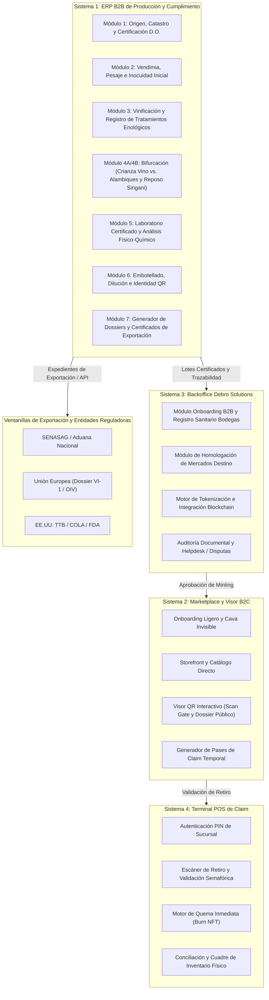

Para convertir a **Drinks on Chain** en la herramienta operativa de viabilidad y auditoría de exportación que las bodegas necesitan, el sistema no puede limitarse a registrar datos agronómicos básicos.

La exportación internacional de vinos y licores (Singani) exige cumplir con marcos normativos estrictos:

1. **Regulación Nacional de Origen:** SENASAG (Inocuidad Alimentaria, Registro Sanitario, Trazabilidad por Lote y Certificado de Exportación).
2. **Unión Europea (OIV / Documento VI-1):** Exige boletines analíticos oficiales de laboratorio (*Ficha de Análisis Enológico Completo*: acidez volátil, dióxido de azufre total/libre, extracto seco libre de azúcar, sobrepresión, grado alcohólico volumétrico real y total).
3. **Estados Unidos (TTB / COLA y FDA):** Requiere certificación de origen geográfico (>85% AVA / D.O.), umbrales varietales (>75%), declaración de sulfitos y trazabilidad física ininterrumpida de insumos/aditivos.

A continuación, se presenta la arquitectura modular expandida y el modelo de datos relacional ajustado bajo el estándar de comercio exterior y auditoría agroalimentaria.

---

### 1. Diagrama de Arquitectura Modular del Ecosistema (Enfocado en Exportación)



---

### 2. Diagrama Entidad-Relación de la Base de Datos

```mermaid
erDiagram
    USERS ||--o{ WINERY_MEMBERS : participates
    USERS ||--o{ USER_WALLETS : owns
    USERS ||--o{ ORDERS : places
    USERS ||--o{ SUPPORT_TICKETS : opens

    WINERIES ||--o{ WINERY_MEMBERS : employs
    WINERIES ||--o{ TERROIRS : owns
    WINERIES ||--o{ HARVEST_BATCHES : processes
    WINERIES ||--o{ BOTTLING_BATCHES : bottles
    WINERIES ||--o{ EXPORT_DOSSIERS : requests
    WINERIES ||--o{ COLLECTIONS : publishes

    TERROIRS ||--o{ HARVEST_BATCHES : yields
    HARVEST_BATCHES ||--o{ FERMENTATION_TANKS : fills
    FERMENTATION_TANKS ||--o{ FERMENTATION_LOGS : tracks
    FERMENTATION_TANKS ||--o{ ENOLOGICAL_TREATMENTS : receives
    FERMENTATION_TANKS ||--o| WINE_AGING_BATCHES : wine_route
    FERMENTATION_TANKS ||--o| SINGANI_DISTILLATION_BATCHES : singani_route

    WINE_AGING_BATCHES ||--o{ BOTTLING_BATCHES : supplies
    SINGANI_DISTILLATION_BATCHES ||--o{ BOTTLING_BATCHES : supplies

    BOTTLING_BATCHES ||--o{ BATCH_LAB_ANALYSES : certifies
    BOTTLING_BATCHES ||--o{ EXPORT_DOSSIER_ITEMS : includes
    BOTTLING_BATCHES ||--o| COLLECTIONS : backs

    EXPORT_DOSSIERS ||--o{ EXPORT_DOSSIER_ITEMS : groups
    EXPORT_DOSSIERS ||--o{ EXPORT_DOCUMENTS_GENERATED : generates

    COLLECTIONS ||--o{ TOKENIZED_ITEMS : mints
    COLLECTIONS ||--o{ ORDERS : sells

    ORDERS ||--o{ ORDER_ITEMS : contains
    ORDER_ITEMS ||--|| TOKENIZED_ITEMS : fulfills

    TOKENIZED_ITEMS ||--o{ CLAIM_PASSES : generates
    CLAIM_PASSES ||--o| CLAIM_REDEMPTIONS : redeems

    PICKUP_LOCATIONS ||--o{ POS_SHIFTS : operates_at
    POS_SHIFTS ||--o{ CLAIM_REDEMPTIONS : records

    USERS {
        uuid id PK
        string email UK
        string phone_number UK
        string password_hash
        enum user_role
        boolean is_active
        timestamp created_at
    }

    WINERIES {
        uuid id PK
        string legal_name
        string commercial_name
        string tax_id_nit UK
        string senasag_sanitary_reg UK
        string geographic_region
        boolean is_export_certified
        timestamp created_at
    }

    WINERY_MEMBERS {
        uuid id PK
        uuid user_id FK
        uuid winery_id FK
        enum member_role
        string professional_license_number
        boolean is_active
    }

    TERROIRS {
        uuid id PK
        uuid winery_id FK
        string parcel_name
        string cadastre_code
        decimal surface_hectares
        decimal altitude_masl
        string grape_variety
        string geographic_polygon_geojson
        boolean is_singani_do_eligible
    }

    HARVEST_BATCHES {
        uuid id PK
        uuid terroir_id FK
        uuid winery_id FK
        string harvest_batch_code UK
        timestamp intake_date
        decimal gross_weight_kg
        decimal tare_weight_kg
        decimal net_weight_kg
        decimal brix_degrees
        decimal initial_ph
        decimal initial_acidity_gl
        enum phytosanitary_status
        uuid certified_by_enologist_id FK
    }

    FERMENTATION_TANKS {
        uuid id PK
        uuid harvest_batch_id FK
        string tank_code
        enum status
        timestamp start_date
        timestamp end_date
        enum destination_type
    }

    FERMENTATION_LOGS {
        uuid id PK
        uuid fermentation_tank_id FK
        decimal temperature_celsius
        decimal specific_gravity
        timestamp recorded_at
        uuid recorded_by_user_id FK
    }

    ENOLOGICAL_TREATMENTS {
        uuid id PK
        uuid fermentation_tank_id FK
        enum treatment_type
        string additive_name
        decimal dosage_applied_g_per_hl
        string senasag_chemical_authorization_code
        timestamp applied_at
        uuid authorized_by_enologist_id FK
    }

    WINE_AGING_BATCHES {
        uuid id PK
        uuid fermentation_tank_id FK
        string barrel_type_origin
        integer barrel_use_cycle
        integer planned_months
        timestamp lock_until_date
        enum aging_status
    }

    SINGANI_DISTILLATION_BATCHES {
        uuid id PK
        uuid fermentation_tank_id FK
        string alembic_identifier
        decimal head_cut_liters
        decimal heart_cut_liters
        decimal tail_cut_liters
        decimal initial_alcohol_percentage
        timestamp mandatory_rest_lock_until
        enum rest_status
    }

    BOTTLING_BATCHES {
        uuid id PK
        uuid winery_id FK
        uuid wine_aging_batch_id FK
        uuid singani_batch_id FK
        string international_lot_code UK
        decimal water_dilution_liters
        decimal final_alcohol_abv
        integer total_bottles_packaged
        string packaging_format_cl
        timestamp bottling_date
        uuid released_by_enologist_id FK
    }

    BATCH_LAB_ANALYSES {
        uuid id PK
        uuid bottling_batch_id FK
        string certified_laboratory_name
        string accredited_lab_certification_code
        decimal actual_alcohol_abv
        decimal total_alcohol_abv
        decimal total_acidity_tartaric_gl
        decimal volatile_acidity_acetic_gl
        decimal free_sulfur_dioxide_mg_l
        decimal total_sulfur_dioxide_mg_l
        decimal reducing_sugars_gl
        decimal total_dry_extract_gl
        decimal overpressure_bar
        decimal methanol_content_mg_l
        timestamp test_performed_at
        string laboratory_report_pdf_url
        boolean conforms_to_export_standards
    }

    EXPORT_DOSSIERS {
        uuid id PK
        uuid winery_id FK
        string destination_country_iso
        string destination_customs_office
        string importer_company_name
        string importer_tax_address
        enum dossier_status
        timestamp requested_at
        timestamp validated_at
        uuid approved_by_admin_id FK
    }

    EXPORT_DOSSIER_ITEMS {
        uuid id PK
        uuid export_dossier_id FK
        uuid bottling_batch_id FK
        integer exported_boxes_count
        integer units_per_box
        decimal total_net_volume_liters
    }

    EXPORT_DOCUMENTS_GENERATED {
        uuid id PK
        uuid export_dossier_id FK
        enum document_type
        string official_document_number
        string document_pdf_url
        string cryptographic_hash_sha256
        timestamp generated_at
    }

    COLLECTIONS {
        uuid id PK
        uuid winery_id FK
        uuid bottling_batch_id FK
        string name
        decimal distributor_price
        integer total_supply
        string smart_contract_address
        enum publication_status
    }

    USER_WALLETS {
        uuid id PK
        uuid user_id FK
        string public_address UK
        string custodial_vault_id
    }

    TOKENIZED_ITEMS {
        uuid id PK
        uuid collection_id FK
        uuid current_owner_user_id FK
        integer bottle_serial_number
        string onchain_token_id UK
        enum token_status
        timestamp minted_at
        timestamp burned_at
    }

    ORDERS {
        uuid id PK
        uuid user_id FK
        decimal total_amount
        enum payment_status
        string payment_gateway_reference
        timestamp created_at
    }

    ORDER_ITEMS {
        uuid id PK
        uuid order_id FK
        uuid tokenized_item_id FK
        decimal unit_price
    }

    PICKUP_LOCATIONS {
        uuid id PK
        string location_name
        string address
        string pin_hash
        boolean is_active
    }

    POS_SHIFTS {
        uuid id PK
        uuid pickup_location_id FK
        uuid cashier_user_id FK
        timestamp shift_opened_at
        timestamp shift_closed_at
        integer total_claims_processed
    }

    CLAIM_PASSES {
        uuid id PK
        uuid tokenized_item_id FK
        uuid user_id FK
        string ephemeral_qr_code UK
        timestamp expires_at
        enum pass_status
    }

    CLAIM_REDEMPTIONS {
        uuid id PK
        uuid claim_pass_id FK
        uuid tokenized_item_id FK
        uuid pos_shift_id FK
        timestamp redeemed_at
    }

    SUPPORT_TICKETS {
        uuid id PK
        uuid user_id FK
        string subject
        text issue_description
        enum ticket_status
        timestamp created_at
    }

```



---

### 3. Justificación y Explicación Detallada de Tablas Nuevas y Modificadas

A continuación se detallan las tablas incorporadas para satisfacer las normas de exportación y auditoría internacional:

#### A. Tablas de Cumplimiento Regulatorio y de Exportación

**1. `EXPORT_DOSSIERS` (Expedientes de Exportación Multimercado)**

* **Por qué existe:** Una bodega no exporta lotes genéricos de forma desestructurada; exporta a través de órdenes aduaneras específicas orientadas a un país destino con reglas comerciales y fiscales concretas (ej. importador autorizado en EE.UU. o la UE).
* **Campos clave:** `id`, `winery_id`, `destination_country_iso` (ej. `US`, `ES`, `DE`), `destination_customs_office`, `importer_company_name`, `importer_tax_address`, `dossier_status` (`DRAFT`, `VALIDATED_FOR_CUSTOMS`, `EXPORTED`).
* **Función operativa:** Agrupa los lotes de vino y Singani que componen un embarque aduanero, validando que todas las partidas cumplan con la normativa específica del país de destino antes de autorizar la salida.


**2. `EXPORT_DOSSIER_ITEMS` (Partidas y Lista de Empaque / Packing List)**

* **Por qué existe:** Vincula el lote físico embotellado con las cantidades reales de cajas y volumen neto exportado.
* **Campos clave:** `id`, `export_dossier_id`, `bottling_batch_id`, `exported_boxes_count`, `units_per_box`, `total_net_volume_liters`.
* **Función operativa:** Permite emitir automáticamente la *Lista de Empaque Oficial (Packing List)* requerida por las aduanas y SENASAG para la emisión de precintos y manifiestos de carga.

**3. `BATCH_LAB_ANALYSES` (Boletín Analítico Oficial / Parámetros OIV y TTB)**

* **Por qué existe:** **Es el requisito técnico más exigente para la exportación de bebidas alcohólicas a nivel mundial.** La Unión Europea (a través del Documento VI-1) y la TTB en EE.UU. exigen un reporte de laboratorio enológico certificado que respalde cada lote.
* **Campos clave:**
* `bottling_batch_id`: Enlace directo al lote embotellado.


* `certified_laboratory_name`, `accredited_lab_certification_code`: Laboratorio avalado (ej. CEVITA u homólogo acreditado).
* `actual_alcohol_abv` y `total_alcohol_abv`: Grado volumétrico real y potencial.
* `total_acidity_tartaric_gl` y `volatile_acidity_acetic_gl`: Acidez total y volátil (control de avinagramiento).
* `free_sulfur_dioxide_mg_l` y `total_sulfur_dioxide_mg_l`: Sulfitos totales y libres (requisito crítico de rotulado alimentario internacional; límite de 10 ppm para advertencia).
* `reducing_sugars_gl`: Azúcares reductores residuales.
* `total_dry_extract_gl`: Extracto seco libre de azúcar.
* `overpressure_bar`: Control de presión para vinos espumosos/gasificados.
* `methanol_content_mg_l`: Metanol residual (vital para Singani / destilados).
* `laboratory_report_pdf_url`, `conforms_to_export_standards`.


* **Función operativa:** Este registro almacena los valores exactos que el backend extrae para rellenar automáticamente la casilla 11 del documento VI-1 de la UE o la declaración de componentes de la TTB.

**4. `EXPORT_DOCUMENTS_GENERATED` (Documentos Oficiales y Hash Inmutable)**

* **Por qué existe:** Almacena los archivos finales oficiales generados para la aduana, garantizando que el PDF emitido no sufra alteraciones.
* **Campos clave:** `id`, `export_dossier_id`, `document_type` (`EU_VI1`, `SENASAG_EXPORT_CERT`, `USA_COLA_ANALYSIS`, `CERTIFICATE_OF_ORIGIN`, `PACKING_LIST`), `official_document_number`, `document_pdf_url`, `cryptographic_hash_sha256`, `generated_at`.
* **Función operativa:** Permite descargar los expedientes oficiales listos para imprimir o firmar electrónicamente, manteniendo una huella digital criptográfica (SHA-256) que demuestra que el documento coincide con los datos registrados en el ERP.


**5. `ENOLOGICAL_TREATMENTS` (Tratamientos Enológicos e Insumos / Trazabilidad Alimentaria)**

* **Por qué existe:** Las agencias de seguridad alimentaria exigen registrar todos los aditivos, clarificantes y conservantes aplicados al vino o mosto.
* **Campos clave:** `id`, `fermentation_tank_id`, `treatment_type` (ej. Corrección de acidez, Clarificación, Sulfatado), `additive_name`, `dosage_applied_g_per_hl`, `senasag_chemical_authorization_code`, `applied_at`, `authorized_by_enologist_id`.
* **Función operativa:** Garantiza la trazabilidad sanitaria retroactiva ante una auditoría o un retiro de mercado internacional (*Recall*).

---

#### B. Modificaciones en Tablas del ERP y Backoffice

* **`WINERIES`:** Se agregaron `tax_id_nit`, `senasag_sanitary_reg` (Registro Sanitario SENASAG indispensable para tramitar exportación) y `is_export_certified`.


* **`WINERY_MEMBERS`:** Se añadió `professional_license_number` (Matrícula profesional del enólogo/agrónomo que firma y se responsabiliza ante los entes fiscalizadores).


* **`TERROIRS`:** Se incluyeron `cadastre_code` (código catastral rural) y `geographic_polygon_geojson` (polígono georreferenciado), requeridos para certificar origen formal ante la OIV y los acuerdos bilaterales de D.O. de Singani.


* **`HARVEST_BATCHES`:** Incorpora `phytosanitary_status` y validación de acidez total en gramos por litro (`initial_acidity_gl`).


* **`BOTTLING_BATCHES`:** Utiliza `international_lot_code` (código de lote internacional estructurado según normas GS1/Lote) y `packaging_format_cl` (ej. 75cl, 70cl; clave para aduanas europeas y norteamericanas).


---

### 4. Flujo y Reportes de Exportación Suministrados a las Bodegas

Gracias a este esquema, el **Sistema 1 (ERP)** y el **Sistema 3 (Backoffice)** pueden emitir los siguientes reportes y documentos que la bodega necesita para exportar:

```
+----------------------------------------------------------------------------------------------------+
|                                    REPORTES DE EXPORTACIÓN Y AUDITORÍA                             |
+------------------------------------+-----------------------------------+---------------------------+
| Documento / Reporte                | Destino / Entidad Receptora       | Datos Clave Consolidados  |
+------------------------------------+-----------------------------------+---------------------------+
| 1. Certificado VI-1 (Document for  | Unión Europea                     | Lote, grado ABV real/pot.,|
|    Importation of Wine into the EC)| (Aduanas UE / Importador)         | acidez volátil/total, SO2 |
|                                    |                                   | libre y total, extracto.  |
+------------------------------------+-----------------------------------+---------------------------+
| 2. Dossier Técnico TTB / COLA      | Estados Unidos                    | Región geográfica (D.O.), |
|    (Certificate of Label Approval) | (TTB / FDA / Agente Aduanal)      | variedad >75%, sulfitos,  |
|                                    |                                   | advertencia de salud.     |
+------------------------------------+-----------------------------------+---------------------------+
| 3. Certificado de Exportación      | SENASAG (Bolivia)                 | Registro sanitario planta,|
|    de Inocuidad Alimentaria        |                                   | trazabilidad de insumos,  |
|                                    |                                   | conformidad de lote.      |
+------------------------------------+-----------------------------------+---------------------------+
| 4. Certificado de Denominación de  | Cámaras de Exportadores /         | Catastro de terroir, cota |
|    Origen (Singani / Vinos Altura) | Acuerdos Comerciales              | altitud >1600 msnm,       |
|                                    |                                   | uva Moscatel Alejandría.  |
+------------------------------------+-----------------------------------+---------------------------+
| 5. Lista de Empaque / Packing List | Transportista Internacional /     | Cajas, botellas por caja, |
|    y Cuadre de Mermas              | Aduana de Frontera                | peso bruto/neto, litros.  |
+------------------------------------+-----------------------------------+---------------------------+

```

Con este modelo de datos, la tokenización de botellas y el marketplace B2C operan sobre una base de datos que ya cumple con los estándares técnicos y legales de exportación requeridos por las bodegas y los organismos internacionales.