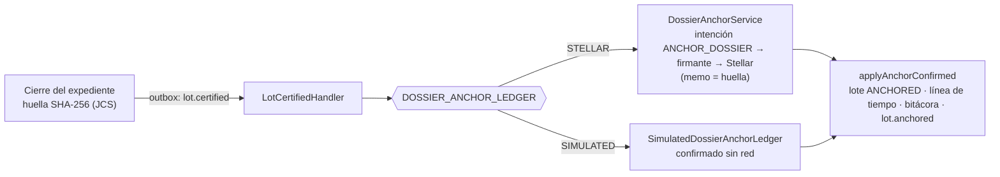

# Anclaje del expediente

> Puerto `DossierAnchorLedger` (`src/modules/chain/anchor/dossier-anchor.port.ts`). Decisión A-22: «anclaje al final».

## Qué huellas hay y cuál va a la red

| Huella | Cuándo se calcula | Dónde vive | ¿Va a la red? |
|---|---|---|---|
| Hash de cada entrada de la **bitácora** (`audit_events.hash`, encadenado con `prevHash`) | En cada acción (cada pesaje, lectura, embotellado…) | Base de datos | No: protege la bitácora contra cambios (`GET /v1/platform/audit/verify`) |
| Raíz **Merkle** de los códigos de botella (`lot_dossiers.bottle_merkle_root`) | Al cerrar el expediente | Base de datos y dentro del expediente | No por separado: va **dentro** del expediente |
| **Huella del expediente** (`lot_dossiers.hash`: SHA-256 del JSON canónico JCS) | Al cerrar el expediente, una vez por lote | Base de datos | **Sí**: es lo único que se ancla |

El expediente canónico reúne **todas las etapas registradas** del lote (parcelas, pesajes, dictámenes, tanques, crianza o destilación, embotellado, laboratorio, correcciones) y la raíz Merkle de las botellas. Su huella resume todo: cambiar un solo dato de cualquier etapa cambia la huella. Por eso basta con anclar **una** huella por lote, al final, y no una por etapa (más barato, y lo acordado en A-22).

## El puerto

```ts
interface DossierAnchorLedger {
  readonly kind: 'STELLAR' | 'SIMULATED';
  request(db, lotId, requestedBy?): Promise<AnchorRequestResult>;
  backfill(limit?): Promise<{ requested: number; more: boolean }>;
}
```

- Lo usan `lot.certified` (`LotCertifiedHandler`) y el relleno `chain.anchor.backfill` (`ChainAnchorBackfillHandler`), inyectando `DOSSIER_ANCHOR_LEDGER`.
- Lo elige `ANCHOR_LEDGER` (`ChainCoreModule`): `STELLAR` por defecto, `SIMULATED` opcional.



## Implementaciones

| `ANCHOR_LEDGER` | Clase | Qué hace |
|---|---|---|
| `STELLAR` | `DossierAnchorService` | Registra la intención `ANCHOR_DOSSIER`; el firmante del worker envía una transacción clásica de la cuenta de anclaje con `MEMO_HASH` = huella; al confirmarse se lee de vuelta y se comprueban memo y cuenta. Sin cadena configurada responde `DISABLED` y el expediente queda pendiente |
| `SIMULATED` | `SimulatedDossierAnchorLedger` | Da el anclaje por confirmado en la misma transacción, sin red: `chain_transactions` `CONFIRMED` en red `LOCAL` con intención `simulated-anchor:{lotId}` y hash determinista, `dossier_anchors` con la cuenta simulada fija (`SIMULATED_ANCHOR_ACCOUNT`), y los mismos efectos que el real (`applyAnchorConfirmed`). La línea de tiempo dice «simulación: sin red» y no hay enlace al explorador |

Al pasar de `SIMULATED` a `STELLAR` con la cadena habilitada, el relleno vuelve a anclar en la red los expedientes anclados en simulación (se reconocen por la cuenta simulada).

## Añadir otra red u otra forma de anclar

1. Una clase que implemente `DossierAnchorLedger` (p. ej. un contrato que guarde la huella, u otra cadena).
2. Al confirmar, llamar a `applyAnchorConfirmed` con la verificación de lo leído en la red, para conservar los efectos.
3. Añadir su valor a `ANCHOR_LEDGER_KINDS`, a la validación de `chain.config.ts` y a la fábrica de `ChainCoreModule`.

Los lotes, el pasaporte, el ERP, el back office y el Marketplace no cambian: leen `dossier_anchors` y `chain_transactions`. Si la nueva red no es `TESTNET`, `PUBLIC` ni `LOCAL`, hay que ampliar `ChainNetwork` en el contrato de la API y en `@drinks-on-chain/mocks`.
