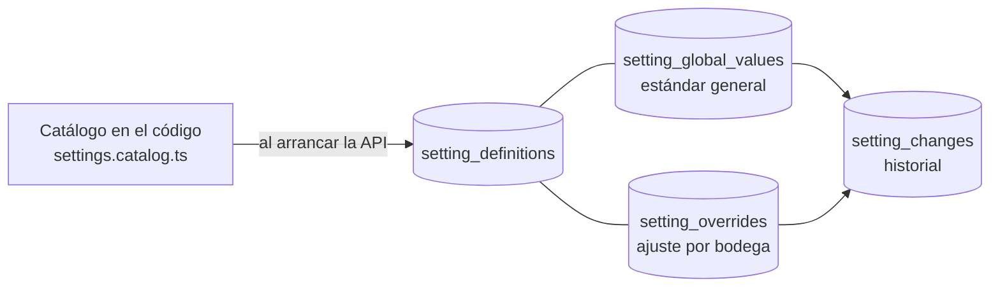

# Configuración en dos niveles

> Ola 0 · paso 0.8 (CFG-01, CFG-05; docs-back/05 §4, docs-back/07 §5, docs-back/03 §10, contrato O1 §6, A-31). Base: catálogo, modelo, resolución del valor efectivo con caché, validación, escrituras con historial y bitácora, e instantánea para el lote. Los endpoints del back office (`/v1/platform/settings/*`) llegan en la Ola 1 sobre `SettingsService`; hoy solo existe `GET /v1/organizations/current/settings` (lectura).

## Modelo

| Tabla | Qué guarda |
|---|---|
| `setting_definitions` | Copia del catálogo del código: clave, descripción, tipo, `enum_values`, unidad, `levels`, `applies_at`, `default_value`, `min`, `max`, `integer`, `nullable`, `legal_minimum`, `is_active` (una clave que el código ya no define queda inactiva, con sus valores e historial) |
| `setting_global_values` | Estándar general por clave (sin fila = valor por defecto del catálogo), con `version`, `updated_at`, `updated_by` |
| `setting_overrides` | Ajuste de una bodega (`key` + `winery_id` únicos), con `legal_exception`, `reason`, `version`, `updated_by`. "Volver al estándar" = borrar la fila |
| `setting_changes` | Historial (CFG-07): `scope` (`GLOBAL` o `WINERY` + `winery_id`), `before` y `after` como `{ value }` o `null` (sin valor propio), `reason`, `legal_exception`, autor, fecha y correlación |

Las definiciones viven en el código (docs-back/03 §10): `SettingsCatalogSync` las copia a la tabla al arrancar la API (idempotente). Añadir un parámetro = añadirlo a `SETTINGS_CATALOG`; valores de enumeración, unidades y límites coinciden con `@drinks-on-chain/mocks` (`backoffice/settings-catalog.ts`).

## Catálogo

Las 27 claves de docs-back/05 §4, tal cual. Mínimos legales (A-31): `trazabilidad.singani.altitudMinimaMsnm` ≥ 1600, `trazabilidad.singani.variedadesExigidas` ⊆ [Moscatel de Alejandría], `trazabilidad.singani.reposoMinimoDias` ≥ 180.

| Tipo | Valor | Notas |
|---|---|---|
| `NUMBER` | número | `min`/`max`; `integer` para días, horas y cantidades |
| `NUMBER_OR_UNLIMITED` | número o `null` | `null` = ilimitado (o desactivado, p. ej. `campanas.recordatorioResena.dias`) |
| `BOOLEAN` | `true`/`false` | |
| `ENUM` | uno de `enumValues` | `canje.ventanaVencida.accion`: `BURN`/`EXTEND`/`COMPENSATE`; `canje.codigoBotella.modo`: `DISABLED`/`OPTIONAL`/`REQUIRED` |
| `LIST` | lista de textos | sin repetidos |
| `OBJECT` | objeto | `trazabilidad.laboratorio.limites` (metanol 200 mg/100 ml a.a. — el límite que ya aplica el registro de análisis —, cobre 6 mg/l, acidez volátil 1,2 g/l; a confirmar con la norma); `precio.politica` = `null` hasta A-32 |
| `STRING` | texto | ninguno por ahora |

## Resolución del valor efectivo (CFG-05)

`effective(key, wineryId?)` / `resolve(key, wineryId?)`:

1. Ajuste de la bodega, si el parámetro admite nivel de bodega.
2. Estándar general, si el parámetro admite nivel general.
3. Valor por defecto del catálogo.

`resolve` devuelve también `source` (`WINERY` | `GLOBAL` | `DEFAULT`) y `legalException`. `effectiveAll(wineryId)` da la lista de `GET /v1/organizations/current/settings` (`source: GLOBAL` también cuando se usa el valor por defecto: es el estándar).

**Caché en Redis por generación**: las entradas son `doc:settings:<generación>:<bodega|_global>` (todos los valores de ese ámbito, 5 min) y la generación vigente está en `doc:settings:gen`. Invalidar = `INCR` de la generación:

- Al confirmar cada escritura, `SettingsService` la invalida.
- Además escribe el evento `setting.changed` en el outbox (misma transacción) y el worker vuelve a invalidar (`SettingChangedHandler`), por si Redis falló justo al confirmar.
- Una lectura que calculó con datos viejos antes del cambio escribe en una generación que ya nadie lee: no hay carrera.
- Sin Redis, se lee de la base (sin esperar al timeout: el cliente falla al momento sin conexión).

## Validación

`validateSettingValue(definición, valor, { scope, legalException })`:

| Caso | Respuesta |
|---|---|
| Tipo, entero, `min`/`max`, enumeración, lista u objeto inválidos | 422 `VALIDATION_ERROR` con `details[{ field: 'value' }]` |
| Ajuste por bodega en un parámetro `GLOBAL`, o estándar en uno `WINERY` | 422 `SETTING_LEVEL_NOT_ALLOWED` |
| Más laxo que el mínimo legal | 422 `SETTING_BELOW_LEGAL_MINIMUM`, salvo en un **ajuste por bodega** con `legalException: true` (el estándar general nunca baja del mínimo). La excepción queda marcada en el ajuste, el historial y la bitácora |
| Motivo vacío o fuera de 3–500 | 422 `VALIDATION_ERROR` en `reason` |
| Clave desconocida | 404 `SETTING_NOT_FOUND` |

Quién puede pedir la excepción legal (solo `ADMIN`, contrato O1 §6) lo comprueba el endpoint de la Ola 1: el servicio confía en quien lo llama.

## Escrituras (para la Ola 1)

Todas en una transacción, con historial, bitácora y `setting.changed`, e invalidación de la caché al confirmar:

- `setGlobal(key, value, { reason })` → `SETTING_CHANGED` (CFG-02).
- `setOverrides(key, wineryIds | 'ALL', value, { reason, legalException? })` → `{ updated }`; una entrada `SETTING_OVERRIDE_SET` por bodega (CFG-03, CFG-04). `ALL` = todas las bodegas no revocadas.
- `resetOverrides(key, wineryIds | 'ALL', { reason })` → `{ reset }`; `SETTING_OVERRIDE_RESET` por bodega ("volver al estándar").

## Instantánea del lote (CFG-06, Ola 2)

`snapshot(wineryId)` → `{ wineryId, takenAt, values, sources, legalExceptions }` con los parámetros `appliesAt = LOT` (reglas de trazabilidad), leídos de la base (no de la caché). El lote la guarda al crearse y valida contra ella aunque la configuración cambie después (docs-back/07 §5.2); `legalExceptions` permite que el pasaporte indique las excepciones.

## Pruebas

- Unitarias: `src/modules/settings/__tests__/` (catálogo completo y válido, validación con mínimos legales y niveles, resolución y caché, instantánea, procesador del worker).
- e2e con Postgres y Redis: `test/settings.e2e-spec.ts` (catálogo sincronizado, estándar con historial, bitácora y outbox, caché e invalidación, excepción legal, lectura por HTTP, volver al estándar).
