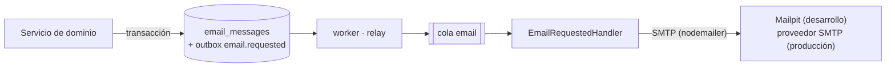

# Correo, archivos y operación

> Ola 0 · paso 0.9 (CMP-01, OPS-06, SE-04, OPS-01, OPS-03, SE-08; docs-back/03 §13–§15, docs-back/07 §11). Correo con plantillas por la cola `email`, almacenamiento de objetos privado con URL firmadas, healthcheck y logs JSON.

## Correo (CMP-01)

- **Encolar**: `MailService.enqueue(tx, { template, to, variables, idempotencyKey?, organizationId? })` dentro de la transacción de la operación (si se revierte, no sale ningún correo). Valida plantilla, variables y dirección antes de escribir. `enqueueStandalone` abre su propia transacción. Importa `MailModule`.
- **Idempotencia**: `idempotency_key` única (p. ej. `invitation:<id>:v1`): encolar dos veces con la misma clave devuelve el mismo correo. En el envío, el procesador reclama el correo con una actualización condicional (`QUEUED`/`FAILED` → `SENDING`), así que un trabajo repetido no envía dos veces; un `SENT` no se vuelve a enviar. Queda un caso "al menos una vez" (el proceso muere tras entregar al SMTP y antes de marcar `SENT`): se reenvía con el mismo `Message-ID` (`<id>@mail.drinksonchain.local`).
- **Estados** (`email_messages.status`): `QUEUED → SENDING → SENT`, o `FAILED` con `last_error` si el SMTP falla (BullMQ reintenta con espera exponencial, `JOB_ATTEMPTS`). `attempts` cuenta los envíos intentados. Un `SENDING` de más de 5 minutos se considera abandonado y se puede volver a reclamar.
- **Privacidad**: al enviarse se borran las variables (pueden llevar enlaces con token); queda el asunto.
- **Plantillas** (`src/modules/mail/templates/`): Handlebars en modo estricto — una variable que falta es un error —, sin helpers ni parciales, HTML escapado, variables planas (texto, número, sí/no) y asunto sin saltos de línea (inyección de cabeceras). Texto plano + HTML con el marco de la marca (papel `#fdfcf5`, tinta, un solo oro, serif), en español. Hoy: `prueba`. Las de la Ola 1 (contrato O1 §10) se añaden a `MAIL_TEMPLATES`.
- **Probar un entorno**: `node dist/scripts/send-test-email.js destino@ejemplo.test` (en el servidor: `docker compose -p doc-dev exec api node dist/scripts/send-test-email.js dev@example.test`) y mirar Mailpit.

| Variable (worker) | Por defecto | Uso |
|---|---|---|
| `SMTP_HOST` / `SMTP_PORT` | `localhost` / `1025` (Mailpit local; `mailpit:1025` en compose) | Servidor SMTP |
| `SMTP_SECURE` | `false` | `true` = TLS directo (465); `false` = STARTTLS si se ofrece |
| `SMTP_USER` / `SMTP_PASSWORD` | vacíos | Autenticación SMTP (Mailpit acepta cualquiera) |
| `MAIL_FROM` / `MAIL_REPLY_TO` | `Drinks on Chain <no-reply@drinksonchain.local>` | Remitente y respuesta |

## Archivos (OPS-06, SE-04)

Nada es público: **no hay carpeta `/uploads` servida** por la API. Los objetos son privados y se leen con **URL firmadas de corta vida** (`STORAGE_SIGNED_URL_TTL_SECONDS`, 15 min por defecto, máximo 1 h).

| Driver | Uso | URL firmadas |
|---|---|---|
| `s3` | MinIO en local y en desarrollo; cualquier S3 compatible en producción. El bucket se crea al arrancar si no existe (privado) | Prefirmadas por el servicio (`X-Amz-Signature`) con `S3_PUBLIC_ENDPOINT` si el navegador ve otro host |
| `local` | Pruebas y desarrollo sin MinIO (carpeta `STORAGE_LOCAL_PATH`) | HMAC (`STORAGE_SIGNING_SECRET`, por defecto derivado de `JWT_SECRET`) validado por `GET /v1/uploads/local?key&expires&signature` |

**`POST /v1/uploads`** (multipart `file`, `?folder=`):

- Solo **personal** (`audience = STAFF`) con organización activa; un consumidor → 403.
- Tipo **real** por la firma de los primeros bytes (`src/shared/storage/file-type.ts`): JPEG, PNG, WEBP, GIF y PDF. **Sin SVG** ni nada más. El MIME declarado debe coincidir con el contenido; si no → 422 `FILE_TYPE_NOT_ALLOWED`.
- Límite por tipo: 5 MB las imágenes, 15 MB los PDF → 413 `FILE_TOO_LARGE`.
- Clave con el prefijo de la organización: `org/<organizationId>/<carpeta>/<aaaa>/<mm>/<uuid>.<ext>` (la plataforma sin organización de bodega usa `org/platform/…`); la carpeta se sanea.
- Respuesta: `{ key, url, expiresAt, originalName, mimeType, sizeBytes }` y `FILE_UPLOADED` en la bitácora.

**`GET /v1/uploads/url?key=`**: URL firmada nueva para mostrar un archivo guardado. Solo para archivos del prefijo de la organización activa (la plataforma puede leer cualquiera); otro prefijo o inexistente → 404 `FILE_NOT_FOUND`.

> **Cambio para el frontend**: la `url` caduca. Lo que se guarda en los registros (inspección, certificado, etiqueta, informe) es la `key`; la URL se pide con `GET /v1/uploads/url` al mostrar el archivo. Los enlaces antiguos a `/uploads/...` dejan de funcionar.

| Variable (API) | Por defecto | Uso |
|---|---|---|
| `STORAGE_DRIVER` | `local` (`s3` en los compose) | Driver |
| `S3_ENDPOINT`, `S3_REGION`, `S3_BUCKET`, `S3_ACCESS_KEY`, `S3_SECRET_KEY`, `S3_FORCE_PATH_STYLE` | —, `us-east-1`, —, —, —, `true` | Conexión S3. En `deploy/dev/compose.yml`: `http://minio:9000`, bucket `doc-dev-uploads` y las credenciales de `MINIO_ROOT_USER`/`MINIO_ROOT_PASSWORD` si no se definen |
| `S3_PUBLIC_ENDPOINT` | = `S3_ENDPOINT` | Host con el que se prefirma (el que abre el navegador) |
| `STORAGE_LOCAL_PATH`, `STORAGE_BASE_URL`, `STORAGE_SIGNING_SECRET` | `./uploads`, `http://localhost:<PORT>`, derivado | Driver local (`STORAGE_BASE_URL` = origen público de la API) |
| `STORAGE_SIGNED_URL_TTL_SECONDS` | `900` | Vida de las URL firmadas (30–3600) |

Pendiente: antivirus y cuotas por rol (SE-04, fuera de esta tarea); en el servidor de desarrollo, publicar MinIO para el navegador (un `server` de nginx con proxy a `minio:9000` y `S3_PUBLIC_ENDPOINT` apuntando a él): hasta entonces las URL firmadas solo se abren dentro de la red interna.

## Salud (OPS-01)

| Ruta | Qué mira | Uso |
|---|---|---|
| `GET /v1/health` | Base de datos y Redis (`status`), más `storage` y `worker` informativos | Healthcheck de la imagen (`Dockerfile`) y de `deploy.sh` |
| `GET /v1/health/live` | Nada (el proceso responde), con `release` | Liveness |
| `GET /v1/health/ready` | Base de datos, Redis y almacenamiento (503 si falta alguno) y `worker: up \| down` | Readiness |

El worker tiene su propio latido: el archivo `WORKER_HEARTBEAT_FILE` para el healthcheck de su contenedor (`dist/worker-healthcheck.js`, ver [outbox](outbox.md)) y la clave `<QUEUE_PREFIX>:worker:heartbeat` en Redis, que caduca a los `WORKER_HEARTBEAT_MAX_AGE_MS` (60 s). Ambos se reescriben solo con Postgres, Redis, el relay y las colas sanos. La API lee la clave: `worker: 'up'` si existe. **El worker no hace fallar la readiness** (la API atiende sin él); sin latido, `/ready` responde 200 con `status: 'degraded'` (no se procesan colas ni correos). `/health` no depende del worker: el worker arranca cuando la API está sana. API y worker deben compartir `QUEUE_PREFIX` (por defecto `doc`).

## Logs (OPS-03)

La API y el worker escriben **JSON de una línea** (`src/shared/logging/json-logger.ts`): `timestamp`, `level`, `context`, `message`, `service` (`api`/`worker`) y, del contexto de la petición, `correlationId`, `sid`, `org`, `userId` y `app` (`X-Client-App`). Un mensaje objeto (`logger.log({ message, ...campos })`) pone sus campos en el primer nivel, saneados. El log HTTP es estructurado (`method`, `path`, `statusCode`, `durationMs`, `ip`). `LOG_FORMAT=text` los hace legibles en local.

## Swagger (SE-08)

`SWAGGER_ENABLED` sin definir: activo fuera de producción y **apagado en producción**. `deploy/dev/compose.yml` lo activa (`/docs`, `/docs-json`: el frontend lee el contrato de ahí). El esquema de seguridad es `bearer` (corregido en 0.3).

## Pruebas

- Correo: `src/modules/mail/__tests__/mail.spec.ts` y `test/mail.e2e-spec.ts` (encola, el worker envía, se lee en Mailpit; en la CI con el servicio `axllent/mailpit`).
- Archivos: `src/shared/storage/__tests__/`, `src/modules/uploads/__tests__/` y `test/uploads.e2e-spec.ts` (driver local y, con `S3_E2E=true`, MinIO; en la CI con un contenedor MinIO).
- Salud, Swagger y logs: `src/modules/health/__tests__/`, `src/config/__tests__/swagger.config.spec.ts`, `src/shared/logging/__tests__/`.
