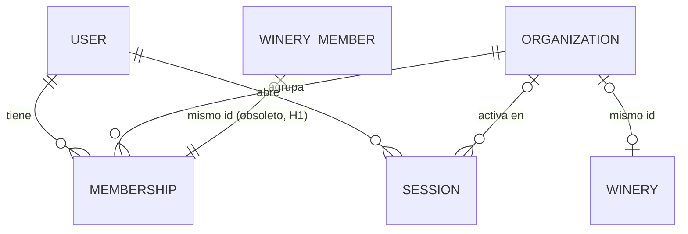
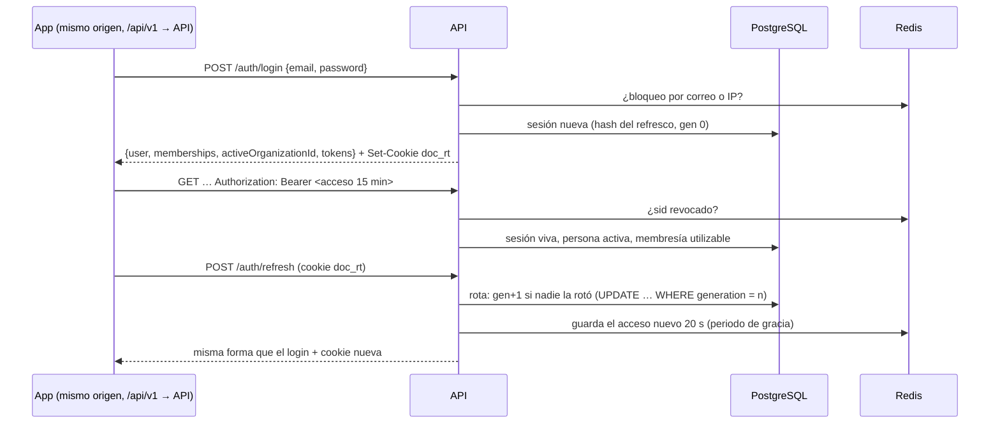
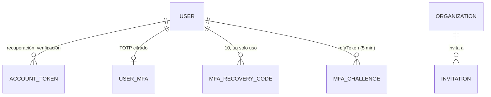
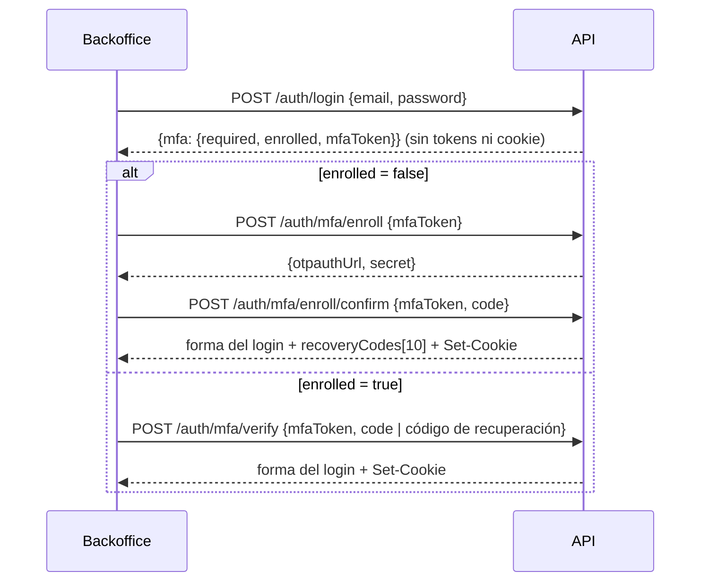

# Identidad, sesiones y membresías

> Ola 0 · pasos 0.5 y 0.6 (IAM-02, 03, 04, 07, 08, 13; EQP-01, EQP-09; SE-01, SE-03, SE-06; OP-05, OP-07) y Ola 1 · pasos 1.1 y 1.2 (IAM-05, 06, 09, 10; PLT-01…05; EQP-03; más abajo). Contrato: `plan/contratos/o0-sesiones-y-estandares.md` §4–§6 y `o1-backoffice-y-bodegas.md` §0 (estado `INVITED`). Ajusta `docs/rules/` (A-33: tokens cortos con renovación rotativa y roles por membresía).

## Modelo

| Tabla | Qué guarda |
|---|---|
| `organizations` | `type` (`PLATFORM` \| `WINERY` \| `PICKUP_POINT`), `name`, `status` (`INVITED` \| `ACTIVE` \| `SUSPENDED` \| `REVOKED`), `winery_id` único. La de una bodega **tiene el mismo id que la bodega** y su nombre y estado se escriben en la misma transacción que ella (`OrganizationsService.syncWinery`). La de plataforma ("Drinks on Chain") tiene el id fijo `00000000-0000-4000-8000-000000000001` (migración y seeder). |
| `memberships` | Persona + organización (única), `role`, `status` (`ACTIVE` \| `BLOCKED`), `blocked_by` (`OWNER` \| `PLATFORM`), `blocked_reason`, `blocked_at`. En las bodegas el id coincide con el de `winery_members`, que sigue siendo el autor de la trazabilidad. |
| `sessions` | `id` = claim `sid`, persona, organización activa, audiencia, hash SHA-256 del refresco vigente, `generation` (rotaciones), `rotated_at`, `last_used_at`, `expires_at` (deslizante), `revoked_at`, `revoked_reason`, IP y agente. La familia de refrescos es la sesión entera. |
| `users.last_organization_id` | Última organización activa elegida (la de por defecto al iniciar sesión). |

Roles válidos por tipo: plataforma `SUPERADMIN`, `ADMIN`, `OPERATIONS`, `SUPPORT`; bodega `OWNER`, `ENOLOGIST`, `AGRONOMIST`, `OPERATOR`, `ACCOUNTANT`; punto de canje `MANAGER`, `CASHIER` (Ola 5).

**Obsoletos hasta H1** (se retiran al cerrar la Ola 1): `users.user_role` (ya no autoriza nada; solo alimenta `user.userRole` y el claim de compatibilidad) y `winery_members` (matrícula profesional y autoría; `is_active` se mantiene sincronizado con `memberships.status`).

### Migración `20260927120000_organizations_memberships_sessions`

Aditiva y de datos, probada sobre una copia con datos (semilla + bodegas `ACTIVE`/`PENDING`/`REVOKED`, una persona en dos bodegas, un `POS_OPERATOR`, un miembro inactivo):

- `winery_status_enum`: `PENDING` → `INVITED` (renombrado del valor: las filas se conservan).
- Organización de plataforma y una organización `WINERY` por bodega (mismo id, nombre comercial y estado).
- `PLATFORM_ADMIN` → membresía `SUPERADMIN` de la plataforma (`BLOCKED` si la cuenta estaba inactiva).
- `winery_members` → membresías `WINERY` con el mismo id y rol (`is_active = false` → `BLOCKED` por la plataforma).
- `POS_OPERATOR` y consumidores: sin membresía (el operario de planta conserva la suya de bodega como `OPERATOR`).

## Sesión (contrato O0 §5)

- **Acceso**: JWT HS256 de **15 min** (`JWT_EXPIRES_IN`, recortado a 900 s aunque se configure más). Claims `sub`, `aud` (`STAFF` \| `CONSUMER`), `org`, `orgType`, `role`, `sid`, `jti` y, hasta H1, `email`, `userRole`, `wineryId`, `memberRole`.
- **Refresco**: `<sid>.<generación>.<secreto>`. El secreto inicial es aleatorio; cada rotación deriva el siguiente con `HMAC-SHA256(JWT_REFRESH_SECRET, "sid.gen+1.secreto")`. Solo se guarda el hash del vigente. Viaja en la cookie `doc_rt` (`HttpOnly; Secure; SameSite=Lax; Path=/; Max-Age`), sin `Secure` solo con `NODE_ENV=development` y origen `localhost`; y en `tokens.refreshToken` por compatibilidad hasta H1 (también se acepta en el cuerpo de `refresh`, `switch-organization` y `logout`).
- **Duración deslizante**: 7 días el personal (`SESSION_TTL_STAFF_DAYS`), 30 los consumidores (`SESSION_TTL_CONSUMER_DAYS`); cada rotación la renueva.
- **Rotación y reutilización**: el refresco vigente rota. El inmediatamente anterior, presentado otra vez dentro del **periodo de gracia** (`REFRESH_GRACE_SECONDS`, 20 s), devuelve **el mismo par nuevo** (el refresco se recalcula por derivación; el acceso sale de Redis): dos pestañas renovando a la vez no cierran la sesión. Fuera de la gracia, o cualquier refresco más antiguo de la cadena → se revoca la sesión y **401 `AUTH_REFRESH_REUSED`**. Un refresco que no encaja en la cadena es **401 `AUTH_REFRESH_INVALID`** y no revoca nada (conocer un `sid` no permite cerrar la sesión de otro).
- **Organización activa**: la última usada si sigue siendo utilizable (membresía `ACTIVE`, organización no `REVOKED`); si no, la primera utilizable (plataforma antes que bodega, y entre bodegas la más antigua); `null` si no hay. Si la sesión no tenía (p. ej. el dueño acaba de registrar su bodega), la renovación toma la de por defecto.
- **`POST /auth/switch-organization`** `{ organizationId }`: exige el acceso y el refresco de **esa misma sesión** (cookie o cuerpo), que se rota; misma `sid`, `org` nueva, se recuerda como la última usada. Sin membresía → 404 `ORG_NOT_FOUND`; membresía bloqueada → 403 `ORG_MEMBERSHIP_BLOCKED`; organización revocada → 403 `ORG_REVOKED`.
- **`POST /auth/logout`** (pública): revoca la sesión identificada por el acceso (aunque haya caducado) o por el refresco, y borra la cookie (`Max-Age=0`). **`POST /auth/logout-all`**: todas las de la persona. Ambas 204.
- **`GET /users/me`** y **`PATCH /users/me`** → `{ user, memberships, activeOrganizationId }` (`user` = perfil de 0.1 + `audience`, `notificationPrefs` y `promotionsConsent`; contrato O1 §1 y §11 bis).

### Revocación inmediata (IAM-13)

Revocar = `sessions.revoked_at` + marca `auth:revoked:<sid>` en Redis durante la vida de un acceso (+60 s). El guard global mira primero Redis (sin tocar la base) y después la base (sesión no revocada, persona activa, membresía de la organización del token `ACTIVE` y organización no `REVOKED`); si Redis no responde, decide la base. Se revoca al:

| Evento | Sesiones revocadas | Motivo |
|---|---|---|
| Bloquear una membresía (`MembershipsService.block`) | Las de esa persona con esa organización activa | `MEMBERSHIP_BLOCKED` |
| Bloquear la cuenta (`UsersService.blockAccount`) | Todas las de la persona | `USER_BLOCKED` |
| Rechazar (revocar) una bodega | Todas las que la tienen activa | `ORGANIZATION_REVOKED` |
| Reutilización de un refresco | Esa sesión | `REFRESH_REUSED` |
| `logout` / `logout-all` | Esa / todas | `LOGOUT` / `LOGOUT_ALL` |
| Contraseña restablecida (`reset-password`) | Todas las de la persona | `PASSWORD_RESET` |
| Contraseña cambiada (`POST /users/me/password`) | Todas menos la actual | `PASSWORD_CHANGED` |
| Segundo factor restablecido por administración | Todas las de la persona | `MFA_RESET` |
| Rol de plataforma cambiado | Las de esa persona con la plataforma activa | `ROLE_CHANGED` |
| Sesión de plataforma sin segundo factor (abierta antes de la Ola 1) | Esa sesión, en su siguiente petición o renovación | `MFA_REQUIRED` |

Los endpoints de bloqueo de la plataforma están en `/v1/platform/users/*` y `/v1/platform/accounts/*` (más abajo).

## Autorización (contrato O0 §6)

Guards globales (`AppModule`, en este orden): límite de peticiones → **`AccessTokenGuard`** (acceso válido + sesión viva) → **`AuthorizationGuard`** → **`TenantGuard`**. Las rutas `@Public()` solo pasan por el primero.

| Decorador | Se evalúa contra |
|---|---|
| `@Audience('STAFF')` | claim `aud` |
| `@OrgType('WINERY')` | tipo de la organización activa |
| `@Roles('OWNER', 'ENOLOGIST')` | rol en la organización activa |
| `@RequireActiveOrg()` | SE-05: bodega activa en estado `ACTIVE`. En la Ola 0 solo aviso en logs; con `FEATURE_ENFORCE_ACTIVE_ORG=true`, 403 `ORG_NOT_ACTIVE` con `details: [{ field: null, message: <estado> }]` |

- **Rutas de bodega** (`@OrgType('WINERY')`: todo el ERP y `wineries/my*`): la bodega es la activa; si la petición apunta a otra (`wineryId` en ruta, query o cuerpo) → **404**. El personal de plataforma pasa sin rol de bodega: `SUPERADMIN`, `ADMIN` y `OPERATIONS` leen y escriben, `SUPPORT` solo lee; eligen la bodega con `?wineryId=` y **las escrituras lo exigen** (422 con `details[{ field: 'wineryId' }]`, OP-07); una bodega inexistente → 404 `ORG_NOT_FOUND`.
- **Rutas de plataforma** (`GET /wineries`, `/wineries/pending`: todo el personal de plataforma; `approve`/`reject`: `SUPERADMIN`, `ADMIN`, `OPERATIONS`).
- **SE-01**: `POST /wineries/my/members` y `/members/create` (solo `OWNER` o plataforma) crean o reactivan **la membresía de esa bodega** (`MembershipsService.addToWinery`); nunca escriben `users.user_role` ni membresías de otra organización. Ya miembro activo → 409 `ORG_ALREADY_MEMBER`; bloqueada por la plataforma → 403 `ORG_BLOCKED_BY_PLATFORM`.

Matriz de roles de bodega en el ERP (docs-back/05 §3; la plataforma, como arriba):

| Ruta | OWNER | ENOLOGIST | AGRONOMIST | OPERATOR | ACCOUNTANT |
|---|---|---|---|---|---|
| Parcelas: alta y edición | ✅ | — | ✅ | — | — |
| Parcelas: lectura | ✅ | ✅ | ✅ | — | ✅ |
| Vendimia (pesaje): alta | ✅ | ✅ | ✅ | ✅ | — |
| Vendimia: lectura | ✅ | ✅ | ✅ | ✅ | ✅ |
| Dictamen fitosanitario | ✅ | ✅ | ✅ | — | — |
| Cubas: alta y tratamientos | ✅ | ✅ | — | — | — |
| Cubas: lectura | ✅ | ✅ | ✅ | ✅ | ✅ |
| Lecturas diarias (`…/logs`) | ✅ | ✅ | ✅ | ✅ | — |
| Crianza, destilación, embotellado: alta | ✅ | ✅ | — | — | — |
| Crianza, destilación, embotellado: lectura | ✅ | ✅ | — | — | ✅ |
| Laboratorio: alta | ✅ | ✅ | — | — | — |
| Laboratorio: lectura | ✅ | ✅ | ✅ | — | ✅ |
| `PATCH /wineries/my`, alta de miembros | ✅ | — | — | — | — |
| `GET /wineries/my`, `/my/members` | ✅ | ✅ | ✅ | ✅ | ✅ |

Cambios frente a 0.1: el operario de planta ya no es `POS_OPERATOR` (OP-05) y pesa y registra lecturas; el contador lee; el dueño dictamina; los consumidores ya no leen análisis de laboratorio por el ERP (llegará con el visor público).

## Límites (SE-06, IAM-07)

- `TRUST_PROXY=1` (una capa: nginx) → `request.ip` es la IP real de `X-Forwarded-For`. `true` se rechaza. En el servidor lo fija `deploy/dev/compose.yml`.
- Límite **global** por IP para toda la API: `RATE_LIMIT_GLOBAL_PER_MINUTE` (300). **`/auth/*`** por IP y ruta: `RATE_LIMIT_AUTH_PER_MINUTE` (20), login `RATE_LIMIT_LOGIN_PER_MINUTE` (10), signup `RATE_LIMIT_SIGNUP_PER_MINUTE` (5), refresh `RATE_LIMIT_REFRESH_PER_MINUTE` (30). 429 `TOO_MANY_REQUESTS` con `Retry-After`. `/health` no cuenta en el global. Contadores en memoria del proceso (una sola réplica); pasar a Redis cuando haya varias.
- **Bloqueo progresivo** del login en Redis, por correo (hash) y por IP: a partir de `LOGIN_LOCK_EMAIL_THRESHOLD` (5) o `LOGIN_LOCK_IP_THRESHOLD` (20) fallos en una hora, 60 s de bloqueo que se duplican con cada fallo (tope 1 h) → 429 `AUTH_TOO_MANY_ATTEMPTS` con `Retry-After`, sin comprobar la contraseña. Un login correcto limpia el contador del correo. El 401 es el mismo para correo inexistente, contraseña mala o cuenta bloqueada (y el tiempo de respuesta también).

## Códigos de error

| Código | HTTP | Cuándo |
|---|---|---|
| `AUTH_INVALID_CREDENTIALS` | 401 | Correo o contraseña incorrectos, o cuenta bloqueada |
| `AUTH_TOKEN_INVALID` / `AUTH_TOKEN_EXPIRED` | 401 | Acceso ausente, mal firmado, de 0.1 (sin `sid`) / caducado |
| `AUTH_REFRESH_INVALID` | 401 | Refresco ausente o ajeno a la sesión |
| `AUTH_REFRESH_REUSED` | 401 | Reutilización fuera de la gracia (sesión revocada) |
| `AUTH_SESSION_REVOKED` / `AUTH_SESSION_EXPIRED` | 401 | Sesión revocada, persona o membresía bloqueada / caducada |
| `AUTH_TOO_MANY_ATTEMPTS` | 429 | Bloqueo progresivo del login |
| `AUTH_INSUFFICIENT_PERMISSIONS` | 403 | Audiencia, tipo de organización o rol insuficientes |
| `ORG_NOT_FOUND` | 404 | Sin membresía en la organización / bodega inexistente |
| `ORG_MEMBERSHIP_BLOCKED` / `ORG_REVOKED` | 403 | `switch-organization` a una membresía bloqueada / organización revocada |
| `ORG_NOT_ACTIVE` | 403 | ERP con bodega no `ACTIVE` (solo con `FEATURE_ENFORCE_ACTIVE_ORG`) |
| `ORG_BLOCKED_BY_PLATFORM` | 403 | El dueño intenta reactivar a quien bloqueó la plataforma |
| `ORG_ALREADY_MEMBER` | 409 | Ya es miembro activo |

## Cuenta, segundo factor e invitaciones (Ola 1 · 1.1 y 1.2)

Contrato `plan/contratos/o1-backoffice-y-bodegas.md` §1, §2, §5 (plataforma) y §11 bis; docs-back/07 §2, §3, §10 y §11. IAM-05, 06, 09, 10; PLT-01…05; EQP-03.

| Tabla | Qué guarda |
|---|---|
| `account_tokens` | Enlaces de un solo uso (`PASSWORD_RESET` 60 min, `EMAIL_VERIFICATION` 48 h): SHA-256 del token, correo, caducidad, uso. Emitir uno anula los anteriores sin usar del mismo tipo; como mucho 3 por persona cada 15 min (el resto, 202 sin correo) |
| `user_mfa` | Secreto TOTP cifrado (AES-256-GCM, `v1.<idClave>.<iv>.<tag>.<cifrado>`), fecha de inscripción, último paso aceptado (un código no vale dos veces), fallos seguidos y bloqueo temporal |
| `mfa_recovery_codes` | HMAC-SHA256 de cada código de recuperación (`XXXXX-XXXXX`, alfabeto de Crockford) y su uso |
| `mfa_challenges` | Reto del login: SHA-256 del `mfaToken`, secreto propuesto en la inscripción (cifrado), organización que quedará activa (invitación aceptada), caducidad (5 min) y uso |
| `invitations` | Correo, organización, rol, estado (`PENDING`/`ACCEPTED`/`EXPIRED`/`REVOKED`; una pendiente vencida se presenta `EXPIRED`), SHA-256 del token, caducidad, quién invitó (y si fue la plataforma), `purpose` (`MEMBER`, `OWNER_ONBOARDING`, `OWNERSHIP_TRANSFER`) y `metadata` para la parte B |
| `users` | `email_verified_at`, `notification_prefs` (`{ lotProgress, redemptionReminders }`), `promotions_consent_at` (consentimiento con fecha), `blocked_reason`/`blocked_at` (cuenta completa) |
| `sessions.mfa_verified_at` | La sesión pasó el segundo factor |

### Cuenta (IAM-05, 06, 09)

| Ruta | Notas |
|---|---|
| `POST /v1/auth/forgot-password` `{ email, captchaToken, website? }` | Siempre 202 (`data: null`). Captcha → 422 `CAPTCHA_INVALID`; campo trampa `website` relleno → 202 sin hacer nada. Enlace a `APP_URL_<app>/restablecer-contrasena?token=` de la app de `X-Client-App` (ERP por defecto) |
| `POST /v1/auth/reset-password` `{ token, password }` | 204. Política de contraseñas → 422 `AUTH_WEAK_PASSWORD`; token malo → 422 `AUTH_RESET_TOKEN_INVALID`. Revoca **todas** las sesiones, limpia el bloqueo del login, marca el correo verificado y avisa por correo |
| `POST /v1/auth/verify-email` `{ token }` · `POST /v1/auth/resend-verification` `{ email, captchaToken, website? }` | 204 / 202. Enlace `…/verificar-correo?token=` |
| `POST /v1/users/me/password` `{ currentPassword, newPassword }` | 204; 422 `AUTH_INVALID_CURRENT_PASSWORD`; cierra las demás sesiones y avisa por correo |
| `PATCH /v1/users/me` | Nombre, teléfono, idioma (`es`/`en`), `notificationPrefs` parcial y `promotionsConsent` (con fecha); bitácora `USER_PROFILE_UPDATED` |

**Política de contraseñas** (`src/modules/auth/account/password-policy.ts`, NIST 800-63B): 10–128 caracteres, fuera de la lista de comunes, no un mismo carácter repetido ni una secuencia de teclas, no el propio correo. Se aplica a las contraseñas nuevas (restablecer, cambiar, aceptar invitación); el `signup` antiguo no cambia (se retira para el personal en H1).

**Captcha** (`src/shared/captcha/captcha.service.ts`): Cloudflare Turnstile con `TURNSTILE_SECRET_KEY`. Las claves de prueba publicadas por Cloudflare se resuelven sin red (`1x…AA` siempre valida, `2x…AA` siempre falla), así el desarrollo y la CI no dependen de Cloudflare. Con una clave real se llama a `siteverify` (5 s); sin respuesta → 503 `CAPTCHA_UNAVAILABLE` (nunca se deja pasar).

### Segundo factor (PLT-05)

- Lo exige toda persona con una **membresía de plataforma activa** (con la de plataforma bloqueada entra normal a sus bodegas).
- TOTP con `otplib` (RFC 6238, SHA-1, 6 dígitos, 30 s, ±1 paso); nunca se acepta un paso ya usado.
- `mfaToken`: 5 min, un solo uso (se consume con `UPDATE … WHERE used_at IS NULL`). Cinco códigos incorrectos seguidos → el reto se anula, el segundo factor queda bloqueado 5 min (429 `AUTH_TOO_MANY_ATTEMPTS`, `Retry-After: 300`) y se avisa por correo.
- La sesión abierta así lleva `mfa_verified_at`. La organización de plataforma **solo** puede quedar activa en una sesión con segundo factor: `switch-organization` sin él → 403 `AUTH_MFA_REQUIRED`; la renovación sin organización activa no elige la plataforma; y el guard de acceso y la renovación revocan (`MFA_REQUIRED`) las sesiones de plataforma sin él (las abiertas antes de desplegar la Ola 1: hay que volver a entrar).
- **Cifrado** (`MfaCrypto`): HKDF-SHA256 de `MFA_ENCRYPTION_KEY`. Sin ella se deriva de `JWT_SECRET` con otra etiqueta y se avisa al arrancar (el entorno funciona sin tumbar el despliegue). Cada cifrado lleva el id de su clave: al definir `MFA_ENCRYPTION_KEY` se siguen leyendo los secretos cifrados con la derivada y se vuelven a cifrar con la nueva la próxima vez que la persona pasa el TOTP; los códigos de recuperación se comprueban con las dos claves. Cambiar `JWT_SECRET` sin `MFA_ENCRYPTION_KEY` definida obliga a restablecer el segundo factor de cada persona.
- `POST /v1/platform/users/{membershipId}/reset-mfa { reason }` (administración): borra secreto y códigos, anula los retos, revoca todas las sesiones y avisa por correo. El del superusuario solo lo restablece otro superusuario.

### Invitaciones (IAM-10, EQP-03, PLT-02)

| Ruta | Quién | Notas |
|---|---|---|
| `GET /v1/invitations/{token}` | Público | `{ email, organizationName, organizationType, role, invitedByName, expiresAt, status, accountExists }`; 404 `INVITATION_NOT_FOUND` |
| `POST /v1/invitations/{token}/accept` | Público o con sesión (`@OptionalAuth`) | Cuenta nueva `{ fullName, password }` (correo verificado, billetera, `userRole` de compatibilidad). Cuenta existente `{}` con el acceso **y la cookie** de esa misma persona (rota la sesión con la organización invitada activa, como `switch-organization`). Plataforma → reto TOTP con la plataforma como organización del reto. Errores: 401 `AUTH_LOGIN_REQUIRED`, 403 `INVITATION_EMAIL_MISMATCH`, 422 `INVITATION_EXPIRED`, 409 `INVITATION_NOT_PENDING` |
| `GET/POST /v1/organizations/current/invitations` | Dueño (o encargado del punto), organización `ACTIVE` | Otros roles o la plataforma → 403; organización no activa → 403 `ORG_NOT_ACTIVE` |
| `POST /v1/invitations/{id}/resend` · `/revoke` `{ reason? }` | Dueño de esa organización o plataforma (las de plataforma, solo administración) | De otra organización → 404. Reenviar: pendiente o caducada, token y caducidad nuevos (el enlace anterior da 404); una caducada vuelve a contar para el límite |
| `POST /v1/platform/organizations/{organizationId}/invitations` `{ email, role, reason? }` | ADMIN, OPERATIONS, SUPPORT | Bodega `ACTIVE` o `SUSPENDED`; avisa al dueño (plantilla `aviso-equipo`) |
| `GET /v1/platform/organizations/{organizationId}/invitations?status=` | ADMIN, OPERATIONS, SUPPORT | **Ampliación del contrato O1** (la pidió el Backoffice); la organización de plataforma → 404 (sus invitaciones salen en `/platform/users`) |

`InvitationsService.create(params, tx?)` es la pieza reutilizable (la parte B la llamará en el alta de bodegas y la transferencia): valida rol por tipo de organización, `OWNER` solo con `purpose` de alta o transferencia (si no, 403 `ORG_OWNER_ROLE_RESERVED`), ya miembro activo o bloqueado → 409 `ORG_ALREADY_MEMBER`, pendiente → 409 `INVITATION_ALREADY_PENDING`, y en las bodegas el límite `equipo.maxColaboradoresPorBodega` (miembros activos + invitaciones pendientes; vacío = ilimitado) → 422 `ORG_MEMBER_LIMIT_REACHED`, bajo un candado por organización (`pg_advisory_xact_lock`). Caducidad `invitacion.caducidadHoras` (72). `InvitationsService.onAccepted(hook)` registra ganchos que corren en la transacción de la aceptación (p. ej. activar la bodega del dueño).

Enlaces de los correos (`AppLinks`, `APP_URL_*`): bodega → ERP, plataforma → Backoffice, punto → POS, en `/invitacion/{token}`. Los tokens valen en cualquier app (§11 bis).

### Usuarios internos y permisos (PLT-01…04)

| Ruta | Quién | Notas |
|---|---|---|
| `GET /v1/platform/permissions` | Personal de plataforma | Matriz `{ capabilities: { key, label, roles } }` de `src/modules/platform-users/permissions.ts`; las rutas del back office toman sus `@Roles` de la misma matriz (`platformRolesWith`) |
| `GET /v1/platform/users?status=&role=` | ADMIN (y SUPERADMIN) | Miembros de la plataforma + invitaciones pendientes (`status: INVITED`, `membershipId: null`, `invitationId`); con `mfaEnabled`, `accountStatus` y `accountBlockedReason` (ampliación O1) |
| `POST /v1/platform/users` `{ email, role, reason? }` | ADMIN | `ADMIN`, `OPERATIONS` o `SUPPORT` |
| `PATCH /v1/platform/users/{membershipId}` `{ role?, reason }` | ADMIN | Cierra sus sesiones de plataforma (el rol viaja en el acceso) |
| `POST /v1/platform/users/{membershipId}/block` · `/unblock` `{ reason }` | ADMIN | Solo membresías de plataforma (otra → 404); bloquear revoca sus sesiones de plataforma |
| `POST /v1/platform/accounts/{userId}/block` · `/unblock` `{ reason }` | ADMIN | Cuenta completa: `users.is_active = false` con motivo y fecha; revoca todas sus sesiones |
| `GET /v1/platform/accounts/{userId}` | ADMIN, OPERATIONS, SUPPORT | **Ampliación del contrato O1**: `{ userId, fullName, email, status, blockedReason, blockedAt, memberships }` |
| `POST /v1/platform/users/{userId}/send-password-reset` `{ reason? }` | ADMIN, OPERATIONS, SUPPORT | 202; enlace al Backoffice si es personal de plataforma, al ERP si no |

El superusuario no se degrada, no se bloquea (membresía ni cuenta) → 403 `PLATFORM_SUPERADMIN_PROTECTED`; nadie se cambia ni se bloquea a sí mismo → 403 `ORG_CANNOT_MODIFY_SELF`.

**Bitácora y motivo (AUD-05)**: cada acción registra su evento en la misma transacción (`AUTH_MFA_CHALLENGED`, `AUTH_LOGIN_SUCCEEDED` con el método del segundo factor, `MFA_*`, `USER_*`, `INVITATION_*`, `PLATFORM_USER_*`, `MEMBER_JOINED`). El motivo es obligatorio (3–500, 422 en `reason`) donde el contrato lo escribe sin `?` (rol, bloqueos, `reset-mfa`) y opcional donde lleva `reason?` (invitar, reenviar, anular, enviar recuperación), como en los mocks.

**Correos** (`src/modules/mail/templates/account.ts`): `invitacion`, `recuperar-contrasena`, `contrasena-cambiada`, `verificar-correo`, `segundo-factor-restablecido`, `segundo-factor-intentos-fallidos`, `aviso-equipo` (al dueño, EQP-10; la parte B lo reutiliza para bloqueos y cambios de rol).

## Pruebas

- Unitarias: `src/modules/auth/__tests__/` (cadena de refrescos, rotación, gracia, reutilización, revocación, guards, bloqueo progresivo, cookie, `TRUST_PROXY`) y `src/modules/organizations/__tests__/` (organización activa por defecto, SE-01, bloqueo).
- Ola 1: `src/modules/auth/__tests__/account-security.spec.ts` (política, TOTP, cifrado, captcha), `src/modules/platform-users/__tests__/permissions.spec.ts` (matriz, estado de invitación, plantillas) y `test/identity-o1.e2e-spec.ts` (recuperación hasta Mailpit, verificación, contraseña, preferencias, TOTP con recuperación y límite, invitaciones con cuenta nueva y existente, correo distinto, caducada, reenviada, anulada, límite, usuarios internos, permisos por rol y 404 entre organizaciones). `test/helpers/identity.ts#loginWithMfa` entra como personal de plataforma en las demás e2e.
- e2e con Postgres y Redis: `test/sessions.e2e-spec.ts` (login y cookie, rotación, dos renovaciones a la vez, reutilización tras la gracia, persona en dos bodegas con 404 cruzado, bloqueo de membresía → 401, logout/logout-all, SE-01, plataforma con `?wineryId=`, límites con `X-Forwarded-For`). Utilidades para las demás e2e: `test/helpers/identity.ts`.
