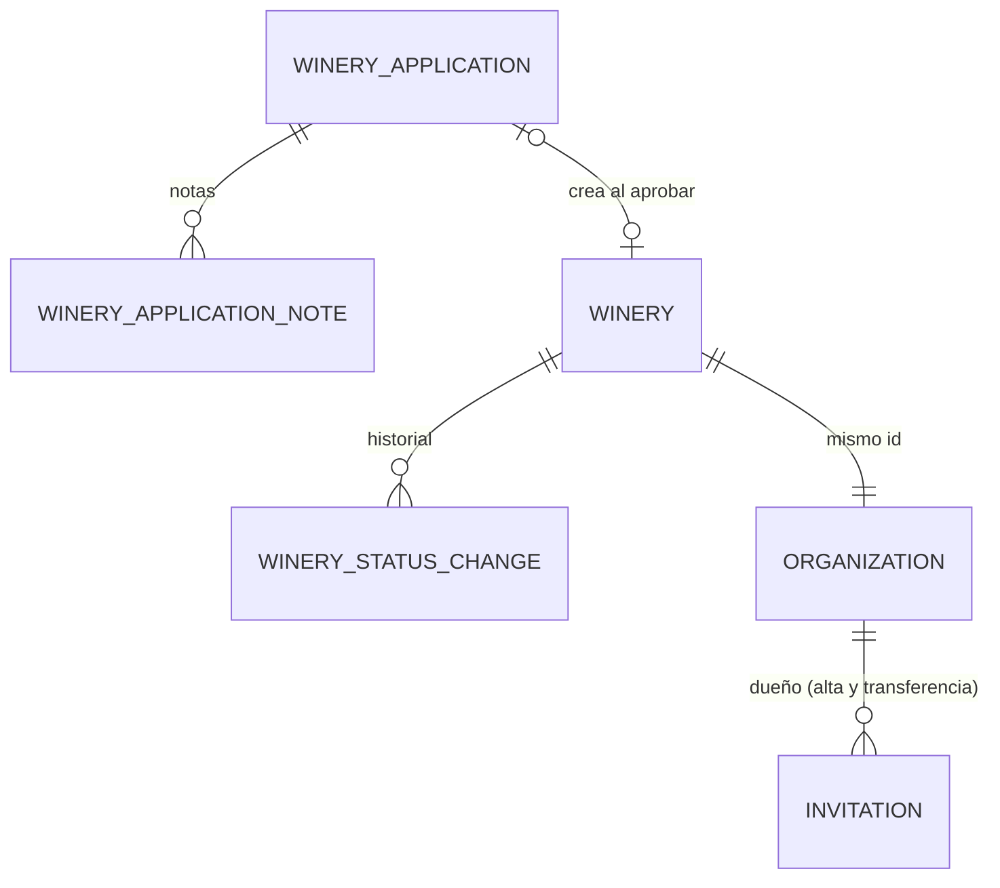
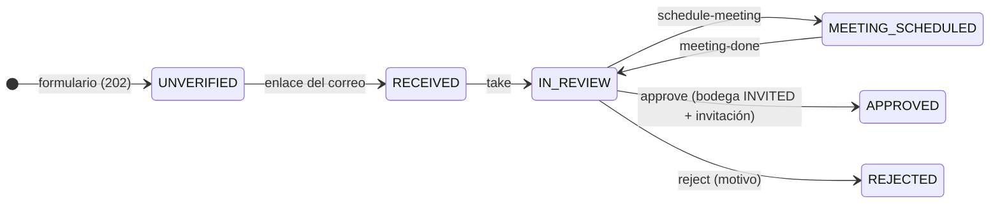

# Solicitudes de alta, bodegas y equipo

> Ola 1 · pasos 1.3, 1.4, 1.5 y 1.6 (ORG-01…05, 07…11; EQP-02…08, 10; SE-05; CMP-02) y el cierre de 1.8 (contadores del tablero, correos y bitácora de la etapa). Contrato: `plan/contratos/o1-backoffice-y-bodegas.md` §0, §3, §4, §5, §8–§11 bis; procesos en docs-back/07 §1–§3, §10 y §11. Se apoya en la parte A (invitaciones, cuenta, TOTP) y la C (configuración, bitácora, `@RequiresReason()`, `@RequireActiveOrg()`): ver [`identidad.md`](identidad.md) y [`bitacora.md`](bitacora.md).

## Modelo

| Tabla / columna | Qué guarda |
|---|---|
| `winery_applications` | Solicitud del formulario público: estado (`UNVERIFIED`, `RECEIVED`, `IN_REVIEW`, `MEETING_SCHEDULED`, `APPROVED`, `REJECTED`), datos de la bodega y del contacto, SHA-256 del enlace de verificación (se borra al usarlo) y su caducidad (72 h), IP del envío, persona asignada (id y nombre), reunión (fecha, canal `CALL`/`VIDEO`/`IN_PERSON`, notas), decisión (quién, cuándo, motivo) y la bodega creada al aprobar |
| `winery_application_notes` | Notas internas de operaciones (también las de la reunión hecha), con el nombre de quien las escribió |
| `winery_status_changes` | Historial de estados de cada bodega (`statusHistory` de la ficha): estado, fecha, quién (id y nombre; `Sistema` en los anteriores a la Ola 1) y motivo |
| `wineries.slug` | Ruta pública `/v1/public/wineries/{slug}`: única y estable (no cambia al renombrar) |
| `wineries.lot_prefix` | Prefijo del código de lote (ORG-05): 3–5 letras mayúsculas (`CHECK`), **único** y definitivo; se asigna al activarse |
| `wineries.activated_at`, `public_story`, `website` | Primera activación, historia y web del perfil público |

### Migración `20260927170000_o1_solicitudes_bodegas_equipo`

Aditiva, con datos (probada sobre una copia con bodegas en todos los estados, nombres repetidos y códigos de lote que chocan):

- `slug` de todas las bodegas (nombre comercial sin tildes ni "bodega"; `-2`, `-3`… si se repite; las más antiguas primero).
- `lot_prefix` de las bodegas activas o suspendidas y de las que ya embotellaron: **primero el que ya usan en sus códigos de lote** (`ALT-2026-…` → `ALT`); si otra bodega lo tiene (las que más embotellaron eligen primero), el derivado del nombre. `activated_at` = `approved_at` (o el alta).
- Historial inicial: `INVITED` en el alta y el estado actual, por `Sistema`.

## Solicitudes de alta (§3)

Cualquier otra transición → 409 `APPLICATION_INVALID_TRANSITION` (`src/modules/winery-applications/application-transitions.ts`, la misma tabla que los mocks). Los cambios se escriben con `UPDATE … WHERE status = <leído>`: dos personas a la vez no pisan la misma solicitud.

| Ruta | Quién | Notas |
|---|---|---|
| `POST /v1/public/winery-applications` | Público | Campos de alta + `captchaToken` + `website` (trampa). **Siempre 202** `{ id, status: 'UNVERIFIED' }`. Captcha → 422 `CAPTCHA_INVALID`. Sin crear nada (202 con un id cualquiera): campo trampa relleno; más de 3 envíos por correo o 10 por IP en una hora; **NIT de una bodega existente o de una solicitud abierta** (aviso a operaciones `solicitud-duplicada-operaciones`, bitácora `WINERY_APPLICATION_DUPLICATE_TAX_ID`). Reenviar la misma solicitud (mismo NIT y correo) sin verificar la actualiza con un enlace nuevo. Límite por IP y minuto: `RATE_LIMIT_APPLICATION_PER_MINUTE` (5) |
| `POST /v1/public/winery-applications/verify` `{ token }` | Público | 204; `RECEIVED`, correo `solicitud-recibida` al contacto y `solicitud-nueva-operaciones` a administración y operaciones. Token desconocido, usado o caducado → 422 `APPLICATION_TOKEN_INVALID` en `token` |
| `GET /v1/platform/winery-applications?status=&q=&assigneeId=` | Todo el personal de plataforma | Más recientes primero, sin `notes`; sin `status` excluye las `UNVERIFIED`. `q`: razón social, nombre, NIT, contacto, región |
| `GET /v1/platform/winery-applications/{id}` | Igual | Detalle con `notes` |
| `POST …/{id}/take` | `SUPERADMIN`, `ADMIN`, `OPERATIONS` | Solo desde `RECEIVED` |
| `POST …/{id}/notes` `{ text }` | Igual | En cualquier estado salvo `UNVERIFIED` |
| `POST …/{id}/schedule-meeting` `{ scheduledAt, channel, notes? }` | Igual | `scheduledAt` ISO 8601 con zona |
| `POST …/{id}/meeting-done` `{ notes }` | Igual | Las notas quedan en la reunión y como nota |
| `POST …/{id}/approve` `{ ownerEmail?, ownerFullName?, reason? }` | Igual | En **una** transacción: NIT libre (si no, 409 `ORG_TAX_ID_TAKEN`), bodega `INVITED` (`slug`, organización, historial, `WINERY_CREATED`), invitación `OWNER` (`InvitationsService.create(…, tx)` con `purpose: OWNER_ONBOARDING`; por defecto el contacto), solicitud `APPROVED` y correo `solicitud-aprobada`. Responde `{ application, winery, invitation }` |
| `POST …/{id}/reject` `{ reason }` | Igual (`@RequiresReason()`) | Correo `solicitud-rechazada` con el motivo |

Soporte lee (403 `AUTH_INSUFFICIENT_PERMISSIONS` al escribir); los roles salen de la matriz de `permissions.ts` (`applications`).

## Bodegas (§4)

| Ruta | Quién | Notas |
|---|---|---|
| `POST /v1/platform/wineries` | `SUPERADMIN`, `ADMIN`, `OPERATIONS` | Alta directa: 201 `{ winery, invitation }` en una transacción, como al aprobar. NIT tomado → 409 `ORG_TAX_ID_TAKEN`; registro SENASAG de otra → 409 `CONFLICT` |
| `GET /v1/platform/wineries?status=&region=&category=&q=` | Todo el personal de plataforma | `WinerySummary` por nombre comercial; `region` y `q` (razón social, nombre, NIT, slug) parciales |
| `GET /v1/platform/wineries/{id}` | Igual | `WineryDetail` con `statusHistory`; inexistente → 404 `ORG_NOT_FOUND` |
| `PATCH /v1/platform/wineries/{id}` | `SUPERADMIN`, `ADMIN`, `OPERATIONS` (`@RequiresReason()`) | Todo el perfil, datos legales incluidos; `null` vacía un opcional; bitácora `WINERY_UPDATED` con lo que cambió |
| `POST …/{id}/suspend` · `/reactivate` | `SUPERADMIN`, `ADMIN`, `OPERATIONS` (motivo) | Desde `ACTIVE` / `SUSPENDED` |
| `POST …/{id}/revoke` | `SUPERADMIN`, `ADMIN` (motivo) | Desde `INVITED`, `ACTIVE` o `SUSPENDED`; anula sus invitaciones pendientes |
| `POST …/{id}/transfer-ownership` `{ newOwnerEmail, reason, keepPreviousOwnerAs? }` | `SUPERADMIN`, `ADMIN` | Bodega `ACTIVE`/`SUSPENDED` con dueño activo (si no, 409 `ORG_INVALID_TRANSITION` / `CONFLICT`); la dueña actual → 409 `ORG_ALREADY_MEMBER`. Invitación `OWNER` con `purpose: OWNERSHIP_TRANSFER` (anula una transferencia pendiente anterior) |
| `GET /v1/organizations/current` | Cualquier rol de la bodega activa | `WineryDetail`; también con la bodega `SUSPENDED` |
| `PATCH /v1/organizations/current` | Dueño, bodega `ACTIVE` | Sin NIT ni razón social (422 si llegan) |
| `GET /v1/public/wineries/{slug}` | Público | `{ slug, tradeName, region, category, logoUrl, publicStory, website }` solo si `ACTIVE`; si no, 404 |

Cambio de estado inválido → 409 `ORG_INVALID_TRANSITION`. Cada cambio escribe el estado, la organización (mismo estado), el historial, el correo `bodega-estado` al dueño y la bitácora (`WINERY_SUSPENDED`, `WINERY_REACTIVATED`, `WINERY_REVOKED`) en una transacción; **después** se revocan las sesiones con la bodega activa (`ORGANIZATION_SUSPENDED` / `ORGANIZATION_REVOKED`). Tras una suspensión, el dueño vuelve a entrar y ve la bodega `SUSPENDED` (403 en el ERP salvo el perfil y la bitácora propia).

### Activación y prefijo de lote (ORG-05)

`WineryManagementService` registra un gancho `InvitationsService.onAccepted` que corre **en la transacción de la aceptación**:

- `OWNER_ONBOARDING` con la bodega `INVITED`: prefijo de lote (`ensureLotPrefix`, bajo `pg_advisory_xact_lock`), `ACTIVE`, `activated_at`, historial por el dueño, evento `winery.activated` en el outbox (cola `chain`; el worker lo registra: la identidad en la red llega en la Ola 3) y bitácora `WINERY_ACTIVATED` con el dueño como actor. Una bodega que ya no está `INVITED` no se toca.
- `OWNERSHIP_TRANSFER`: la persona nueva ya es `OWNER` (lo escribe la aceptación); la anterior pasa a `ENOLOGIST` y, con `keepPreviousOwnerAs: BLOCKED` (por defecto), queda bloqueada por la plataforma. Bitácora `WINERY_OWNERSHIP_TRANSFERRED`. El gancho devuelve una función que la aceptación ejecuta **al confirmar**: revoca las sesiones de la persona anterior con la bodega (`OWNERSHIP_TRANSFERRED`).

Prefijo (`src/modules/wineries/winery-identity.ts`, mismo criterio que los mocks y la migración): iniciales de las palabras significativas del nombre comercial (sin artículos ni "bodega", "viñedos", "casa"…), completadas con letras de la última hasta 3 (`Altos del Sur` → `ASU`); si está tomado, 4 y 5 letras (`ASUO`, `ASUOS`) y, por último, las dos primeras con otra letra final. Nunca cambia (columna única; ningún flujo la reescribe).

**Embotellado**: el código internacional de lote usa el prefijo (`ASU-2026-WINE-001`) en lugar de las tres primeras letras del nombre, lo que cierra la colisión de prefijos de **EA-07**. Una bodega activa sin prefijo (creada fuera de estos flujos) recibe el suyo al embotellar. La **secuencia sin carreras** (contador por bodega y año, en vez de contar los lotes) queda para la Etapa 2 (EA-07).

## Bodega no activa en el ERP (SE-05)

`FEATURE_ENFORCE_ACTIVE_ORG` pasa a **activo por defecto** (`false` lo deja en aviso). Toda ruta con `@RequireActiveOrg()` y la bodega activa en otro estado → 403 `ORG_NOT_ACTIVE` con `details: [{ field: null, message: 'SUSPENDED' | 'REVOKED' | 'INVITED' }]`. Admiten `SUSPENDED`: `GET /v1/organizations/current`, `GET /v1/organizations/current/audit` y `GET /v1/wineries/my`. El personal de plataforma no se ve afectado. Se aplica a todo el ERP (parcelas, vendimia, cubas, crianza, destilación, embotellado, laboratorio, configuración efectiva, equipo e invitaciones de la bodega y `PATCH /v1/wineries/my`).

## Equipo (§5)

| Ruta | Quién | Notas |
|---|---|---|
| `GET /v1/organizations/current/members?status=&role=` | Cualquier rol de la bodega activa (`ACTIVE`) | El dueño ve todo; los demás, solo los miembros activos (`lastLoginAt: null`) |
| `PATCH /v1/organizations/current/members/{membershipId}` `{ role }` | Dueño | |
| `POST …/members/{membershipId}/block` · `/unblock` `{ reason? }` | Dueño | |
| `GET /v1/platform/organizations/{organizationId}/members` | `SUPERADMIN`, `ADMIN`, `OPERATIONS`, `SUPPORT` | Con `accountStatus` y `accountBlockedReason` (§11 bis). Solo bodegas (si no, 404 `ORG_NOT_FOUND`) |
| `PATCH` · `block` · `unblock` de la plataforma | Igual (`@RequiresReason()`) | Bloqueo `blockedBy: PLATFORM`; aviso `aviso-equipo` al dueño salvo que sea el afectado (EQP-10) |

Reglas (`TeamService`): membresía de otra organización → 404; nadie se cambia ni se bloquea a sí mismo → 403 `ORG_CANNOT_MODIFY_SELF`; `OWNER` no se asigna ni se quita → 403 `ORG_OWNER_ROLE_RESERVED` (transferencia); el dueño no desbloquea lo que bloqueó la plataforma → 403 `ORG_BLOCKED_BY_PLATFORM`; ya bloqueado / no bloqueado → 409 `CONFLICT`. **Bloquear** y **cambiar el rol** revocan al confirmar las sesiones de la persona con esa bodega (`MEMBERSHIP_BLOCKED`, `ROLE_CHANGED`: el rol viaja en el acceso). **Desbloquear** respeta el límite de colaboradores (`equipo.maxColaboradoresPorBodega`: miembros activos, dueño incluido, + invitaciones pendientes) bajo el mismo candado que las invitaciones → 422 `ORG_MEMBER_LIMIT_REACHED`. Bitácora `MEMBER_ROLE_CHANGED`, `MEMBER_BLOCKED`, `MEMBER_UNBLOCKED` (con `actor.viaPlatform` y el motivo).

**Operario y parcelas** (§11 bis): `OPERATOR` lee `GET /v1/terroirs` y `GET /v1/terroirs/{id}` para elegir la parcela del pesaje; no las crea ni edita.

## Correos (§10, CMP-02)

Plantillas en `src/modules/mail/templates/organizations.ts` (marco común de `layout.ts`), encoladas en la transacción de la acción:

| Plantilla | A quién | Cuándo |
|---|---|---|
| `solicitud-verificar` | Contacto | Formulario enviado (enlace `APP_URL_BODEGAS/unirse/verificar?token=`, 72 h) |
| `solicitud-recibida` | Contacto | Correo verificado |
| `solicitud-nueva-operaciones` | Administración y operaciones activas | Correo verificado (enlace al Backoffice `/solicitudes/{id}`) |
| `solicitud-duplicada-operaciones` | Igual | Formulario con un NIT ya registrado |
| `solicitud-aprobada` / `solicitud-rechazada` | Contacto | Aprobar / rechazar (con el motivo) |
| `invitacion` | Dueño | Alta y transferencia (parte A) |
| `bodega-estado` | Dueño | Suspender, reactivar, revocar (con el motivo) |
| `aviso-equipo` | Dueño | Cambio de rol, bloqueo o desbloqueo hecho por la plataforma |

## Rutas retiradas en H1 (§11)

Se marcaron `deprecated` durante la Ola 1 (con `Deprecation: true`, `Link` y aviso en los logs) y se **borraron al cerrarla**: ahora responden 404. Ni el ERP ni el Backoffice en `dev` las usaban.

| Ruta retirada | Sustituta |
|---|---|
| `POST /v1/auth/signup` con `userRole` (registro de personal) | Solicitud de alta o invitación; `signup` queda para consumidores (`userRole` → 422) |
| `POST /v1/wineries` (autoinscripción) | `POST /v1/public/winery-applications`, `POST /v1/platform/wineries` |
| `GET /v1/wineries/pending`, `POST /v1/wineries/{id}/approve` · `/reject` | `/v1/platform/winery-applications/*`, `/v1/platform/wineries/{id}/revoke` |
| `GET /v1/wineries/my/members`, `POST /v1/wineries/my/members` · `/create` | `/v1/organizations/current/members`, `/v1/organizations/current/invitations` |

Siguen `GET /v1/wineries` (directorio de plataforma) y `GET`/`PATCH /v1/wineries/my` (perfil de 0.1 que el ERP aún lee). Con las rutas se fueron su código (DTOs, `OnchainProducerHook` simulado, `WineryMemberRepository`) y el código de error `WINERY_NOT_PENDING`. Los procesadores de `winery.created` y `member.added` del worker se conservan para vaciar eventos antiguos del outbox, aunque ya nada los emite. `DeprecatedRoute` queda disponible para próximas retiradas.

## Pruebas

- Unitarias: `src/modules/wineries/__tests__/winery-identity.spec.ts` (slug y prefijo), `src/modules/winery-applications/__tests__/application-transitions.spec.ts`, `src/modules/winery-management/__tests__/winery-management.service.spec.ts` (activación, transferencia, transiciones), `src/modules/team/__tests__/team.service.spec.ts` (reglas del equipo), `src/shared/decorators/__tests__/deprecated-route.spec.ts`, tablero con Prisma.
- e2e (`test/organizations-o1.e2e-spec.ts`, Postgres, Redis y Mailpit): formulario → verificación con el enlace leído de Mailpit → tomar → reunión → aprobar → el dueño acepta con cuenta nueva → `ACTIVE` con prefijo y `winery.activated` → ERP y perfil público; rechazo con motivo; campo trampa y NIT repetido; alta directa; editar con motivo; suspender (sesión revocada, 403 `ORG_NOT_ACTIVE`, perfil y bitácora legibles), reactivar, revocar; transferir con `ENOLOGIST` y `BLOCKED`; equipo del dueño y del back office con todas las reglas, límite al desbloquear y aviso al dueño; 403 por rol y 404 entre organizaciones; el operario lee parcelas pero no las crea; bodega `INVITED` → 403. `test/seed.e2e-spec.ts` comprueba las solicitudes y los perfiles de la semilla.
