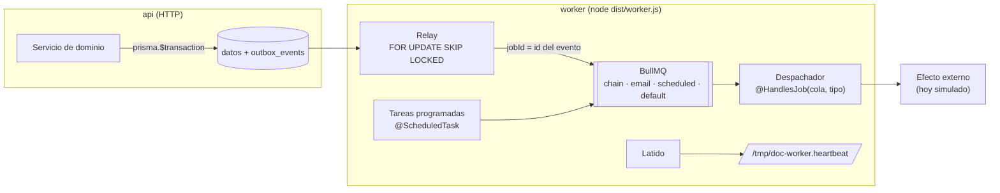

# Outbox, worker y colas

> Ola 0 · paso 0.4 (OPS-04, OPS-05, OP-01; ADR-005). Sustituye la "doble escritura" de `docs/rules/` (ajuste A-33).

## Por qué

Una operación que escribe en PostgreSQL y además llama a algo externo (red, correo, banco) puede quedar a medias: la base se confirma y la llamada falla, o al revés. Con el **outbox transaccional** la operación solo escribe en la base, incluido un evento en `outbox_events`, dentro de **una** transacción. Otro proceso publica después ese evento en una cola y un procesador hace el efecto externo, con reintentos.

- Si la transacción se revierte, el evento no existe: nunca se hace un efecto de algo que no ocurrió.
- Si se confirma, el evento se publicará aunque Redis o el worker estén caídos en ese momento.
- La API no espera a la red ni al correo.

## Piezas



| Pieza | Archivo | Qué hace |
|---|---|---|
| `OutboxEvent` | `prisma/schema.prisma` | Tipo, agregado e id, cola, carga JSON, `correlationId`, estado `PENDING → PROCESSING → DONE / FAILED`, intentos, próximo intento, último error y fechas |
| `OutboxService.add(tx, evento)` | `src/shared/outbox/outbox.service.ts` | Escribe el evento **solo** con el cliente de una transacción (rechaza el cliente raíz). Toma el `correlationId` de la petición en curso |
| Relay | `src/worker/outbox-relay.service.ts` | Cada `OUTBOX_RELAY_INTERVAL_MS` reclama un lote con `FOR UPDATE SKIP LOCKED` (dos relays nunca toman el mismo evento), publica cada evento en su cola con `jobId` = id del evento y lo marca `DONE`. Si publicar falla, vuelve a `PENDING` con espera `OUTBOX_RETRY_BASE_MS · 2^(intento−1)` (tope `OUTBOX_RETRY_MAX_MS`) y pasa a `FAILED` tras `OUTBOX_MAX_ATTEMPTS`. Un evento en `PROCESSING` más de `OUTBOX_LOCK_TIMEOUT_MS` (relay muerto a mitad) se vuelve a reclamar |
| Colas | `src/shared/queue/queue.constants.ts`, `src/worker/queue-registry.service.ts` | `chain`, `email`, `scheduled`, `default`; cada trabajo con `JOB_ATTEMPTS` intentos y backoff exponencial (`JOB_BACKOFF_MS`); completados 24 h, fallidos 7 días |
| Despachador | `src/worker/job-dispatcher.service.ts` | Un `Worker` de BullMQ por cola; despacha por nombre al procesador `@HandlesJob(cola, nombre)`. Un trabajo sin procesador falla sin reintentos |
| Tareas programadas | `src/worker/job-scheduler.service.ts` | Registra los `@ScheduledTask` como *job schedulers* de BullMQ (cron en UTC o cada N ms) y borra los que ya no existen. Ejemplo: `outbox.cleanup` (cada hora, minuto 17) borra los `DONE` de más de `OUTBOX_RETENTION_DAYS` |
| Latido | `src/worker/heartbeat.service.ts`, `src/worker-healthcheck.ts` | Cada `WORKER_HEARTBEAT_INTERVAL_MS` comprueba Postgres, Redis, el relay y los workers y, si todo está bien, reescribe `WORKER_HEARTBEAT_FILE`. El healthcheck del contenedor exige que tenga menos de `WORKER_HEARTBEAT_MAX_AGE_MS` |
| Logs | `src/shared/logging/json-logger.ts` | JSON de una línea con `service: "worker"` y el `correlationId` del evento (el `X-Correlation-ID` de la petición que lo originó) |

## Garantías y lo que no garantiza

- **Entrega al menos una vez.** El `jobId` evita duplicar el trabajo si el mismo evento se publica dos veces, y `SKIP LOCKED` evita que dos relays lo tomen a la vez; aun así, un procesador puede ejecutarse más de una vez (reintentos de BullMQ, relay muerto tras publicar y antes de marcar `DONE`). **Todo procesador debe ser idempotente**, y lo que mueve valor comprueba antes su propio estado (p. ej. `tx_hash` ya registrado, `docs/rules/08`).
- `DONE` significa "publicado en la cola", no "efecto hecho". Los trabajos que agotan sus reintentos quedan en la lista de fallidos de BullMQ (7 días) y en el log con nivel `error`.
- Sin orden global: los eventos se reclaman por `next_attempt_at` y fecha de creación, pero se procesan en paralelo.
- Los `FAILED` del outbox se conservan (la limpieza solo borra `DONE`) para revisarlos; reencolarlos a mano: `UPDATE outbox_events SET status='PENDING', attempts=0, next_attempt_at=now() WHERE id=…`.

## Operaciones de varios pasos (OP-01)

`createWinery` (bodega + membresía de dueño + billetera + claves de la bodega) y `createAndAddMember` (usuario + billetera + membresía) corren en `prisma.$transaction` y escriben en la misma transacción los eventos `winery.created` y `member.added` (cola `chain`). Sus procesadores (`src/modules/wineries/jobs/`) hacen el efecto externo del alta de la bóveda (`IWalletProvider.activateCustodialVault`, simulado hasta la Ola 3). Las respuestas de la API no cambian: la dirección se genera en local dentro de la transacción, como hará la derivación de direcciones de la Ola 3.

Los repositorios y `WalletsService` aceptan un `tx` opcional para participar en la transacción de quien los llama.

## Eventos y tareas de los lotes (Ola 2)

Procesadores en `src/modules/lots/jobs/` ([trazabilidad](trazabilidad.md#códigos-de-botella-paso-26)):

| Trabajo | Cola | Qué hace |
|---|---|---|
| `trace.bottle-codes.export` | `default` | Lo escribe `POST /v1/lots/{id}/bottle-codes/exports` junto a la fila `PENDING` de `bottle_code_exports`. Genera el ZIP para la imprenta (CSV + un QR por código) en el almacenamiento privado y deja la fila `READY`; idempotente; en el último intento fallido (`JOB_ATTEMPTS`), `FAILED` |
| `trace.bottle-codes.exports-cleanup` | `scheduled` | Cada hora (minuto 41): borra del almacenamiento los ZIP caducados (7 días) |
| `lot.certified` | `chain` | Lo escribe el cierre del expediente con la huella del lote. Hoy solo deja constancia; la Ola 3 lo usará para anclar el hash |

El contrato O2 §15 nombra una cola `exports` para la primera tarea; mientras no exista como cola propia, va por `default`.

## Cómo añadir un evento y su procesador

1. En el servicio, dentro de la transacción:
   ```ts
   await this.prisma.$transaction(async (tx) => {
     const order = await tx.order.update({ … });
     await this.outbox.add<OrderPaidPayload>(tx, {
       type: 'order.paid',          // dominio.hecho_en_pasado
       aggregateType: 'order',
       aggregateId: order.id,
       queue: QUEUE_CHAIN,          // chain · email · scheduled · default
       payload: { orderId: order.id }, // identificadores, sin secretos ni PII innecesaria
     });
   });
   ```
   Importa `OutboxModule` en el módulo. La carga es un `type` (no `interface`) para que encaje con el JSON de Prisma.
2. El procesador, en `src/modules/<modulo>/jobs/`:
   ```ts
   @Injectable()
   @HandlesJob(QUEUE_CHAIN, 'order.paid')
   export class OrderPaidHandler implements JobHandler<OutboxJobData<OrderPaidPayload>> {
     async handle(data: OutboxJobData<OrderPaidPayload>, ctx: JobContext) { … } // idempotente
   }
   ```
3. Un módulo `<modulo>-jobs.module.ts` con los procesadores y sus dependencias, añadido a `JOB_MODULES` en `src/worker/worker.module.ts`. La API no carga esos módulos.
4. Una tarea programada es igual con `@ScheduledTask({ name, pattern: '0 3 * * *' })` o `{ name, every: 60_000 }` en lugar de `@HandlesJob`.
5. Pruebas: unitarias del procesador y, si toca la base, un e2e como `test/worker.e2e-spec.ts`.

## Variables

Ver `.env.example` (bloque "Worker"). Ninguna es obligatoria salvo `DATABASE_URL` y `REDIS_URL`; el worker no necesita los secretos de JWT ni CORS.

## Despliegue

Misma imagen que la API con `node dist/worker.js` (servicio `worker` en `docker-compose.yml`, perfil `app`, y en `deploy/dev/compose.yml`). Arranca cuando la API está sana (la API aplica las migraciones), no aplica migraciones, no publica puertos, tiene su propio healthcheck (`node dist/worker-healthcheck.js`) y 30 s de gracia al parar: deja de declararse sano, deja de reclamar eventos, espera a los trabajos en curso y cierra conexiones. `deploy.sh` espera a que la API **y** el worker estén sanos antes de dar el despliegue por bueno.
