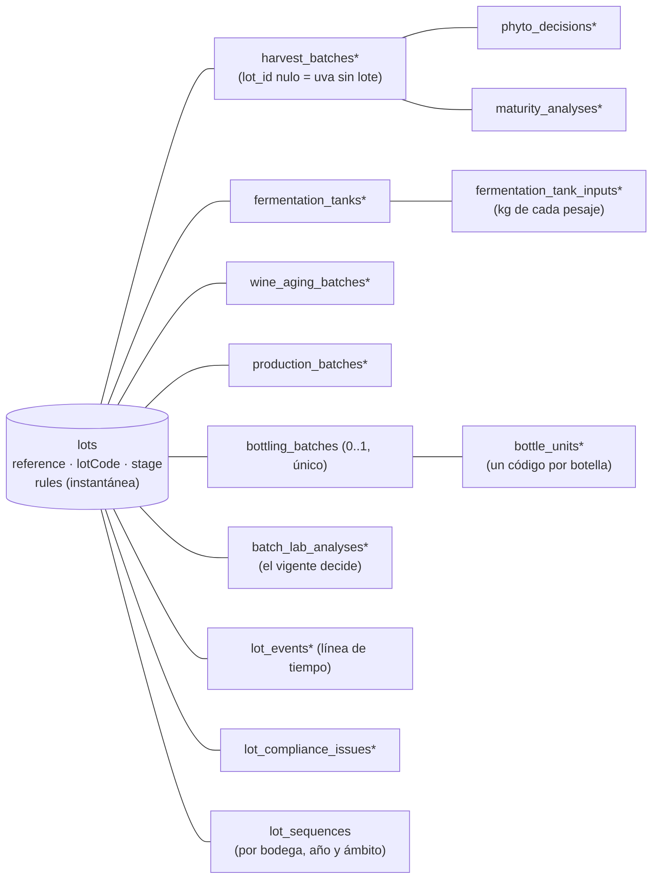

# Trazabilidad confiable: el lote del servidor

> Ola 2 · apertura (O2-BE-1; contrato `plan/contratos/o2-erp-confiable.md` §0–§2, §13, §14, §16, §20; docs-back/01 §9.1 EA-01…EA-08 y SE-07; docs-back/08 §5). Esta página describe lo que ya está en `dev`: el modelo del lote, la instantánea de reglas, la migración de los datos anteriores y los cierres de seguridad. Lo que el contrato publica pero aún no tiene lógica responde **501 `NOT_IMPLEMENTED`** (ver [Rutas](#rutas)).

## Modelo

Antes de la Ola 2 la trazabilidad era una cadena sin raíz (`Terroir → HarvestBatch → FermentationTank → WineAgingBatch | ProductionBatch → BottlingBatch → BatchLabAnalysis`) y el ERP derivaba un "lote" en el cliente (`LotView`). Ahora el **lote es una entidad del servidor** que agrupa la cadena:



| Tabla | Qué guarda |
|---|---|
| `lots` | Referencia interna `{lotPrefix}-L{año}-{NNN}` (desde la creación), código de lote de la etiqueta (`lotCode`, al embotellar), nombre, `productType` (`WINE`/`SINGANI`, nulo hasta decidirse), `stage` calculada, añada, estimación de botellas, formato y grado previstos, fecha objetivo, parcelas previstas, **`rules`** (instantánea) con `rules_origin` (`LOT_CREATION`/`MIGRATION`), descarte con motivo y autor |
| `lot_events` | Línea de tiempo (§11.1): un evento por escritura, en la misma transacción, con `seq` consecutivo por lote (la fila del lote está bloqueada), `occurred_at` (la fecha del hecho) y `recorded_at`, etapa tras el evento, actor (membresía), resumen, datos con unidad, recurso y visibilidad (`PUBLIC`/`INTERNAL`). Las lecturas de fermentación se agrupan en un evento por tanque y día |
| `lot_sequences` | Secuencias por bodega, año y ámbito (`HARVEST`, `LOT_CODE`, `LOT_REFERENCE`) |
| `phyto_decisions` | Dictámenes fitosanitarios (solo inserción; el estado del pesaje es el del último) con autor, informe (`key`) y origen (`ERP`/`MIGRATION`) |
| `maturity_analyses` | Análisis de madurez (Brix, pH, acidez) separados del pesaje; el último por fecha de medición es el vigente y se refleja en el pesaje |
| `fermentation_tank_inputs` | Kilos de cada pesaje que entran a un tanque (`availableKg` = neto − entradas) |
| `bottle_units` | Código de botella (8 caracteres Crockford: 7 aleatorios + control Luhn mod 32), serie, estado (`ACTIVE`/`VOIDED`), sal de la hoja Merkle |
| `lot_compliance_issues` | Incidencias de cumplimiento (`MIGRATION`, `CORRECTION`, `RULES_REEVALUATION`) con `details` ampliados; una abierta bloquea el embotellado |
| `bottle_code_exports`, `trace_corrections`, `lot_attachments`, `lot_dossiers` | Creadas en la apertura para los pasos 2.6–2.9 (sin lógica todavía) |
| `lot_backfill_pending` | Cola del relleno de la migración (ver [Migración](#migración-de-los-datos-anteriores-26)) |

Columnas nuevas (todas nulas o con valor por defecto) en la cadena actual: `lot_id` en pesajes, tanques, crianzas, destilaciones, embotellados (única: **un embotellado por lote**) y análisis; `created_by_membership_id` (autoría real, `TraceActor`); `terroir_snapshot` del pesaje; `final_volume_liters` del tanque; `start_date`, `container_count` y descarte de la crianza; cortes (`heads/heart/tails/vinasse_liters`, `heart_abv_percent`) y descarte de la destilación; `available_liters`, remanente y `label_design_key` del embotellado; `methanol_mg_100ml_aa`, `conformity`, `conformity_status`, `superseded_at` y `laboratory_report_key` del análisis. Brix, pH y acidez del pesaje pasan a ser **nulos** sin análisis.

Dos restricciones únicas se relajan: el código de vendimia es único **por bodega** (su secuencia es por bodega) y un embotellado admite **varios análisis** (reanálisis: el nuevo sustituye al anterior, sin 409).

Los actores se guardan por su membresía (`*_membership_id`, sin clave foránea, como en la bitácora) y se resuelven a `TraceActor { membershipId, userId, fullName, role }`; `null` = sistema o no registrado (datos anteriores). Las claves foráneas nuevas son `Restrict`; las antiguas `Cascade` pasan a `Restrict` en el cierre de la ola (H2), junto con `lot_id NOT NULL` (salvo en pesajes).

El código vive en `src/modules/lots/`: `domain/` (reglas puras y probadas: D.O., laboratorio, candados, balance, códigos de botella, etapa, fechas en La Paz), `lot-records.ts` (crear y bloquear lotes, recalcular la etapa), `bottling-engine.ts` (reglas del embotellado), `lot-backfill.ts` (relleno), `chain.ts` (destino, D.O. y volumen de la cadena) y `contract/` (rutas del contrato con 501).

## Instantánea de reglas (CFG-06)

Al crear el lote se guarda `SettingsService.snapshot(wineryId)` (parámetros `appliesAt: 'LOT'`, **leídos de la base**, con la excepción legal de A-31) como `LotRules`:

```ts
{ takenAt, origin: 'LOT_CREATION' | 'MIGRATION',
  singani: { minAltitudeMasl, requiredVarieties, minRestDays },
  wine: { minAgingMonths }, phytosanitary: { requireApproved },
  bottling: { maxLossPercent }, lab: { limits },
  legalExceptions, sources, values }
```

Todas las validaciones del lote usan **esa** instantánea aunque la configuración cambie después: un cambio en el back office solo afecta a los lotes creados después (probado en e2e). La instantánea no se edita nunca. La aptitud D.O. de las **parcelas** (que no pertenecen a un lote) usa los valores **efectivos** de la bodega (`rulesSource: EFFECTIVE_SETTINGS`).

## Etapa del lote (§2.2)

La calcula el servidor a partir de los registros (`deriveLotStage`); ninguna ruta la fija salvo el descarte: `ORIGIN` (sin pesajes) → `HARVEST` → `FERMENTING` (algún tanque) → `AGING` (crianza) o `DISTILLING`/`RESTING` (destilaciones abiertas/cerradas) → `BOTTLED` → `CERTIFIED` (expediente cerrado, paso 2.8) → `ANCHORED` (Ola 3). `REJECTED` (todos los pesajes rechazados y ninguno en un tanque) y `DISCARDED` (con motivo: fuentes abiertas a `DISCARDED` y códigos de botella anulados). `REJECTED`, `DISCARDED` y `CERTIFIED` son terminales: toda escritura → 409 `TRC_LOT_TERMINAL`.

El lote nace en origen (`POST /v1/lots`), desde el pesaje (`newLot`) o desde el tanque (`newLot`). Un pesaje puede registrarse **sin lote** (uva recibida, `GET /v1/harvest-batches?lotId=none`); al llenar un tanque con uva sin lote y sin `lotId`/`newLot`, el servidor crea el lote del tanque (compatibilidad con el ERP actual, que no conoce los lotes).

## Reglas que ya no se pueden eludir

Todas se evalúan en el servidor con la instantánea del lote y el **reloj de la base de datos** (`now()` y el día en America/La_Paz), dentro de una transacción que bloquea la fila del lote (`SELECT … FOR UPDATE`).

| Hallazgo | Antes | Ahora |
|---|---|---|
| **EA-04** dictamen | `phytosanitaryStatus` en el alta del pesaje (autoaprobación); se fermentaba uva rechazada | El alta solo admite `PENDING_INSPECTION` (otro → 422 `TRC_PHYTO_IN_CREATE`). El dictamen va aparte (`POST …/phyto-decisions`, solo inserción; `APPROVED`/`REJECTED` finales; `REJECTED`/`QUARANTINE` con motivo; nada cambia con la uva en un tanque → 409 `TRC_PHYTO_DECISION_FINAL`). Un tanque exige `APPROVED` (o `PENDING` si la instantánea no lo exige; nunca `REJECTED`/`QUARANTINE`) → 422 `TRC_PHYTO_NOT_APPROVED` con un detalle por pesaje. `PATCH …/phyto-status` es un alias que ya no pisa las notas |
| **EA-01** tipo del embotellado | La estrategia se elegía con el `productType` que enviaba el cliente (`WINE` sobre una destilación no miraba el reposo) | El tipo se deriva del origen (crianza → `WINE`, destilación → `SINGANI`); uno distinto → 422 `TRC_PRODUCT_TYPE_MISMATCH`. Candados: `unlockDate ≤ hoy` (reloj de la base) **y** `≤ bottlingDate` → si no, 422 `TRC_LOCK_NOT_RELEASED` con `rule`, `unlockDate` y `daysRemaining`. Crianza: inicio + meses de calendario (≥ mínimo de la instantánea); reposo: fin de la destilación + `minRestDays` de la instantánea (no más 180 fijos); con registros anteriores manda la fecha más tardía entre la calculada y la guardada |
| **EA-02** embotellado ilimitado | Sin balance ni estados terminales | Un embotellado por lote (409 `TRC_LOT_ALREADY_BOTTLED` y restricción única `bottling_batches(lot_id)`); todas las fuentes abiertas entran o se descartan antes (`TRC_BOTTLING_SOURCES_PENDING`); balance de volumen `botellas × cL + remanente ≤ disponible + agua` (`TRC_BOTTLING_EXCEEDS_VOLUME` con `maxBottles`) y merma ≤ `maxLossPercent` (`TRC_BOTTLING_LOSS_ABOVE_TOLERANCE`); alcohol puro embotellado ≤ el del corazón con 0,5 % de tolerancia (`TRC_ALCOHOL_BALANCE_EXCEEDED`); vino sin agua (`TRC_DILUTION_NOT_ALLOWED`); incidencias abiertas bloquean (`TRC_COMPLIANCE_ISSUES_OPEN`). Fuentes a `BOTTLED`, tanques a `TRANSFERRED`, lote a `BOTTLED` y un código por botella, en la misma transacción. `blockchainDataHash` ya no se calcula (el hash válido será el del expediente) |
| **EA-03** D.O. | La destilación solo validaba si llegaba `isDoEligible: true`; la parcela declaraba su aptitud | Aptitud calculada: altitud ≥ mínimo y cepa entre las exigidas (sin mayúsculas, tildes ni espacios repetidos; sin sinónimos, P-7). Parcelas: `isDoEligible` calculado con los valores efectivos y `doEvaluation`; el valor enviado se ignora. Lote singani: la parcela del pesaje (`TRC_DO_TERROIR_NOT_ELIGIBLE`), el destino singani de un tanque y cada destilación evalúan **todos** los pesajes del lote con la instantánea (`TRC_DO_NOT_ELIGIBLE`, un detalle por regla con `expected`/`actual`). `ELIGIBLE_BY_EXCEPTION` cuando solo cumple por un valor bajo el mínimo legal autorizado (A-31). Destino coherente con el tipo del lote (`TRC_DESTINATION_MISMATCH`) |
| **EA-07** secuencias | `count + 1` y sufijo por colisión | `lot_sequences` con `INSERT … ON CONFLICT DO UPDATE … RETURNING` (bloqueo de fila); el valor nunca queda por debajo de lo que ya existe en los datos. Código de vendimia `HARV-{año}-{parcela}-{NNN}` por bodega y año; código de lote `{lotPrefix}-{año}-{WINE\|SINGANI}-{NNN}` por bodega y año, común a los productos; referencia `{lotPrefix}-L{año}-{NNN}` |
| **EA-08** laboratorio | `conformsToSenasagStandards` `true` por defecto; metanol en mg/L comparado con un límite en mg/100 mL | Conformidad calculada contra `rules.lab.limits` con unidades explícitas (`units` en la respuesta). Metanol en mg/L de producto → mg/100 mL de alcohol anhidro (`10 × mgL / grado`); si llegan ambos y difieren > 1 % → 422. Parámetros exigidos: singani (metanol, cobre, grado), vino (acidez volátil, grado); falta uno → `INCOMPLETE` (nunca conforme por omisión); unidad desconocida → `UNIT_UNKNOWN`. Aviso si el grado medido difiere > 0,5 % vol del etiquetado |
| **EA-05** (parte) grafo | Métricas fijas (12,80 %, 0,28 g/L), `isCertified: true` fijo, operadores genéricos | Solo datos registrados (métrica vacía si no hay dato), `isCertified` = expediente cerrado, operador desde la membresía o "No registrado" |
| **SE-07** grafo | `GET /traceability/dag/:id` para cualquier sesión; el pasaporte público aceptaba el id | Solo los miembros de la bodega dueña y el personal de plataforma (ADMIN, OPERATIONS, SUPPORT, SUPERADMIN); cualquier otra sesión → 404. El pasaporte legado solo por código de lote |
| **S-25** plataforma | Escribía con `?wineryId=` (contrato O0 §8) | **Solo lee** la trazabilidad (`@PlatformReadOnly()` en parcelas, vendimia, tanques, crianza, destilación, embotellado, laboratorio y lotes): escrituras → 403 `TRC_PLATFORM_READ_ONLY` |

Otras reglas del contrato activas desde la apertura: fechas no futuras (`TRC_DATE_IN_FUTURE`, 5 min de tolerancia en los instantes) ni anteriores a la etapa previa (`TRC_DATE_BEFORE_PREVIOUS_STAGE`) en pesajes, dictámenes, tanques, lecturas, tratamientos, crianzas, destilaciones y laboratorio; entradas de un solo lote por tanque (`TRC_MIXED_LOTS`), kilos ≤ disponibles y llenado ≤ capacidad; código físico del tanque ocupado hasta limpiarlo (409 `TRC_TANK_CODE_IN_USE`); lecturas y tratamientos solo en tanques activos (409 `TRC_TANK_NOT_ACTIVE`); crianza ≥ mínimo de la instantánea (`TRC_AGING_BELOW_MINIMUM`) con `volumeLiters` obligatorio ≤ lo disponible del tanque; destilación con entrada ≤ lo disponible del tanque y cortes ≤ entrada (`TRC_MASS_BALANCE_EXCEEDED`); parcela usada sin `PATCH` de altitud, cepa ni materia prima (409 `TRC_TERROIR_IN_USE`).

### Errores de reglas

Estado del recurso → **409**; regla de negocio incumplida → **422**; plataforma escribiendo → **403**. El código de la respuesta es el de la primera violación y `details` lleva **todas**, con la forma ampliada del contrato O2 §0 (aditiva sobre la de la Ola 0):

```json
{ "field": "bottlingDate", "message": "Reposo mínimo de 180 días: disponible el 2026-10-13 (faltan 16 días)",
  "code": "TRC_LOCK_NOT_RELEASED", "rule": "trazabilidad.singani.reposoMinimoDias",
  "expected": "2026-10-13", "actual": "2026-09-27",
  "meta": { "sourceId": "…", "kind": "REST", "unlockDate": "2026-10-13", "daysRemaining": 16 } }
```

El filtro global conserva `code`, `rule`, `expected`, `actual` y `meta` (`normalizeErrorDetails`); el resto de campos se descarta como antes. La lista completa de códigos está en `src/shared/exceptions/error-codes.ts` y en `docs/rules/03-formato-respuestas.md`.

## Migración de los datos anteriores (§2.6)

1. **Expandir** (`20260928090000_o2_lotes_expand`): tablas nuevas y columnas nulas; la migración **encola** cada pesaje existente en `lot_backfill_pending`.
2. **Relleno** (`LotBackfillRunner`, al arrancar la API y sin bloquear el arranque; `LOT_BACKFILL_ON_BOOT=false` lo desactiva): cada pesaje en su propia transacción con `FOR UPDATE SKIP LOCKED` (varias instancias se reparten la cola), hasta 5 intentos con `last_error`. Por pesaje (`backfillHarvestChain`, idempotente: un pesaje con lote no se toca):
   - **Un lote por pesaje** (la regla de `LotView`), id **UUID v5 de `lot:{harvestBatchId}`** en el espacio de nombres de los mocks (`6b2f4c1e-…`), nombre = código de lote si está embotellado o `'{variedad} {año}'`, `productType` derivado (destilación o tanque a singani → `SINGANI`; crianza o tanque a vino → `WINE`; si no, nulo), referencia con la secuencia nueva y `lotCode` del embotellado.
   - **Instantánea** con `origin: 'MIGRATION'` tomada al migrar.
   - **Dictamen**: cada estado distinto de `PENDING_INSPECTION` genera un `PhytoDecision` `MIGRATION` con `certifiedByMemberId` como autor. Brix, pH y acidez generan el primer `MaturityAnalysis` (salvo 0/0/0, que en los datos anteriores significaba "sin análisis").
   - **Entradas de tanque**: el neto del pesaje; con varios tanques del mismo pesaje, repartido por volumen llenado (así no se cuenta dos veces).
   - Crianza con `start_date` (su fecha de alta en La Paz); cortes de la destilación desde `additionalParams` y el grado del corazón desde `initialAlcoholPercentage`.
   - **Laboratorio**: conformidad recalculada con la instantánea (el `conformsToSenasagStandards` guardado queda como histórico).
   - **Códigos de botella** para los embotellados existentes y `qrBatchUrl` reescrita a `{PASSPORT_BASE_URL}/b/{lotCode}`.
   - Línea de tiempo con los hechos a sus fechas y una entrada de bitácora `LOT_MIGRATED` (actor sistema).
   - **Revisión de integridad**: D.O. del lote singani, dictamen de la uva en tanques, candado a la fecha del embotellado, balance de volumen y alcohol, agua en vino, volumen de la fuente, salidas del tanque por encima de su volumen, un segundo embotellado del mismo lote y fuentes abiertas en un lote embotellado. Lo que no cumple **no se borra ni se corrige solo**: queda como `ComplianceIssue` `MIGRATION` visible en el lote (y bloquea embotellar hasta corregirlo o descartar el lote).
3. Un registro anterior que aún no tenga lote (p. ej. si el relleno falló) se rellena **al vuelo** en cuanto una escritura lo necesita (`ensureHarvestLot`).
4. **Contraer** (cierre de la ola, H2): `lot_id NOT NULL` salvo en pesajes, `Restrict` en las claves antiguas y retirada de lo legado (§16.2).

Probado sobre una copia con la semilla de demostración anterior a la migración (Postgres 16): 12 pesajes → 12 lotes, 15.400 códigos de botella, 95 eventos, 10 dictámenes, 11 análisis de madurez, 3 análisis de laboratorio conformes y 4 incidencias en los datos que no cumplían (ver [Semilla](#semilla)). La e2e `traceability-o2` repite el relleno sobre datos anteriores creados a mano (incidencias `TRC_DO_NOT_ELIGIBLE` y `TRC_BOTTLING_EXCEEDS_VOLUME`) y comprueba que una segunda pasada no toca nada.

### Semilla

La semilla determinista (`pnpm seed`) rellena sus lotes con la misma función y aplica **correcciones de realismo** (`src/seed/corrections.ts`) a los fixtures de los mocks 0.3.x que incumplían las reglas nuevas, sin falsear datos:

| Registro | Corrección | Por qué |
|---|---|---|
| CVJ-2026-SINGANI-002 | Agua 620 L → 630 L | 2.140 × 75 cL = 1.605 L con solo 1.600 L disponibles (980 L de corazón + 620 L) |
| Destilación AL-02 de marzo de 2026 (TK-02) | Se retira | El tanque ya se destiló entero en 2025 y su lote se embotelló en febrero de 2026 |
| Tanque TK-07 | Se retira | Lleno con un pesaje en cuarentena |
| Crianza de CVJ-2026-WINE-003 | `READY` → `BOTTLED` | Ya estaba embotellada |

Con ellas la semilla no genera incidencias. Una base que ya tenía la semilla anterior conserva esos registros y los muestra como incidencias de la migración (así se comporta con datos reales). Los mocks v2 (O2-PK-1) deben adoptar las mismas correcciones y el id de lote `uuidv5('lot:{harvestBatchId}')`.

## Rutas

Implementadas en la apertura (con su OpenAPI y validadas contra él en e2e): `GET/POST /v1/lots`, `GET/PATCH /v1/lots/{id}`, `POST /v1/lots/{id}/discard`; `POST /v1/lots/{id}/bottling/preview` y `POST /v1/lots/{id}/bottling` (mismo motor que la ruta legada; sin `sources`, todas las fuentes abiertas del lote con todo su volumen); `POST/GET /v1/harvest-batches/{id}/phyto-decisions` y `…/maturity-analyses`; `GET /v1/harvest-batches?lotId=none`; y las rutas actuales con las reglas nuevas y los campos aditivos (`lotId`, `inputs`, `lock`, `balance`, `bottleCodes`, `conformity`, `units`…). `GET /v1/public/wineries` también responde (O2-WEB-1).

Publicadas con **501 `NOT_IMPLEMENTED`** (el `details[0].meta.step` dice el paso de la Etapa 2 que las trae): transiciones del tanque (2.3), descarte de crianza y cierre/descarte de destilación (2.4), códigos de botella y exportaciones (2.6), laboratorio por lote y correcciones (2.7) y expediente (2.8). La línea de tiempo, el grafo, el balance, el panel, los reportes, los adjuntos (2.9) y el pasaporte público (2.10) ya tienen lógica: ver la sección siguiente.

## Vistas del lote y pasaporte público (pasos 2.9 y 2.10)

Código en `src/modules/lots/views/` (vistas y archivos), `src/modules/lots/passport/` (pasaporte) y `domain/lot-balance.ts`, `domain/merkle.ts` (funciones puras con sus pruebas). Contrato O2 §11 y §12.

### Vistas (§11)

| Ruta | Quién | Qué devuelve |
|---|---|---|
| `GET /v1/lots/{id}/timeline` | Los cinco roles; plataforma | Eventos de `lot_events` por `seq` con su actor, `lateEntry` (registrado más de 7 días después del hecho, S-9), candados y fecha estimada |
| `GET /v1/lots/{id}/balance` | Todos salvo OPERATOR; plataforma | Kilos por dictamen, mosto y rendimiento (sobre los kilos que entraron a tanques), merma de fermentación, crianza o destilación (cortes, grado medio ponderado, alcohol puro), balance del embotellado y proyección de botellas (S-19) |
| `GET /v1/lots/{id}/graph` | Miembros de la bodega dueña; plataforma | Nodos y aristas con cantidades y métricas reales. **SE-07**: cualquier otra sesión (otra bodega, consumidor, punto de retiro) → 404 `TRC_LOT_NOT_FOUND`, nunca 403 |
| `GET /v1/traceability/dashboard` | Todos salvo OPERATOR; plataforma | Lotes por etapa, candados que se liberan en ≤ 14 días, alertas de fermentación (última lectura > 32 °C o 48 h sin lecturas, S-18), dictámenes pendientes, embotellados sin laboratorio, lotes listos para cerrar, incidencias abiertas y uva sin lote |
| `GET /v1/traceability/reports/production` | OWNER, ENOLOGIST, ACCOUNTANT; plataforma | Una fila por lote y totales por tipo (`WINE`, `SINGANI`, `UNDECIDED`). `format=csv`: UTF-8 con BOM, coma, CRLF y celdas seguras contra fórmulas. Más de 10 000 lotes → 422 `TRC_REPORT_TOO_LARGE` |

Lo que no está registrado **no se supone**: sin volumen final del tanque, la merma de fermentación es `null` (no cero); una métrica del grafo sin dato es `null`.

### Archivos del lote (§11.5, S-20)

`POST /v1/lots/{id}/attachments` referencia por su `key` un archivo ya subido con `POST /v1/uploads`. La clave debe ser del prefijo de la bodega (`org/{wineryId}/…`) y existir → si no, 422 `TRC_FILE_NOT_FOUND`. Al adjuntar se guardan el tipo real (firma de bytes), el tamaño y la **huella SHA-256** del archivo (lo que el expediente usa en lugar de la URL). Todo nace `PRIVATE` salvo la etiqueta (`LABEL`), que nace `PUBLIC`; publicar otro tipo de archivo es cosa de OWNER o ENOLOGIST. Con el expediente cerrado → 409 `TRC_DOSSIER_CLOSED`; lote terminal → 409 `TRC_LOT_TERMINAL`.

La lista (`GET`) incluye además los informes de dictamen y de laboratorio guardados por su `key`, cada uno con una URL firmada de 15 minutos; AGRONOMIST y OPERATOR solo ven los que adjuntaron ellos (§14).

`POST …/{attachmentId}/visibility` **no edita el adjunto** (solo inserción): añade un evento `FILE_ATTACHED` con `data.action = VISIBILITY_CHANGED` a la línea de tiempo y una entrada `ATTACHMENT_VISIBILITY_CHANGED` a la bitácora. La visibilidad vigente es la del último de esos eventos; repetir la vigente no registra nada.

### Pasaporte público (§12)

`GET /v1/public/passports/{code}` normaliza el código (§7.1) y decide: 8 caracteres Crockford con el control válido → botella; forma de código de lote → lote; cualquier otra cosa → 422 `PUB_CODE_MALFORMED` sin tocar la base. Solo hay pasaporte de lotes con código de lote (embotellados).

Qué se publica y qué no (§12.3):

- **Solo datos registrados** (EA-05): cada apartado lleva su `status` (`RECORDED`, `NOT_RECORDED`, `NOT_APPLICABLE`) y los campos sin dato van en `null`. Un vino tiene `distillation: NOT_APPLICABLE`; un singani, `aging: NOT_APPLICABLE`.
- **Roles, no personas** (S-21): la línea de tiempo lleva `actorRole`. Sus textos son **propios del pasaporte** (`publicEventSummary`), nunca el resumen interno del evento, que lleva kilos, litros, motivos y códigos internos.
- **Sin cifras internas** (S-22): ni pesos, ni volúmenes intermedios, ni dosis, ni mermas, ni notas, ni el motivo de un descarte o de una anulación. De las correcciones, cuántas y cuándo.
- La parcela es la del momento del pesaje (`terroirSnapshot`); la D.O. se evalúa con la instantánea del lote. `origin.terroirs[].region` es la región de la bodega (la parcela no guarda una propia).
- Sigue respondiendo con la bodega suspendida o revocada (`winery.active: false`), con el lote descartado (`stage: DISCARDED`) y con el código anulado (`bottle.status: VOIDED`) (S-23).
- **Expediente**: `dossier.status`, `hash` y `canonicalUrl` solo con el expediente `CLOSED`; abierto, `OPEN` y `null`. `GET /v1/public/lots/{lotCode}/dossier` devuelve los bytes canónicos tal como se guardaron (sin envoltorio), con la huella como `ETag`. La **prueba Merkle** de una botella se publica solo si reproduce la raíz guardada al cerrar (`domain/merkle.ts` prueba las construcciones habituales del árbol); si no, `merkleProof: null`.
- `GET /v1/public/lots/{lotCode}/attachments/{attachmentId}` redirige (302) a una URL firmada de corta vida, solo para adjuntos con visibilidad vigente `PUBLIC`.

Límites y caché (§12.4, PUB-05):

- **404 uniforme** `PUB_CODE_NOT_FOUND` ("Código no encontrado") para un código de botella o de lote que no existe, un expediente sin cerrar o un adjunto privado.
- **60 peticiones por minuto e IP real** para todas las rutas del pasaporte juntas y 120 para `/v1/public/wineries` (límites `passport` y `publicWineries` del `AppThrottlerGuard`). La IP es la firmada por el proxy de las apps (`X-DOC-Client-IP`).
- **Freno a la enumeración** (S-24): cada código bien formado que no existe cuenta para su IP; al superar 20 en 10 minutos (ventana fija desde el primero), todas las consultas del pasaporte de esa IP responden 429 `PUB_TOO_MANY_LOOKUPS` con `Retry-After` hasta que acaba la ventana. Los códigos mal formados (422) no cuentan. Contadores en Redis; si Redis no responde, en la memoria del proceso.
- `Cache-Control: public, max-age=60, stale-while-revalidate=600` y `ETag` (con `If-None-Match` → 304). Lote con el expediente cerrado: `max-age=3600`; el de una botella se queda en 60 s porque su código aún se puede anular (S-14). Los 404 llevan `max-age=30` y se recuerdan 30 s en Redis; 422 y 429, `no-store`.
- **Caché en Redis de 60 s** del pasaporte del lote, guardada con una marca de su estado (último `seq` de la línea de tiempo, última escritura, etapa, estado de la bodega y del expediente). Cada lectura compara la marca con una consulta ligera: cualquier evento del lote deja la entrada sin efecto, sin depender de que quien escribe avise.

## Configuración

| Variable | Uso |
|---|---|
| `PASSPORT_BASE_URL` | Base del QR: `{PASSPORT_BASE_URL}/b/{código}` (OP-06). Por defecto `APP_URL_MARKETPLACE`; si tampoco, `http://localhost:3005` |
| `LOT_BACKFILL_ON_BOOT` | `false` desactiva el relleno al arrancar (por defecto activo) |
| `API_PUBLIC_URL` | Origen público de la API para los enlaces del pasaporte (`dossier.canonicalUrl` y `publicAttachments[].url`). Vacío: rutas relativas (`/v1/public/lots/…`) que la app resuelve contra su proxy |
| `RATE_LIMIT_PASSPORT_PER_MINUTE` | Peticiones por minuto e IP en el pasaporte público (60) |
| `RATE_LIMIT_PUBLIC_WINERIES_PER_MINUTE` | Peticiones por minuto e IP en `/v1/public/wineries` (120) |
| `PASSPORT_MISS_LIMIT`, `PASSPORT_MISS_WINDOW_SECONDS` | Códigos inexistentes por IP antes del 429 `PUB_TOO_MANY_LOOKUPS` (20) y su ventana en segundos (600) |
