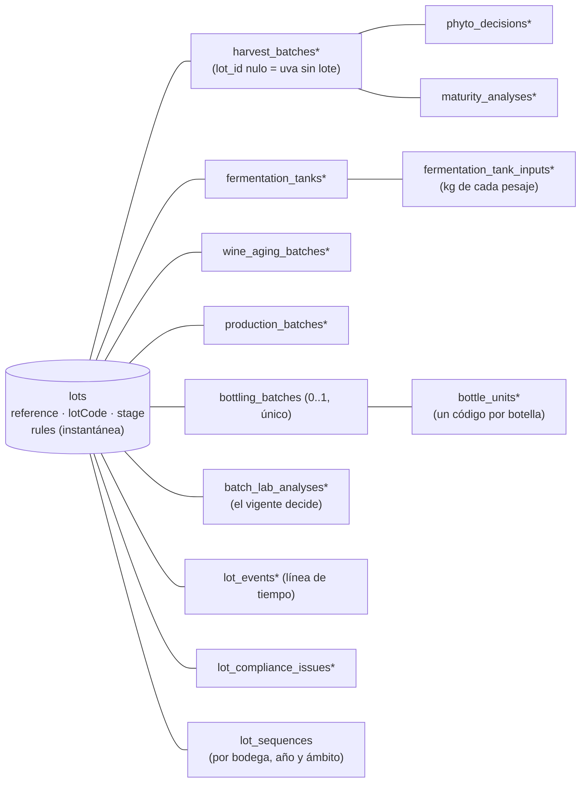

# Trazabilidad confiable: el lote del servidor

> Ola 2 · Etapa 2 completa y cerrada en H2 (O2-BE-1; contrato `plan/contratos/o2-erp-confiable.md`; docs-back/01 §9.1 EA-01…EA-08 y SE-07; docs-back/08 §5). Esta página describe lo que hay en `dev` desde `v0.2.0`: el modelo del lote, la instantánea de reglas, los cierres de seguridad, las rutas del contrato (ninguna con 501) y el [cierre H2](#cierre-h2-contracción-v020): la migración *contract* y la retirada de las rutas y los campos legados.

## Modelo

Antes de la Ola 2 la trazabilidad era una cadena sin raíz (`Terroir → HarvestBatch → FermentationTank → WineAgingBatch | ProductionBatch → BottlingBatch → BatchLabAnalysis`) y el ERP derivaba un "lote" en el cliente (`LotView`). Ahora el **lote es una entidad del servidor** que agrupa la cadena:



| Tabla | Qué guarda |
|---|---|
| `lots` | Referencia interna `{lotPrefix}-L{año}-{NNN}` (desde la creación), código de lote de la etiqueta (`lotCode`, al embotellar), nombre, `productType` (`WINE`/`SINGANI`, nulo hasta decidirse), `stage` calculada, añada, estimación de botellas, formato y grado previstos, fecha objetivo, parcelas previstas, **`rules`** (instantánea) con `rules_origin` (`LOT_CREATION`/`MIGRATION`), descarte con motivo y autor |
| `lot_events` | Línea de tiempo (§11.1): un evento por escritura, en la misma transacción, con `seq` consecutivo por lote (la fila del lote está bloqueada), `occurred_at` (la fecha del hecho) y `recorded_at`, etapa tras el evento, actor (membresía), resumen, datos con unidad, recurso y visibilidad (`PUBLIC`/`INTERNAL`). Las lecturas de fermentación se agrupan en un evento por tanque y día |
| `lot_sequences` | Secuencias por bodega, año y ámbito (`HARVEST`, `LOT_CODE`, `LOT_REFERENCE`) |
| `phyto_decisions` | Dictámenes fitosanitarios (solo inserción; el estado del pesaje es el del último) con autor, informe (`key`) y origen (`ERP`/`MIGRATION`) |
| `maturity_analyses` | Análisis de madurez (Brix, pH, acidez) separados del pesaje; el último por fecha de medición es el vigente y se refleja en el pesaje |
| `fermentation_tank_inputs` | Kilos de cada pesaje que entran a un tanque (`availableKg` = neto − entradas) |
| `bottle_units` | Código de botella (8 caracteres Crockford: 7 aleatorios + control Luhn mod 32), serie, estado (`ACTIVE`/`VOIDED`), sal de la hoja Merkle |
| `lot_compliance_issues` | Incidencias de cumplimiento (`MIGRATION`, `CORRECTION`, `RULES_REEVALUATION`) con `details` ampliados; una abierta bloquea el embotellado |
| `bottle_code_exports` | Cada exportación de códigos (CSV o ZIP): rango de series, opciones del QR, estado (`PENDING`/`READY`/`FAILED`), filas, quién la pidió, clave del ZIP en el almacenamiento privado y caducidad (ver [Códigos de botella](#códigos-de-botella-paso-26)) |
| `lot_dossiers` | Expediente cerrado del lote: `hash`, `canonical` (los bytes hasheados), raíz Merkle y número de códigos, fecha y autor del cierre (ver [Expediente](#expediente-del-lote-y-hash-canónico-paso-28)) |
| `trace_corrections`, `lot_attachments` | Creadas en la apertura para los pasos 2.7 y 2.9 |
| `lot_backfill_pending` | Cola del relleno de la apertura (ver [Migración](#migración-de-los-datos-anteriores-26)). Vacía y sin uso desde el cierre H2: se conserva una versión más porque la API anterior la consulta (un rollback de la imagen no revierte migraciones) y se retira en una ola posterior |

Columnas nuevas en la cadena anterior a la Ola 2: `lot_id` en pesajes, tanques, crianzas, destilaciones, embotellados (única: **un embotellado por lote**) y análisis — **obligatoria desde el cierre H2** salvo en el pesaje (uva recibida sin lote) —; `created_by_membership_id` (autoría real, `TraceActor`); `terroir_snapshot` del pesaje; `final_volume_liters` del tanque; `start_date`, `container_count` y descarte de la crianza; cortes (`heads/heart/tails/vinasse_liters`, `heart_abv_percent`) y descarte de la destilación; `available_liters`, remanente y `label_design_key` del embotellado; `methanol_mg_100ml_aa`, `conformity`, `conformity_status`, `superseded_at`, `laboratory_report_key` y `laboratory_report_sha256` del análisis. Brix, pH y acidez del pesaje pasan a ser **nulos** sin análisis.

Dos restricciones únicas se relajan: el código de vendimia es único **por bodega** (su secuencia es por bodega) y un embotellado admite **varios análisis** (reanálisis: el nuevo sustituye al anterior, sin 409).

Los actores se guardan por su membresía (`*_membership_id`, sin clave foránea, como en la bitácora) y se resuelven a `TraceActor { membershipId, userId, fullName, role }`; `null` = sistema o no registrado (datos anteriores). Todas las claves foráneas de la trazabilidad son `Restrict` (las de las tablas nuevas desde la apertura; las 18 de la cadena anterior que borraban o desenganchaban en cascada, desde el cierre H2): ningún registro desaparece ni pierde su origen o su autor por borrar otro.

El código vive en `src/modules/lots/`: `domain/` (reglas puras y probadas: D.O., laboratorio, candados, balance, códigos de botella, etapa, fechas en La Paz, JSON canónico, árbol Merkle, contenido del expediente, CSV, ZIP y QR), `lot-records.ts` (crear y bloquear lotes, recalcular la etapa), `bottling-engine.ts` (reglas del embotellado), `bottle-codes.service.ts` y `bottle-code-export.builder.ts` (códigos de botella), `lot-dossier.ts` y `dossier.service.ts` (expediente), `jobs/` (procesadores del worker), `chain.ts` (destino, D.O. y volumen de la cadena), `views/` y `passport/` (vistas y pasaporte público) y `contract/` (controladores de las rutas del contrato).

## Instantánea de reglas (CFG-06)

Al crear el lote se guarda `SettingsService.snapshot(wineryId)` (parámetros `appliesAt: 'LOT'`, **leídos de la base**, con la excepción legal de A-31) como `LotRules`:

```ts
{ takenAt, origin: 'LOT_CREATION' | 'MIGRATION',
  singani: { minAltitudeMasl, requiredVarieties, minRestDays },
  wine: { minAgingMonths }, phytosanitary: { requireApproved },
  bottling: { maxLossPercent }, lab: { limits },
  legalExceptions, sources, values }
```

Todas las validaciones del lote usan **esa** instantánea aunque la configuración cambie después: un cambio en el back office solo afecta a los lotes creados después (probado en e2e). La instantánea no se edita nunca. La aptitud D.O. de las **parcelas** (que no pertenecen a un lote) usa los valores **efectivos** de la bodega (`rulesSource: EFFECTIVE_SETTINGS`).

## Etapa del lote (§2.2)

La calcula el servidor a partir de los registros (`deriveLotStage`); ninguna ruta la fija salvo el descarte: `ORIGIN` (sin pesajes) → `HARVEST` → `FERMENTING` (algún tanque) → `AGING` (crianza) o `DISTILLING`/`RESTING` (destilaciones abiertas/cerradas) → `BOTTLED` → `CERTIFIED` (expediente cerrado, paso 2.8) → `ANCHORED` (Ola 3). `REJECTED` (todos los pesajes rechazados y ninguno en un tanque) y `DISCARDED` (con motivo: fuentes abiertas a `DISCARDED` y códigos de botella anulados). `REJECTED`, `DISCARDED` y `CERTIFIED` son terminales: toda escritura → 409 `TRC_LOT_TERMINAL`.

El lote nace en origen (`POST /v1/lots`), desde el pesaje (`newLot`) o desde el tanque (`newLot`). Un pesaje puede registrarse **sin lote** (uva recibida, `GET /v1/harvest-batches?lotId=none`); al llenar un tanque con uva sin lote y sin `lotId`/`newLot`, el servidor crea el lote del tanque (un tanque siempre pertenece a un lote).

## Reglas que ya no se pueden eludir

Todas se evalúan en el servidor con la instantánea del lote y el **reloj de la base de datos** (`now()` y el día en America/La_Paz), dentro de una transacción que bloquea la fila del lote (`SELECT … FOR UPDATE`).

| Hallazgo | Antes | Ahora |
|---|---|---|
| **EA-04** dictamen | `phytosanitaryStatus` en el alta del pesaje (autoaprobación); se fermentaba uva rechazada | El alta no tiene dictamen: enviar `phytosanitaryStatus` (con cualquier valor) → 422 `TRC_PHYTO_IN_CREATE`. El dictamen va aparte (`POST …/phyto-decisions`, solo inserción; `APPROVED`/`REJECTED` finales; `REJECTED`/`QUARANTINE` con motivo; nada cambia con la uva en un tanque → 409 `TRC_PHYTO_DECISION_FINAL`). Un tanque exige `APPROVED` (o `PENDING` si la instantánea no lo exige; nunca `REJECTED`/`QUARANTINE`) → 422 `TRC_PHYTO_NOT_APPROVED` con un detalle por pesaje |
| **EA-01** tipo del embotellado | La estrategia se elegía con el `productType` que enviaba el cliente (`WINE` sobre una destilación no miraba el reposo) | El tipo se deriva del origen (crianza → `WINE`, destilación → `SINGANI`) y no es un campo de la entrada. Candados: `unlockDate ≤ hoy` (reloj de la base) **y** `≤ bottlingDate` → si no, 422 `TRC_LOCK_NOT_RELEASED` con `rule`, `unlockDate` y `daysRemaining`. Crianza: inicio + meses de calendario (≥ mínimo de la instantánea); reposo: fin de la destilación + `minRestDays` de la instantánea (no más 180 fijos); con registros anteriores manda la fecha más tardía entre la calculada y la guardada |
| **EA-02** embotellado ilimitado | Sin balance ni estados terminales | Un embotellado por lote (409 `TRC_LOT_ALREADY_BOTTLED` y restricción única `bottling_batches(lot_id)`); todas las fuentes abiertas entran o se descartan antes (`TRC_BOTTLING_SOURCES_PENDING`); balance de volumen `botellas × cL + remanente ≤ disponible + agua` (`TRC_BOTTLING_EXCEEDS_VOLUME` con `maxBottles`) y merma ≤ `maxLossPercent` (`TRC_BOTTLING_LOSS_ABOVE_TOLERANCE`); alcohol puro embotellado ≤ el del corazón con 0,5 % de tolerancia (`TRC_ALCOHOL_BALANCE_EXCEEDED`); vino sin agua (`TRC_DILUTION_NOT_ALLOWED`); incidencias abiertas bloquean (`TRC_COMPLIANCE_ISSUES_OPEN`). Fuentes a `BOTTLED`, tanques a `TRANSFERRED`, lote a `BOTTLED` y un código por botella, en la misma transacción. `blockchainDataHash` ya no se calcula (el hash válido será el del expediente) |
| **EA-03** D.O. | La destilación solo validaba si llegaba `isDoEligible: true`; la parcela declaraba su aptitud | Aptitud calculada: altitud ≥ mínimo y cepa entre las exigidas (sin mayúsculas, tildes ni espacios repetidos; sin sinónimos, P-7). Parcelas: `isDoEligible` calculado con los valores efectivos y `doEvaluation`; no es un campo de la entrada (ni en parcelas ni en la destilación). Lote singani: la parcela del pesaje (`TRC_DO_TERROIR_NOT_ELIGIBLE`), el destino singani de un tanque y cada destilación evalúan **todos** los pesajes del lote con la instantánea (`TRC_DO_NOT_ELIGIBLE`, un detalle por regla con `expected`/`actual`). `ELIGIBLE_BY_EXCEPTION` cuando solo cumple por un valor bajo el mínimo legal autorizado (A-31). Destino coherente con el tipo del lote (`TRC_DESTINATION_MISMATCH`) |
| **EA-07** secuencias | `count + 1` y sufijo por colisión | `lot_sequences` con `INSERT … ON CONFLICT DO UPDATE … RETURNING` (bloqueo de fila); el valor nunca queda por debajo de lo que ya existe en los datos. Código de vendimia `HARV-{año}-{parcela}-{NNN}` por bodega y año; código de lote `{lotPrefix}-{año}-{WINE\|SINGANI}-{NNN}` por bodega y año, común a los productos; referencia `{lotPrefix}-L{año}-{NNN}` |
| **EA-08** laboratorio | `conformsToSenasagStandards` `true` por defecto; metanol en mg/L comparado con un límite en mg/100 mL | Conformidad calculada contra `rules.lab.limits` con unidades explícitas (`units` en la respuesta). Metanol en mg/L de producto → mg/100 mL de alcohol anhidro (`10 × mgL / grado`); si llegan ambos y difieren > 1 % → 422. Parámetros exigidos: singani (metanol, cobre, grado), vino (acidez volátil, grado); falta uno → `INCOMPLETE` (nunca conforme por omisión); unidad desconocida → `UNIT_UNKNOWN`. Aviso si el grado medido difiere > 0,5 % vol del etiquetado |
| **EA-05** grafo y pasaporte | Métricas fijas (12,80 %, 0,28 g/L), `isCertified: true` fijo, operadores genéricos | Solo datos registrados (`null` = no registrado), autor desde la membresía, y el estado del expediente en lugar de un «certificado» fijo ([vistas y pasaporte](#vistas-del-lote-y-pasaporte-público-pasos-29-y-210)) |
| **SE-07** grafo | `GET /traceability/dag/:id` para cualquier sesión; el pasaporte público aceptaba el id | `GET /v1/lots/{id}/graph`: solo los miembros de la bodega dueña y el personal de plataforma (ADMIN, OPERATIONS, SUPPORT, SUPERADMIN); cualquier otra sesión → 404. El grafo por embotellado y el pasaporte legados se retiraron en H2 |
| **S-25** plataforma | Escribía con `?wineryId=` (contrato O0 §8) | **Solo lee** la trazabilidad (`@PlatformReadOnly()` en parcelas, vendimia, tanques, crianza, destilación, embotellado, laboratorio y lotes): escrituras → 403 `TRC_PLATFORM_READ_ONLY` |

Otras reglas del contrato activas desde la apertura: fechas no futuras (`TRC_DATE_IN_FUTURE`, 5 min de tolerancia en los instantes) ni anteriores a la etapa previa (`TRC_DATE_BEFORE_PREVIOUS_STAGE`) en pesajes, dictámenes, tanques, lecturas, tratamientos, crianzas, destilaciones y laboratorio; entradas de un solo lote por tanque (`TRC_MIXED_LOTS`), kilos ≤ disponibles y llenado ≤ capacidad; código físico del tanque ocupado hasta limpiarlo (409 `TRC_TANK_CODE_IN_USE`); lecturas y tratamientos solo en tanques activos (409 `TRC_TANK_NOT_ACTIVE`); crianza ≥ mínimo de la instantánea (`TRC_AGING_BELOW_MINIMUM`) con `volumeLiters` obligatorio ≤ lo disponible del tanque; destilación con entrada ≤ lo disponible del tanque y cortes ≤ entrada (`TRC_MASS_BALANCE_EXCEEDED`); parcela usada sin `PATCH` de altitud, cepa ni materia prima (409 `TRC_TERROIR_IN_USE`).

### Errores de reglas

Estado del recurso → **409**; regla de negocio incumplida → **422**; plataforma escribiendo → **403**. El código de la respuesta es el de la primera violación y `details` lleva **todas**, con la forma ampliada del contrato O2 §0 (aditiva sobre la de la Ola 0):

```json
{ "field": "bottlingDate", "message": "Reposo mínimo de 180 días: disponible el 2026-10-13 (faltan 16 días)",
  "code": "TRC_LOCK_NOT_RELEASED", "rule": "trazabilidad.singani.reposoMinimoDias",
  "expected": "2026-10-13", "actual": "2026-09-27",
  "meta": { "sourceId": "…", "kind": "REST", "unlockDate": "2026-10-13", "daysRemaining": 16 } }
```

El filtro global conserva `code`, `rule`, `expected`, `actual` y `meta` (`normalizeErrorDetails`); el resto de campos se descarta como antes. La lista completa de códigos está en `src/shared/exceptions/error-codes.ts` y en `docs/rules/03-formato-respuestas.md`.

## Vinificación, crianza y destilación, laboratorio y correcciones (pasos 2.2–2.4 y 2.7)

> O2-BE-1 · bloque A (contrato O2 §3.1, §4, §5, §8, §9 y §15). Estas rutas ya **no** responden 501: `POST /v1/fermentation-tanks/{id}/start|complete|clean`, `POST /v1/wine-aging/{id}/discard`, `POST /v1/production-batches/{id}/close|discard`, `POST/GET /v1/lots/{id}/lab-analyses`, `POST/GET /v1/lots/{id}/corrections` y `POST /v1/terroirs/{id}/corrections`. Cada escritura bloquea la fila del lote y deja su evento en `lot_events` y su entrada de bitácora en la misma transacción.

### Transiciones del tanque (§4.2–§4.3)

El estado del tanque cambia solo con **acciones** (`TankTransitionsService`); una acción desde otro estado → 409 `TRC_TANK_INVALID_TRANSITION` con `meta: { from, to }`.

| Acción | De → a | Reglas | Evento · bitácora |
|---|---|---|---|
| `start` | `FILLING → FERMENTING` | `startedAt` (por defecto, ahora) ni futuro ni anterior al llenado | `FERMENTATION_STARTED` · `TANK_TRANSITION` |
| `complete` | `FERMENTING → COMPLETED` | `finalVolumeLiters ≤ volumeFilledLiters` (`TRC_VOLUME_EXCEEDS_AVAILABLE`); `endDate` ni futura ni anterior al llenado; **bifurcación** | `FERMENTATION_COMPLETED` (y `PRODUCT_DECIDED`) · `TANK_TRANSITION` |
| (automática) | `→ TRANSFERRED` | Al crear la crianza del tanque, al agotarse su volumen con las destilaciones o con `closeTank: true` en la destilación | Historial del tanque |
| `clean` | `TRANSFERRED → CLEANED` (y `COMPLETED` con remanente, abajo) | `cleanedAt` ni futuro ni anterior al fin de la fermentación; libera el `tankCode` (S-7) | `TANK_TRANSITION` |

- **Bifurcación (ERP-09)**: `destination` debe coincidir con el tipo del lote (`WINE ↔ WINE_AGING`, `SINGANI ↔ SINGANI_DIST`; si no, 422 `TRC_DESTINATION_MISMATCH`). Si el lote aún no tiene tipo, la primera bifurcación lo fija y todos sus tanques comparten destino. Con destino singani, la D.O. se evalúa sobre **todos** los pesajes del lote con la instantánea (422 `TRC_DO_NOT_ELIGIBLE`): si falla, nada se guarda y el lote sigue sin tipo.
- La respuesta del tanque añade `availableLiters` (el volumen final, o el de llenado, menos lo transferido; 0 con el tanque transferido), `transferLossLiters` (lo que quedó sin transferir: la merma de trasiego) y `transitions` (`{ status, at, by }`, empezando por el llenado). El historial se guarda en `fermentation_tanks.transition_log`.
- **Solo un tanque `COMPLETED` es origen de una crianza o de una destilación**: sin completar (`FILLING`/`FERMENTING`), ya transferido o limpio → 409 `TRC_TANK_NOT_COMPLETED` con `meta: { status, tankId }` (sin la tolerancia que hubo hasta H2).
- **Tanque `COMPLETED` con remanente**: si ya salió alguna destilación y queda vino base, `clean` lo cierra y lo limpia en un paso (`COMPLETED → TRANSFERRED → CLEANED` en su historial; el remanente queda como merma de trasiego, `transferLossLiters`). Sin ninguna salida, `clean` responde 409: el vino base del lote sigue dentro.
- `clean` no escribe en la línea de tiempo del lote (no es un hecho de su producción y el lote puede estar ya cerrado): queda en el historial del tanque y en la bitácora.

### Crianza, destilación y reposo (§5)

- **Destilación en dos pasos**: `POST /v1/production-batches/distillation` la **abre** (tanque `COMPLETED` con destino singani, `inputVolumeLiters` obligatorio y ≤ lo disponible del tanque, D.O. del lote) y `POST …/close` la **cierra**. Desde H2 no hay alta «todo en uno» ni cortes en `additionalParams`.
- **Cierre de la destilación** (`POST …/close`): cortes tipados (`cuts.headsLiters`, `heartLiters`, `tailsLiters`, `vinasseLiters?`) y `heartAbvPercent`. **Balance de masa**: cabezas + corazón + colas (+ vinaza) ≤ entrada → si no, 422 `TRC_MASS_BALANCE_EXCEEDED` (`meta: { inputLiters, outputLiters }`). Sin volumen de entrada registrado → 422 `TRC_VOLUME_MISSING`; ya cerrada → 409 `TRC_DISTILLATION_ALREADY_CLOSED`. El reposo se abre desde `processEndDate` con el `minRestDays` de la **instantánea** del lote (`mandatoryRestUntil`, `restStatus: RESTING`); con todas las destilaciones cerradas el lote pasa a `RESTING`.
- **Descartes** (`POST /v1/wine-aging/{id}/discard`, `POST /v1/production-batches/{id}/discard`): con motivo; la fuente pasa a `DISCARDED` y deja de contar como fuente abierta del embotellado. Una fuente ya embotellada o descartada → 409 `TRC_INVALID_STAGE`. El evento es interno (los motivos y las mermas no son públicos, S-22) y las incidencias abiertas del lote se reevalúan (p. ej. una fuente abierta en un lote ya embotellado).
- **Candados** (§5.3): el embotellado los recalcula siempre con la instantánea y el reloj de la base. La tarea diaria **`trace.locks.release`** (worker, 00:05 de America/La_Paz y al arrancar) solo **persiste** el estado: pasa a `READY` las crianzas `AGING` y las destilaciones `RESTING` con `unlockDate ≤ hoy` y escribe `LOCK_RELEASED` en la línea de tiempo y en la bitácora (actor sistema). Es idempotente y segura con varias réplicas (cada lote en su transacción, con su fila bloqueada). Al cerrar una destilación con una fecha que ya cumple el reposo (registro tardío), el candado se libera en el momento.

### Laboratorio del lote (§8)

`POST /v1/lots/{id}/lab-analyses` es la única alta del laboratorio (la legada `POST /v1/lab-analyses` se retiró en H2; `GET /v1/lab-analyses/batch/{bottlingBatchId}` sigue dando el vigente): lote embotellado (si no, 409 `TRC_LOT_NOT_BOTTLED`) y expediente abierto (409 `TRC_DOSSIER_CLOSED`); informe **obligatorio por su `key`** de `POST /v1/uploads`, de la bodega y existente (422 `TRC_FILE_NOT_FOUND`); ensayo ni futuro ni anterior al embotellado. La respuesta trae `report: { key, sha256, url }`: la **huella SHA-256** del archivo se calcula al registrar el análisis y se guarda con él (`laboratory_report_sha256`), y `url` es una URL firmada de corta vida. `GET /v1/lots/{id}/lab-analyses` lista todos, el más reciente primero, con `current: true` en el vigente (ni sustituido por un reanálisis ni anulado por una corrección). El informe del dictamen fitosanitario sigue las mismas reglas (`inspectionReportKey`, huella en `inspection_report_sha256` —que también va en el expediente canónico— y URL firmada). `POST /v1/uploads` devuelve ya la huella (`sha256`) del archivo subido.

### Correcciones compensatorias (§9; EA-06)

Ningún registro de la trazabilidad tiene ruta de edición ni de borrado. Un error se corrige con un **registro aparte** (`trace_corrections`): objetivo (`target.type`, `target.id`), `kind`, `changes: [{ field, before, after }]`, motivo (10–500) y autor. El recurso pasa a devolver el **valor vigente** y añade `correctedFields`, `voided` y `correctionIds`; el valor original queda en la corrección y en la bitácora (`CORRECTION_REGISTERED`), y los eventos del registro quedan marcados `corrected`.

- **`AMEND`** sobre una **lista cerrada** de campos (`src/modules/lots/domain/corrections.ts`): pesaje (`grossWeightKg`, `tareWeightKg`, `intakeDate`, `temperatureAtIntakeC`, `notes`), análisis de madurez y lecturas (sus valores y fechas), tratamiento (dosis, aditivo, proveedor, fecha, notas), tanque (`volumeFilledLiters`, `finalVolumeLiters`, `startDate`, `endDate`), crianza (`plannedMonths`, `volumeLiters`, `startDate`), destilación (`inputVolumeLiters`, cortes, `heartAbvPercent`, fechas), embotellado (`finalAlcoholAbv`, `bottleType`, `leftover`), laboratorio (sus valores y la fecha del ensayo) y parcela (`altitudeMasl`, `varietyName`, `rawMaterialType`). Otro campo → 422 `TRC_CORRECTION_FIELD_NOT_CORRECTABLE`. No son corregibles el lote de pertenencia, el tipo de producto, el código de lote, los códigos de botella ni el número de botellas.
- **`VOID`** (el registro deja de contar): lecturas, tratamientos, análisis de madurez, análisis de laboratorio y dictámenes (estos solo mientras la uva no entró a un tanque → si no, 409 `TRC_PHYTO_DECISION_FINAL`). Anular un dictamen devuelve el pesaje al estado de su último dictamen vigente; anular el análisis de laboratorio vigente devuelve la vigencia al anterior.
- **Quién** (S-17): el rol que puede crear el registro (p. ej. el operario corrige pesajes y lecturas; tanques, crianzas, destilaciones, embotellado y laboratorio, solo dirección y enología) → si no, 403 `AUTH_INSUFFICIENT_PERMISSIONS`.
- **Valores derivados**: el neto del pesaje (y las entradas del tanque, si toda la uva del pesaje estaba en tanques), el candado de la crianza y del reposo (se recalculan desde la fecha corregida, y el estado `READY`/`AGING`/`RESTING` sigue al cálculo), el metanol en mg/100 mL a.a. y la conformidad del laboratorio, y los litros disponibles del embotellado.
- **Reglas** (`lotIntegrityViolations`): cada corrección vuelve a evaluar el lote entero con su instantánea (D.O., dictamen de la uva en tanques, kilos y litros disponibles, capacidad, crianza mínima, balance de masa y, si el lote está embotellado, candados a la fecha del embotellado, balance de volumen, merma, alcohol y agua) y compara con la revisión anterior a la corrección:
  - si la corrección **introduce** una violación → 422 `TRC_CORRECTION_BREAKS_RULES` con los detalles de la regla (`code` interno, `rule`, `expected`, `actual`) y nada se guarda;
  - si la violación es de un **embotellado ya hecho** (que no se puede deshacer), la corrección se registra —el dato corregido es el verdadero— y abre una incidencia con `source: 'CORRECTION'`, que bloquea el cierre del expediente;
  - si deja de incumplirse una regla con incidencia abierta, la incidencia queda resuelta (`resolvedAt`, con la corrección que lo logró).
- **Parcelas** (`POST /v1/terroirs/{id}/corrections`, §3.1): los campos normativos de una parcela usada solo cambian por aquí (el `PATCH` responde 409 `TRC_TERROIR_IN_USE`). La corrección tiene `lotId: null` y reevalúa la D.O. de los lotes singani abiertos que usan la parcela: el que deja de cumplir recibe una incidencia `TRC_DO_NOT_ELIGIBLE` con `source: 'RULES_REEVALUATION'`; el que vuelve a cumplir, la resuelve.
- Estados que no admiten correcciones: expediente cerrado → 409 `TRC_DOSSIER_CLOSED`; lote descartado → 409 `TRC_LOT_TERMINAL`; lote `REJECTED` → solo la anulación de un dictamen (así se deshace un rechazo erróneo); registro ya anulado → 409 `CONFLICT`; fuente descartada → 409 `TRC_INVALID_STAGE`.

### Registros anulados y correcciones en las vistas

Un registro anulado (`voided_at`) **deja de contar** en todo lo que se calcula o se publica, y queda **marcado** donde se muestra el historial. Las marcas de corrección salen siempre de `trace_corrections`.

| Dónde | Registros anulados | Correcciones |
|---|---|---|
| Recursos del ERP (tanque con sus lecturas y tratamientos, pesaje, laboratorio…) | Se devuelven marcados: `voided: true` | `correctedFields`, `correctionIds` |
| Línea de tiempo (`GET /v1/lots/{id}/timeline`) | El evento sigue, con `corrected: true`. El evento diario de lecturas (`FERMENTATION_READINGS`) se recuenta: `data.count` y su texto reflejan solo las lecturas vigentes de ese día («Lecturas anuladas en TK-03» si no queda ninguna) | Un evento `CORRECTION` por corrección y `corrected: true` en los del registro |
| Grafo (`GET /v1/lots/{id}/graph`) | Lecturas y tratamientos anulados no cuentan en las métricas del tanque (`readings`, `lastTemperatureC`, `treatments`); un análisis de laboratorio anulado sigue como nodo con `status: 'VOIDED'` | `corrected: true` en el nodo corregido; la corrección de un análisis de madurez o de un dictamen marca el pesaje, y la de una lectura o un tratamiento, el tanque |
| Balance y reporte de producción | `labStatus` es el del análisis vigente (ni sustituido ni anulado); el dictamen del pesaje es el de su último dictamen sin anular | Usan siempre el valor vigente |
| Panel | Una lectura anulada no dispara ni apaga una alerta de fermentación; `bottledWithoutLab` y `readyToClose` miran el análisis vigente | — |
| Archivos del lote | El informe de un dictamen o de un análisis anulado no se lista | — |
| Expediente canónico | Siguen, con `voidedAt` ([forma canónica](#forma-canónica-doc-dossier1)); el requisito `LAB_CONFORMING` mira el vigente | Todas, con sus valores anteriores |
| Pasaporte público | Fuera: ni en `fermentation.readingsCount` ni en `treatments`, ni como laboratorio vigente, ni sus eventos en la línea de tiempo (un dictamen o un análisis anulado) | `corrections: { count, lastAt }` (cuántas y cuándo, S-22) y `corrected: true` en los eventos del registro corregido |

### Precisiones sobre el contrato

| Tema | Lo que hace el backend | Por qué |
|---|---|---|
| Tanque `COMPLETED` con remanente (§4.2) | `clean` lo cierra (`TRANSFERRED`, remanente = merma de trasiego) y lo limpia si ya salió alguna destilación | El contrato solo cierra el tanque con `closeTank` en la última destilación o al agotarse: un remanente olvidado dejaba el tanque `COMPLETED` y su código ocupado hasta embotellar |
| Dictamen en el alta del pesaje (§3.2, §16.2) | El campo salió del contrato (OpenAPI) en H2, pero enviarlo sigue respondiendo 422 `TRC_PHYTO_IN_CREATE` (no un `VALIDATION_ERROR` genérico) | El código es el del contrato §13 para ese intento de elusión (§18) y el ERP ya lo traduce |
| `status` en el alta del tanque (§4.1) | Se conserva, marcado `deprecated` (solo `FILLING`/`FERMENTING`; lo sustituye `startFermentation`) | El contrato lo llama «legado» pero no lo lista en §16.2 para H2 |
| `doCertificateUrl` de la parcela | Se conserva como campo de la entrada | No es un archivo de la trazabilidad del lote, el contrato no define su `…Key` y el ERP lo envía |
| Limpieza del tanque de un lote descartado (§4.2) | `clean` se admite desde cualquier estado si el lote está `DISCARDED` o `REJECTED` | Un lote terminal no admite transiciones: su tanque quedaría ocupado para siempre (S-7) |
| Evento del descarte de una fuente (§11.1) | `LOT_DISCARDED` interno con `data.scope: 'SOURCE'` y el recurso de la fuente; bitácora `AGING_DISCARDED`/`DISTILLATION_DISCARDED` | El contrato no define un tipo de evento para el descarte de una crianza o una destilación |
| `discardedLiters` de la crianza (§5.1) | Informativo (por defecto, todo el volumen): la crianza pasa entera a `DISCARDED` | No hay descartes parciales en el contrato |
| Corrección que incumple una regla de un embotellado ya hecho (§9) | Se registra y abre una incidencia `CORRECTION` (no 422) | El embotellado no se puede deshacer y el dato corregido es el verdadero; el 422 se reserva para lo que aún se puede evitar |
| Cómo se guarda una corrección (§9) | El registro pasa a tener el valor vigente; el anterior queda en `trace_corrections.changes` y en la bitácora | Todas las reglas y vistas leen un único valor vigente; no hay rutas de edición ni de borrado |
| Eventos del outbox `lot.*` (§15) | Solo se emite `lot.certified` (cierre del expediente), con su procesador en la cola `chain`. `lot.created`, `lot.stage_changed`, `lot.lock_released`, `lot.bottled` y `lot.discarded` **no se emiten en esta ola** | En esta ola su único consumidor sería la caché del pasaporte, que ya se invalida sola: cada lectura compara la marca de estado del lote (§12.4), sin depender de eventos. Un evento sin procesador falla en el worker, así que cada uno se añadirá junto con su consumidor: el anclaje (Ola 3) y los avisos al comprador (Ola 4). Ver [outbox](outbox.md#eventos-y-tareas-de-los-lotes-ola-2) |
## Embotellado seguro: precisiones del paso 2.5

`POST /v1/lots/{id}/bottling[/preview]` usan el motor `bottling-engine.ts` (la ruta legada `POST /v1/bottling` se retiró en H2; `GET /v1/bottling` y `GET /v1/bottling/{id}` siguen). Además de la tabla de arriba:

- **Fuentes sin repetir**: la misma crianza o destilación dos veces en `sources` → 422 `TRC_BOTTLING_SOURCE_INVALID` (contaría dos veces su volumen y su alcohol).
- **`liters` no esconde merma**: como hay un embotellado por lote y cada fuente incluida queda `BOTTLED`, `balance.availableLiters` es siempre el volumen **entero** de las fuentes. Si `liters` pide menos, la diferencia se declara en `leftover` o cuenta como merma (y puede superar la tolerada). El alcohol puro disponible (`balance.pureAlcohol.availableLiters`) es solo el de los litros que se toman. Más litros que los de la fuente → 422 `TRC_VOLUME_EXCEEDS_AVAILABLE`.
- **Tolerancia del balance de alcohol** (S-11): alcohol puro embotellado ≤ alcohol del corazón × 1,005.
- **Etiqueta**: solo por su `key` (`labelDesignUrl` ya no es un campo de la entrada). `labelDesignKey` es la `key` de un archivo subido por la propia bodega (`org/{bodega}/…`); ajena o inexistente → 422 `TRC_FILE_NOT_FOUND` (en la vista previa, una violación más). El detalle del embotellado devuelve `labelDesign: { key, url }` con una URL firmada de corta vida.
- **Código de lote**: `{lotPrefix}-{año del embotellado}-{WINE|SINGANI}-{NNN}`; la secuencia (por bodega y año, común a los productos) sale de `lot_sequences` con la fila bloqueada. Probado con embotellados simultáneos de dos bodegas, de tres lotes de la misma bodega (números consecutivos) y del mismo lote (uno entra, el otro 409 `TRC_LOT_ALREADY_BOTTLED`).
- **Rendimiento**: los códigos se insertan por tandas de 5.000 (`generateBottleUnits`); un lote de 5.000 botellas se embotella en una transacción en pocos segundos.

## Códigos de botella (paso 2.6)

Contrato O2 §7. Un código por botella desde el embotellado (8 caracteres Crockford: 7 aleatorios + control Luhn mod 32), con serie `1…N`. Los listan, exportan y anulan **OWNER y ENOLOGIST**; de la plataforma solo listan ADMIN y OPERATIONS (con `?wineryId=`; SUPPORT → 403). La plataforma no exporta ni anula. Los demás roles ven solo los totales del embotellado (`bottleCodes`).

| Ruta | Qué hace |
|---|---|
| `GET /v1/lots/{id}/bottle-codes` | Página por serie (`limit`/`offset`), filtros `status`, `fromSerial`, `toSerial` y búsqueda `q` (fragmento del código tal como se teclea, o la serie exacta). Un código sustituido y su sustituto comparten serie (primero el anulado). La sal de la hoja Merkle no sale por la API |
| `GET /v1/lots/{id}/bottle-codes/export` | CSV por *streaming* (cursor por serie, tandas de 1.000) |
| `POST /v1/lots/{id}/bottle-codes/exports` | Pide el ZIP para la imprenta: `202 { exportId, status: 'PENDING' }` |
| `GET /v1/lots/{id}/bottle-codes/exports/{exportId}` | Estado de la exportación y, con el ZIP listo y sin caducar, `downloadUrl` (URL firmada de 15 min) |
| `POST /v1/bottle-codes/{code}/void` | Anula un código; con `replace: true` emite otro con la misma serie |

Lote sin embotellar → 409 `TRC_LOT_NOT_BOTTLED`. Rango inválido (`fromSerial > toSerial` o fuera de `1…N`) o sin códigos activos → 422 `VALIDATION_ERROR`.

**CSV** (`text/csv; charset=utf-8`, `Content-Disposition: attachment; filename="codigos-{lotCode}-{desde}-{hasta}.csv"`, cabeceras `X-Export-Rows` y `X-Export-Id`):

```
serial,code,codeFormatted,qrUrl,lotCode,lotName,productType,bottlingDate
1,K7M2Q9XA,K7M2-Q9XA,https://app.drinksonchain.com/b/K7M2Q9XA,CVJ-2026-SINGANI-004,Singani Gran Reserva 2026,SINGANI,2026-10-01
```

Una fila por código **activo** del rango (un código anulado no se imprime; de una serie sustituida sale el sustituto), UTF-8 **con BOM**, separador coma, `CRLF` y celdas neutralizadas contra fórmulas, como los demás CSV del backend. `qrUrl` = `{PASSPORT_BASE_URL}/b/{código}`.

**ZIP** (en el almacenamiento privado, clave `exports/bottle-codes/{bodega}/{exportId}.zip`: fuera del prefijo `org/…` de las subidas, así que `GET /v1/uploads/url` no lo firma):

```
codigos.csv                 # el mismo CSV, con las filas del rango
qr/1-K7M2Q9XA.svg           # qr/{serial}-{code}.svg (o .png), uno por código activo
qr/2-P3R8T2W7.svg
```

El QR codifica `qrUrl` con corrección de errores `M`. `qr.imageFormat` es `SVG` (vectorial, lo que conviene a la imprenta) o `PNG` (1 bit, exactamente `sizePx × sizePx`); por defecto `sizePx: 512` y `margin: 4` módulos. Lo genera el worker con la tarea **`trace.bottle-codes.export`**: la petición escribe la fila `PENDING` y el evento del outbox en la misma transacción, el procesador (`jobs/bottle-codes-export.handler.ts`) arma el ZIP y deja la fila `READY` (idempotente; en el último intento fallido, `FAILED`). Como máximo **20.000 códigos por ZIP** (se arma en memoria y el formato ZIP clásico admite 65.535 entradas): un lote mayor se exporta por rangos. Caduca a los **7 días**: `downloadUrl` pasa a `null` y la tarea horaria `trace.bottle-codes.exports-cleanup` borra el archivo (la fila se conserva).

Cada exportación (CSV o ZIP) queda en `bottle_code_exports`, suma en `exportsCount`/`firstExportedAt` de cada código y deja la entrada `BOTTLE_CODES_EXPORTED` en la bitácora **con el rango**, antes de enviar nada.

**Anular** (`{ reason, replace? }`): el código pasa a `VOIDED` (ya anulado → 409 `TRC_BOTTLE_CODE_ALREADY_VOIDED`; de otra bodega, inexistente o con el control mal → 404 `TRC_BOTTLE_CODE_NOT_FOUND`). Con `replace: true` se emite un código nuevo con la **misma serie** (`replaces` / `voided.replacedBy`). Deja el evento `BOTTLE_CODE_VOIDED` en la línea de tiempo (interno, con la serie pero sin el código) y la entrada `BOTTLE_CODE_VOIDED` en la bitácora. Invariante: códigos `ACTIVE` = botellas − bajas sin sustituto. Con el **expediente cerrado** se puede anular pero no sustituir (S-14): `replace: true` → 409 `TRC_DOSSIER_CLOSED`.

## Expediente del lote y hash canónico (paso 2.8)

Contrato O2 §10 y §20. Lo leen todos los miembros (y la plataforma); lo cierran OWNER y ENOLOGIST.

| Ruta | Qué hace |
|---|---|
| `GET /v1/lots/{id}/dossier/preview` | `{ ready, requirements[], hashPreview }` |
| `POST /v1/lots/{id}/dossier/close` | `{ confirm: true }` → `LotDossier`; lote → `CERTIFIED` |
| `GET /v1/lots/{id}/dossier` | `LotDossier` (`OPEN` mientras no se cierra) |
| `GET /v1/lots/{id}/dossier/canonical` | Los bytes canónicos, sin el envoltorio `data`; cabeceras `X-Dossier-Status` (`OPEN`/`CLOSED`) y `X-Dossier-Hash` |

**Requisitos del cierre** (un `ErrorDetail` por cada uno sin cumplir en el 422 `TRC_DOSSIER_NOT_READY`, con `meta.requirement`):

| Requisito | Se cumple cuando | `meta` extra |
|---|---|---|
| `BOTTLED` | El lote tiene su embotellado | — |
| `LAB_CONFORMING` | El análisis vigente (el último sin sustituir ni anular) es `CONFORMING`; ausente, incompleto o no conforme no cumplen | `labStatus` |
| `BOTTLE_CODES_READY` | Hay códigos activos, cada serie `1…N` tiene código y ninguna tiene dos activos | — |
| `NO_OPEN_COMPLIANCE_ISSUES` | Sin incidencias de cumplimiento abiertas | `issueIds` |
| `NO_OPEN_SOURCES` | Sin crianzas ni destilaciones abiertas | `sourceIds` |

**Cierre** (con la fila del lote bloqueada): expediente ya cerrado → 409 `TRC_DOSSIER_CLOSED` (`meta.closedAt`, `meta.hash`); lote `REJECTED` o `DISCARDED` → 409 `TRC_LOT_TERMINAL`; requisitos → 422. Después calcula el contenido canónico y su SHA-256, guarda `lot_dossiers`, el lote pasa a `CERTIFIED` y deja el evento `DOSSIER_CLOSED` (público) en la línea de tiempo, la entrada `DOSSIER_CLOSED` en la bitácora y el evento **`lot.certified`** en el outbox (cola `chain`; payload `{ lotId, wineryId, lotCode, hash, bottleMerkleRoot, bottleCount, closedAt }`). El procesador de hoy solo lo registra: el anclaje llega en la Ola 3.

Tras el cierre, el lote no admite más registros y el código de la respuesta es el que fija el contrato §13 para cada escritura:

| Escritura con el expediente cerrado | Respuesta |
|---|---|
| Laboratorio (`POST /v1/lots/{id}/lab-analyses`, §8.1), correcciones (`POST /v1/lots/{id}/corrections`, §9), archivos (`POST /v1/lots/{id}/attachments`, §11.5), sustituir un código (`replace: true`, §7.2) y un segundo cierre (§10) | 409 **`TRC_DOSSIER_CLOSED`** con `meta: { closedAt, hash }` |
| El resto (pesajes, tanques, crianzas, destilaciones, embotellado, editar o descartar el lote) | 409 `TRC_LOT_TERMINAL` con `meta.stage: 'CERTIFIED'` (`lockLot(…, { writable: true })`) |
| Anular un código sin sustituto (S-14) | 200: es lo único que el lote sigue admitiendo |

Las primeras llaman a **`assertDossierOpen(tx, lotId)`** (`lot-dossier.ts`) con la fila del lote bloqueada y antes de comprobar la etapa: una sola definición del error para los tres bloques. El expediente no cambia nunca más.

### Lo que se guarda (`lot_dossiers`)

| Columna | Contenido |
|---|---|
| `lot_id` | Clave: un expediente por lote. La fila se crea al cerrar (sin fila = `OPEN`) |
| `schema` | `doc-dossier/1` |
| `status` | `CLOSED` |
| `hash` | SHA-256 (hexadecimal en minúsculas) de los bytes UTF-8 de `canonical`. Algoritmo: `sha256/jcs-rfc8785` |
| `canonical` | El JSON canónico, tal cual: sus bytes UTF-8 son lo que se hasheó y lo que devuelven `GET …/dossier/canonical` y el pasaporte público |
| `bottle_count`, `bottle_merkle_root` | Número de hojas y raíz Merkle de los códigos de botella. Algoritmo: `sha256-merkle/serial-code-salt` |
| `closed_at`, `closed_by_membership_id` | Fecha (reloj de la base, leído con el lote bloqueado) y autor del cierre |

### Forma canónica `doc-dossier/1`

JSON canónico **RFC 8785 (JCS)**, UTF-8: propiedades ordenadas por unidades de código UTF-16, sin espacios, cadenas y números con la serialización de ECMAScript (`domain/jcs.ts`, probado con los ejemplos de la RFC). Reglas del contenido (`domain/dossier.ts`):

- Las **medidas** (columnas decimales) van como cadenas de escala fija, con la escala de su columna: kilos `"18400.000"`, litros de tanque y crianza `"12100.00"`, litros de destilación y embotellado `"1500.000"`, grados `"40.00"`, Brix y pH `"23.50"`, densidad `"1.0850"`. Los enteros (botellas, cL, meses, añada) son números.
- Los **documentos guardados como JSON** (instantánea de reglas, conformidad del laboratorio, valores `before`/`after` de las correcciones) van tal cual se guardaron.
- Instantes en ISO 8601 UTC con milisegundos; fechas de calendario `YYYY-MM-DD`.
- Listas ordenadas por fecha e id (comparación binaria en la aplicación, no la intercalación de la base).
- Personas como `{ membershipId, role }` (o `null`): sin nombres ni correos. Tampoco van textos libres (notas, motivos; de una corrección de `notes` queda solo el campo), ni URL o claves de archivos, ni los códigos de botella.

```jsonc
{
  "schema": "doc-dossier/1",
  "closedAt": "2026-10-01T15:04:05.123Z",           // null en la vista previa
  "closedBy": { "membershipId": "…", "role": "OWNER" },
  "winery": { "id": "…", "lotPrefix": "CVJ", "tradeName": "Destilería Cinti Viejo" },
  "lot": { "id", "reference", "lotCode", "name", "productType", "harvestYear",
           "createdAt", "createdBy", "bottledAt" },
  "rules": { /* instantánea completa (LotRules), tal como se guardó */ },
  "harvests": [{ "id", "code", "intakeDate", "harvestYear", "grossWeightKg", "tareWeightKg",
                 "netWeightKg", "temperatureAtIntakeC", "phytosanitaryStatus",
                 "terroir": { "id", "parcelName", "altitudeMasl", "varietyName",
                              "rawMaterialType", "takenAt" },   // tal como era al pesar
                 "recordedAt", "recordedBy",
                 "maturityAnalyses": [{ "id", "brixDegrees", "ph", "acidityGl", "measuredAt",
                                        "recordedAt", "recordedBy", "source", "voidedAt" }],
                 "phytoDecisions": [{ "id", "decision", "decidedAt", "recordedAt", "decidedBy",
                                      "inspectionReportSha256", "source", "voidedAt" }] }],
  "tanks": [{ "id", "tankCode", "material", "capacityLiters", "volumeFilledLiters",
              "finalVolumeLiters", "destinationType", "status", "startDate", "endDate",
              "recordedAt", "recordedBy",
              "inputs": [{ "harvestBatchId", "kg" }],
              "readings": [{ "id", "recordedAt", "temperatureCelsius", "specificGravity", "phValue",
                             "voidedAt" }],
              "treatments": [{ "id", "treatmentType", "additiveName", "dosageAppliedGPerHl",
                               "totalAppliedG", "regulatoryAuthCode", "appliedAt", "voidedAt" }] }],
  "agings": [{ "id", "fermentationTankId", "containerType", "containerMaterial", "containerCount",
               "barrelUseCycle", "volumeLiters", "plannedMonths", "startDate", "unlockDate",
               "status", "discardedAt", "recordedAt", "recordedBy" }],
  "distillations": [{ "id", "fermentationTankId", "processType", "equipmentIdentifier",
                      "processStartDate", "processEndDate", "inputVolumeLiters", "headsLiters",
                      "heartLiters", "tailsLiters", "vinasseLiters", "heartAbvPercent",
                      "restUntil", "status", "discardedAt", "recordedAt", "recordedBy" }],
  "bottling": { "id", "lotCode", "productType", "bottlingDate", "packagingFormatCl",
                "totalBottlesPackaged", "finalAlcoholAbv", "waterDilutionLiters", "bottleType",
                "leftover": { "liters", "disposition" },
                "balance": { "availableLiters", "waterDilutionLiters", "bottledLiters",
                             "leftoverLiters", "lossLiters", "lossPercent",
                             "pureAlcohol": { "availableLiters", "bottledLiters" } },
                "recordedAt", "recordedBy" },
  "labAnalyses": [{ "id", "laboratoryName", "certificationCode", "analysisRequestDate",
                    "testPerformedAt", "actualAlcoholAbv", "totalAlcoholAbv",
                    "totalAcidityTartaricGl", "volatileAcidityAceticGl", "freeSulfurDioxideMgL",
                    "totalSulfurDioxideMgL", "reducingSugarsGl", "totalDryExtractGl",
                    "sugarFreeDryExtractGl", "overpressureBar", "methanolContentMgL",
                    "methanolMg100mlAa", "copperContentMgL", "conformityStatus",
                    "conformity": { /* LabConformity guardada */ },
                    "current", "supersededAt", "voidedAt", "recordedAt", "recordedBy" }],
  "corrections": [{ "id", "target": { "type", "id" }, "kind",
                    "changes": [{ "field", "before", "after" }], "createdAt", "createdBy" }],
  "attachments": [{ "kind", "sha256" }],
  "bottleCodes": { "count": 2950, "merkleRoot": "…", "algorithm": "sha256-merkle/serial-code-salt" }
}
```

Los **registros anulados** por una corrección `VOID` (lecturas, tratamientos, análisis de madurez, dictámenes y análisis de laboratorio) **siguen en el expediente, marcados** con su `voidedAt` (los vigentes llevan `null`), junto a la corrección que los anuló: el expediente es la evidencia completa, y quien lo lee sabe qué contó y qué no. `labAnalyses[].current` nunca es un análisis anulado.

El `balance` del expediente se recalcula con los registros vigentes y el volumen entero de las fuentes embotelladas. Las propiedades sin dato van con `null` (nunca se omiten), así la forma es estable.

**Vista previa**: con el expediente abierto, `GET …/dossier/canonical` devuelve el mismo documento con `closedAt` y `closedBy` en `null`, y `hashPreview` es su SHA-256. No cambia mientras no cambien los registros del lote (sirve a la UI para detectar cambios); la huella definitiva incluye además la fecha y el autor del cierre. Con el expediente cerrado, `hashPreview` es la huella definitiva.

### Raíz Merkle de los códigos de botella

El expediente es público y los códigos son el antifalsificación de la etiqueta, así que no van en claro (supuesto técnico de §20, P-3). `domain/merkle.ts`:

1. Hojas: los códigos **activos al cerrar**, ordenados por serie. `hoja = SHA-256("{serie}:{código}:{sal}")` sobre el texto UTF-8, con la sal de la botella (`bottle_units.salt`: 16 bytes aleatorios en hexadecimal, 32 caracteres) tal cual está guardada.
2. Cada nivel empareja de izquierda a derecha: `padre = SHA-256(izquierdo ‖ derecho)` sobre los 32 bytes de cada resumen.
3. Un nodo sin pareja al final de un nivel **sube tal cual** (no se duplica).
4. La raíz, en hexadecimal en minúsculas. Sin hojas, `SHA-256("")`.

**Para el pasaporte público** (`PublicBottlePassport.bottle.merkleProof`): `bottleMerkleProof(client, lotId, code)` (`lot-dossier.ts`) devuelve `{ salt, path: { side: 'L' | 'R', hash }[], merkleRoot }`, o `null` si el expediente no está cerrado o el código no entró en la raíz (anulado antes del cierre). `side` es el lado del hermano: `L` → `SHA-256(hermano ‖ actual)`; `R` → `SHA-256(actual ‖ hermano)`; se comprueba con `verifyMerkleProof(hoja, path, raíz)`. Las hojas de un expediente cerrado son los códigos activos hoy más los anulados **después** del cierre (tras el cierre no se emiten códigos nuevos); `closedDossierLeaves` las reconstruye y comprueba que reproducen la raíz guardada antes de dar una prueba. Para que ese orden sea exacto, el cierre y la anulación leen el reloj de la base con el lote ya bloqueado (`lockedClock`, `clock_timestamp()`).

**Cómo verifica un tercero**: descarga los bytes (`GET /v1/lots/{id}/dossier/canonical`, o el del pasaporte público), calcula su SHA-256 y lo compara con `hash`; con la serie, el código y la sal de una botella calcula la hoja y sigue `path` hasta `bottleCodes.merkleRoot`, que está dentro de esos mismos bytes.

## Migración de los datos anteriores (§2.6)

Migración *expand/contract* en dos tiempos:

1. **Expandir** (apertura, `20260928090000_o2_lotes_expand`): tablas nuevas y columnas nulas; la migración encoló cada pesaje existente en `lot_backfill_pending` y la API, al arrancar, creó **un lote por pesaje** (la regla de `LotView`): id **UUID v5 de `lot:{harvestBatchId}`** en el espacio de nombres de los mocks, instantánea `origin: 'MIGRATION'`, dictámenes y primer análisis de madurez desde el pesaje, entradas de tanque, cortes de la destilación desde `additionalParams`, conformidad de laboratorio recalculada, códigos de botella, línea de tiempo y **revisión de integridad**: lo que no cumplía quedó como `ComplianceIssue` `MIGRATION` (no se borró ni se corrigió solo). Ese relleno (`LotBackfillRunner`, `ensureHarvestLot`, `LOT_BACKFILL_ON_BOOT`) terminó su trabajo y se retiró del código en el cierre H2.
2. **Contraer** (cierre H2, `20261002180000_o2_contraer_h2`): ver [Cierre H2](#cierre-h2-contracción-v020).

## Cierre H2: contracción (`v0.2.0`)

### Migración *contract* (`20261002180000_o2_contraer_h2`)

| Qué | Detalle |
|---|---|
| `lot_id NOT NULL` | En `fermentation_tanks`, `wine_aging_batches`, `production_batches`, `bottling_batches` y `batch_lab_analyses`. `harvest_batches.lot_id` sigue siendo opcional: la uva recibida sin lote es legítima (§2.4) |
| Fin de las cascadas | Las 18 claves foráneas de la cadena anterior a la Ola 2 que eran `CASCADE` (13) o `SET NULL` (5: las dos fuentes del embotellado y las tres de autoría hacia `winery_members`) pasan a `RESTRICT` |
| Un código activo por serie | Índice único parcial `bottle_units_lot_id_serial_active_key` (`lot_id`, `serial`) `WHERE status = 'ACTIVE'`: la invariante «códigos activos = botellas» (§7.1), también en la base. Al sustituir un código, primero se anula y después se emite el sustituto |
| Índices | Los de las claves por las que se consulta la cadena (`winery_id`, `terroir_id`, `harvest_batch_id`, `fermentation_tank_id`, fuentes del embotellado, `bottle_units(bottling_batch_id, status)`…) |
| `laboratory_report_sha256` | Huella del informe de laboratorio subido (aditiva) |

**Segura sobre datos reales.** El archivo entero es una transacción y empieza con dos comprobaciones que **fallan con un mensaje claro sin aplicar nada**:

- registros de la cadena sin lote (tanques, crianzas, destilaciones, embotellados, análisis): el relleno de la apertura no terminó, o hay un segundo embotellado de un lote ya embotellado (incidencia `TRC_LOT_ALREADY_BOTTLED`), que no tiene lote;
- series de botella con más de un código activo.

Antes de desplegar, la comprobación (solo lectura) es:

```sql
SELECT (SELECT count(*) FROM fermentation_tanks WHERE lot_id IS NULL) AS tanques,
       (SELECT count(*) FROM wine_aging_batches WHERE lot_id IS NULL) AS crianzas,
       (SELECT count(*) FROM production_batches WHERE lot_id IS NULL) AS destilaciones,
       (SELECT count(*) FROM bottling_batches WHERE lot_id IS NULL) AS embotellados,
       (SELECT count(*) FROM batch_lab_analyses WHERE lot_id IS NULL) AS analisis,
       (SELECT count(*) FROM lot_backfill_pending) AS relleno_pendiente,
       (SELECT count(*) FROM (SELECT 1 FROM bottle_units WHERE status = 'ACTIVE'
          GROUP BY lot_id, serial HAVING count(*) > 1) d) AS series_duplicadas;
```

Todo en cero (salvo `relleno_pendiente`, que solo informa) → la migración se aplica. Si falla en un despliegue, Prisma la deja marcada como fallida y **no arranca ninguna versión** hasta resolverla: corrige los datos, `prisma migrate resolve --rolled-back 20261002180000_o2_contraer_h2` y vuelve a desplegar. Es compatible con la versión anterior de la API (un rollback de la imagen no necesita revertirla): esa versión ya asigna el lote a todo lo que crea y no borra trazabilidad.

Probada en `test/migration-contract.e2e-spec.ts` (estado de la apertura con datos: falla sin aplicar nada con huérfanos y con series duplicadas, se aplica tras corregirlos, y después nada se borra por arrastre) y, a mano, sobre una base con la semilla anterior y sobre una con los datos de la suite.

### Usuario de base sin `DELETE` (preparado, sin aplicar)

El contrato (§1) pide que el usuario de base de la aplicación no tenga `DELETE` sobre las tablas de trazabilidad. Hoy la API se conecta con el **dueño** de la base (a quien no se le pueden quitar permisos), así que hace falta un rol aparte: es un cambio en el Postgres del servidor y lo aplica la coordinación. Queda preparado en `deploy/dev/sql/rol-app-sin-delete.sql` (rol de la aplicación sin `DELETE`/`TRUNCATE` en la trazabilidad ni `UPDATE`/`DELETE` en la bitácora), con `APP_DB_USER`/`APP_DB_PASSWORD` en `deploy/dev/compose.yml` y `MIGRATE_DATABASE_URL` en `docker/entrypoint.sh` (las migraciones las sigue aplicando el dueño). Pasos en [`deploy/README.md`](../../deploy/README.md). Sin esas variables, todo sigue como hasta ahora.

### Rutas y campos retirados

| Retirado | En su lugar |
|---|---|
| `PATCH /v1/harvest-batches/{id}/phyto-status` | `POST /v1/harvest-batches/{id}/phyto-decisions` |
| `POST /v1/bottling` (y `TRC_PRODUCT_TYPE_MISMATCH`) | `POST /v1/lots/{id}/bottling[/preview]` (el tipo se deriva del origen) |
| `POST /v1/lab-analyses` | `POST /v1/lots/{id}/lab-analyses` |
| `GET /v1/traceability/dag/{bottlingBatchId}` | `GET /v1/lots/{id}/graph` |
| `GET /v1/traceability/public/{lotCode}` | `GET /v1/public/passports/{code}` (o `/v1/public/lots/{lotCode}`) |
| `POST /v1/harvest-batches`: `phytosanitaryStatus`, `brixDegrees`, `initialPh`, `initialAcidityGl` | El dictamen, aparte; el análisis, en `maturity` o en `POST …/maturity-analyses` |
| `POST`/`PATCH /v1/terroirs`: `isDoEligible` | Calculado (`isDoEligible`, `doEvaluation` en la respuesta) |
| `POST /v1/fermentation-tanks`: `harvestBatchId`; `inputs` y `volumeFilledLiters` opcionales | `inputs` (≥ 1) y `volumeFilledLiters`, obligatorios |
| `POST /v1/production-batches/distillation`: `processEndDate`, `outputVolumeLiters`, `wasteVolumeLiters`, `additionalParams`, `isDoEligible`; `inputVolumeLiters` opcional | `inputVolumeLiters` obligatorio; el cierre, en `POST …/{id}/close` con `cuts` tipados |
| `POST /v1/lots/{id}/bottling[/preview]`: `labelDesignUrl` | `labelDesignKey` |
| `POST /v1/lots/{id}/lab-analyses`: `laboratoryReportPdfUrl`; `laboratoryReportKey` opcional | `laboratoryReportKey` obligatorio |
| Crianza o destilación desde un tanque sin completar | 409 `TRC_TANK_NOT_COMPLETED`: antes, `POST /v1/fermentation-tanks/{id}/complete` |

Los campos de **respuesta** no cambian (`labelDesignUrl`, `laboratoryReportPdfUrl`, `phytoInspectionPdfUrl`, `additionalParams`… siguen saliendo con los datos anteriores). Un campo retirado en una entrada responde 422 `VALIDATION_ERROR` en ese campo (`forbidNonWhitelisted`), salvo `phytosanitaryStatus` del pesaje (422 `TRC_PHYTO_IN_CREATE`).

### Semilla

La semilla determinista (`pnpm seed`) siembra los **lotes de demostración de `@drinks-on-chain/mocks` 0.5.0** (`src/seed/lots.seed.ts`; fixtures en `src/seed/fixtures/`, versión en `source.json`), con sus mismos ids, registros, autores, fechas y línea de tiempo:

- **21 lotes, uno o más en cada etapa**: `ORIGIN`, `HARVEST` (pendiente y en cuarentena), `FERMENTING` (con y sin tipo decidido), `AGING`, `DISTILLING`, `RESTING`, `BOTTLED` (con laboratorio conforme, no conforme y sin laboratorio), `REJECTED`, `DISCARDED` (antes y después de embotellar) y `CERTIFIED`; más un pesaje sin lote (uva recibida).
- **Singani Gran Reserva 2026** (`CVJ-2026-SINGANI-004`), el caso de §18, con el **expediente cerrado**: pesaje de 18.400 kg (09-03-2026), tanque de 12.100 L, destilación cerrada el 24-03 (corazón 1.500 L al 60 %), reposo de 180 días hasta el 20-09, 2.950 botellas el 22-09 (una serie sustituida), laboratorio conforme el 23-09 y cierre el 24-09. La huella y la raíz Merkle se calculan al sembrar con los registros reales (los códigos de botella son aleatorios: no son las de los mocks).
- Un lote con la **excepción legal** de A-31 (`Singani El Portillo 2025`, altitud mínima de 1.500 m autorizada): `ELIGIBLE_BY_EXCEPTION`.
- La instantánea de reglas de cada lote es la de los fixtures: no depende de la configuración que tenga hoy la bodega.

Todos cumplen las reglas con su instantánea (sin incidencias de cumplimiento) y su cronología es coherente (pesaje → dictamen → tanque → crianza o destilación → reposo ≥ 180 días → embotellado → laboratorio): lo comprueba `test/seed.e2e-spec.ts` con `lotIntegrity` sobre cada lote.

**Solo inserción, también para la semilla.** El lote nace antes que su cadena (los tanques, crianzas, destilaciones, embotellados y análisis siempre llevan su lote) y se crea **entero o no se crea**:

- un lote de demostración que **ya existe no se toca** (ni él ni sus registros): volver a ejecutarla no reescribe la trazabilidad;
- un lote nuevo cuyo código de vendimia o de lote ya esté en uso se salta, con un aviso en el log;
- su referencia es la de los mocks si está libre; si no, la siguiente de la bodega.

Personas, bodegas, membresías y parcelas (datos maestros) sí vuelven a su estado inicial, como antes; en una parcela que ya existe no se reescriben la altitud, la cepa ni la materia prima (solo cambian con una corrección, §3.1).

**Correcciones de realismo** (`src/seed/corrections.ts`), para que los mocks las adopten. Las cuatro de la apertura ya están en los mocks 0.5.0; las del cierre H2:

| Registro | Corrección | Por qué |
|---|---|---|
| Tanques TK-06, TK-09 y TK-RED-04 | Se retiran (y sus eventos) | Estaban `CLEANED` con 0 L de 0 kg, y TK-06 fechado dos meses antes del pesaje del que decía salir |
| Tanque TK-08 (lote `CVJ-L2026-001`) | `COMPLETED` → `TRANSFERRED` | Su destilación se llevó los 6.300 L (§4.2) |
| Tanque TK-01 de Cinti Viejo | `TRANSFERRED` → `CLEANED` (26-05-2025) | Ejemplo real del estado `CLEANED` en lugar de los tanques vacíos |

Pendiente en los mocks (no es una regla, así que la semilla no lo toca): en los lotes `CVJ-L2026-001` y `ALT-L2026-001` el mosto de los tanques equivale a ~1,0 L por kilo de uva (lo habitual es 0,65–0,75).

Lo que la semilla **no** siembra de los mocks: los archivos (informes, etiquetas y adjuntos no existen en el almacenamiento: sus enlaces no abren, y los eventos `FILE_ATTACHED` se omiten), las exportaciones de códigos y los ajustes por bodega.

**Bases sembradas antes del cierre H2** (el servidor de desarrollo): los 12 lotes antiguos ya existen con los mismos ids, así que **se quedan como están**, con las incoherencias de los fixtures 0.3.x que la migración de la apertura dejó como incidencias (p. ej. `CVJ-2026-SINGANI-002`, embotellado el 10-02-2026, con una segunda destilación del 20–22-03-2026 en reposo hasta el 18-09-2026). La semilla añade los 9 lotes nuevos. Para dejar la demostración entera y coherente hay que retirar antes la trazabilidad de las bodegas de demostración: `deploy/dev/sql/reiniciar-trazabilidad-demo.sql` (borra datos: lo decide y lo ejecuta la coordinación, con copia previa) y, después, la semilla.

La semilla escribe las entradas de bitácora de sus lotes (`LOT_MIGRATED`, con el motivo «Semilla de demostración…») **como último paso** de su transacción. El candado de la cadena de la bitácora (`pg_advisory_xact_lock`) es de toda la base de datos y dura hasta el `COMMIT`: tomarlo con el primer lote lo retenía mientras se generaban los códigos de botella de los demás, y cualquier otra escritura auditada (también la de otra suite e2e en otro esquema) caducaba esperando.

## Rutas

Implementadas en la apertura (con su OpenAPI y validadas contra él en e2e): `GET/POST /v1/lots`, `GET/PATCH /v1/lots/{id}`, `POST /v1/lots/{id}/discard`; `POST /v1/lots/{id}/bottling/preview` y `POST /v1/lots/{id}/bottling` (sin `sources`, todas las fuentes abiertas del lote con todo su volumen); `POST/GET /v1/harvest-batches/{id}/phyto-decisions` y `…/maturity-analyses`; `GET /v1/harvest-batches?lotId=none`; y las rutas actuales con las reglas nuevas y los campos aditivos (`lotId`, `inputs`, `lock`, `balance`, `bottleCodes`, `conformity`, `units`…). `GET /v1/public/wineries` también responde (O2-WEB-1).

Implementadas en los pasos 2.3, 2.4 y 2.7 ([arriba](#vinificación-crianza-y-destilación-laboratorio-y-correcciones-pasos-2224-y-27)): transiciones del tanque, descarte de crianza, cierre y descarte de destilación, laboratorio por lote y correcciones. La línea de tiempo, el grafo, el balance, el panel, los reportes, los adjuntos (2.9) y el pasaporte público (2.10) también están implementados ([abajo](#vistas-del-lote-y-pasaporte-público-pasos-29-y-210)).

Con lógica desde los pasos 2.6 y 2.8: las cinco rutas de [códigos de botella](#códigos-de-botella-paso-26) y las cuatro del [expediente](#expediente-del-lote-y-hash-canónico-paso-28).

Con esto **ya no queda ninguna ruta del contrato con 501 `NOT_IMPLEMENTED`**: las que se publicaron así en la apertura tienen su lógica desde la Etapa 2 (pasos 2.3–2.10). Las rutas y los campos legados que convivieron con ellas hasta H2 están en [Rutas y campos retirados](#rutas-y-campos-retirados).

## Vistas del lote y pasaporte público (pasos 2.9 y 2.10)

Código en `src/modules/lots/views/` (vistas y archivos), `src/modules/lots/passport/` (pasaporte) y `domain/lot-balance.ts`, `domain/merkle.ts` (funciones puras con sus pruebas). Contrato O2 §11 y §12.

### Vistas (§11)

| Ruta | Quién | Qué devuelve |
|---|---|---|
| `GET /v1/lots/{id}/timeline` | Los cinco roles; plataforma | Eventos de `lot_events` por `seq` con su actor, `lateEntry` (registrado más de 7 días después del hecho, S-9), candados y fecha estimada |
| `GET /v1/lots/{id}/balance` | Todos salvo OPERATOR; plataforma | Kilos por dictamen, mosto y rendimiento (sobre los kilos que entraron a tanques), merma de fermentación, crianza o destilación (cortes, grado medio ponderado, alcohol puro), balance del embotellado y proyección de botellas (S-19) |
| `GET /v1/lots/{id}/graph` | Miembros de la bodega dueña; plataforma | Nodos y aristas con cantidades y métricas reales. **SE-07**: cualquier otra sesión (otra bodega, consumidor, punto de retiro) → 404 `TRC_LOT_NOT_FOUND`, nunca 403 |
| `GET /v1/traceability/dashboard` | Todos salvo OPERATOR; plataforma | Lotes por etapa, candados que se liberan en ≤ 14 días, alertas de fermentación (última lectura > 32 °C o 48 h sin lecturas, S-18), dictámenes pendientes, embotellados sin laboratorio, lotes listos para cerrar, incidencias abiertas y uva sin lote |
| `GET /v1/traceability/reports/production` | OWNER, ENOLOGIST, ACCOUNTANT; plataforma | Una fila por lote y totales por tipo (`WINE`, `SINGANI`, `UNDECIDED`). `format=csv`: UTF-8 con BOM, coma, CRLF y celdas seguras contra fórmulas. Más de 10 000 lotes → 422 `TRC_REPORT_TOO_LARGE` |

Lo que no está registrado **no se supone**: sin volumen final del tanque, la merma de fermentación es `null` (no cero); una métrica del grafo sin dato es `null`.

### Archivos del lote (§11.5, S-20)

`POST /v1/lots/{id}/attachments` referencia por su `key` un archivo ya subido con `POST /v1/uploads`. La clave debe ser del prefijo de la bodega (`org/{wineryId}/…`) y existir → si no, 422 `TRC_FILE_NOT_FOUND`. Al adjuntar se guardan el tipo real (firma de bytes), el tamaño y la **huella SHA-256** del archivo (lo que el expediente usa en lugar de la URL). Todo nace `PRIVATE` salvo la etiqueta (`LABEL`), que nace `PUBLIC`; publicar otro tipo de archivo es cosa de OWNER o ENOLOGIST. Con el expediente cerrado → 409 `TRC_DOSSIER_CLOSED`; lote terminal → 409 `TRC_LOT_TERMINAL`.

La lista (`GET`) incluye además los informes de dictamen y de laboratorio guardados por su `key`, cada uno con una URL firmada de 15 minutos; AGRONOMIST y OPERATOR solo ven los que adjuntaron ellos (§14).

`POST …/{attachmentId}/visibility` **no edita el adjunto** (solo inserción): añade un evento `FILE_ATTACHED` con `data.action = VISIBILITY_CHANGED` a la línea de tiempo y una entrada `ATTACHMENT_VISIBILITY_CHANGED` a la bitácora. La visibilidad vigente es la del último de esos eventos; repetir la vigente no registra nada.

### Pasaporte público (§12)

`GET /v1/public/passports/{code}` normaliza el código (§7.1) y decide: 8 caracteres Crockford con el control válido → botella; forma de código de lote → lote; cualquier otra cosa → 422 `PUB_CODE_MALFORMED` sin tocar la base. Solo hay pasaporte de lotes con código de lote (embotellados).

Qué se publica y qué no (§12.3):

- **Solo datos registrados** (EA-05): cada apartado lleva su `status` (`RECORDED`, `NOT_RECORDED`, `NOT_APPLICABLE`) y los campos sin dato van en `null`. Un vino tiene `distillation: NOT_APPLICABLE`; un singani, `aging: NOT_APPLICABLE`.
- **Roles, no personas** (S-21): la línea de tiempo lleva `actorRole`. Sus textos son **propios del pasaporte** (`publicEventSummary`), nunca el resumen interno del evento, que lleva kilos, litros, motivos y códigos internos.
- **Sin cifras internas** (S-22): ni pesos, ni volúmenes intermedios, ni dosis, ni mermas, ni notas, ni el motivo de un descarte o de una anulación. De las correcciones, cuántas y cuándo.
- La parcela es la del momento del pesaje (`terroirSnapshot`); la D.O. se evalúa con la instantánea del lote. `origin.terroirs[].region` es la región de la bodega (la parcela no guarda una propia).
- Sigue respondiendo con la bodega suspendida o revocada (`winery.active: false`), con el lote descartado (`stage: DISCARDED`) y con el código anulado (`bottle.status: VOIDED`) (S-23).
- **Expediente**: `dossier.status`, `hash` y `canonicalUrl` solo con el expediente `CLOSED`; abierto, `OPEN` y `null`. `GET /v1/public/lots/{lotCode}/dossier` devuelve los bytes canónicos tal como se guardaron (sin envoltorio), con la huella como `ETag`. La **prueba Merkle** de una botella (`bottle.merkleProof: { salt, path }`) usa la construcción única de `domain/merkle.ts` ([arriba](#raíz-merkle-de-los-códigos-de-botella)) sobre las hojas de `closedDossierLeaves`, que solo se dan si reproducen `lot_dossiers.bottle_merkle_root`. Un código anulado **antes** del cierre no entró en la raíz: `merkleProof: null`. Uno anulado **después** (S-14) sigue con su prueba y con `status: VOIDED`.
- `GET /v1/public/lots/{lotCode}/attachments/{attachmentId}` redirige (302) a una URL firmada de corta vida, solo para adjuntos con visibilidad vigente `PUBLIC`.

Límites y caché (§12.4, PUB-05):

- **404 uniforme** `PUB_CODE_NOT_FOUND` ("Código no encontrado") para un código de botella o de lote que no existe, un expediente sin cerrar o un adjunto privado.
- **60 peticiones por minuto e IP real** para todas las rutas del pasaporte juntas y 120 para `/v1/public/wineries` (límites `passport` y `publicWineries` del `AppThrottlerGuard`). La IP es la firmada por el proxy de las apps (`X-DOC-Client-IP`).
- **Freno a la enumeración** (S-24): cada código bien formado que no existe cuenta para su IP; al superar 20 en 10 minutos (ventana fija desde el primero), todas las consultas del pasaporte de esa IP responden 429 `PUB_TOO_MANY_LOOKUPS` con `Retry-After` hasta que acaba la ventana. Los códigos mal formados (422) no cuentan. Contadores en Redis; si Redis no responde, en la memoria del proceso.
- `Cache-Control: public, max-age=60, stale-while-revalidate=600` y `ETag` (con `If-None-Match` → 304). Lote con el expediente cerrado: `max-age=3600`; el de una botella se queda en 60 s porque su código aún se puede anular (S-14). Los 404 llevan `max-age=30` y se recuerdan 30 s en Redis; 422 y 429, `no-store`.
- **Caché en Redis de 60 s** del pasaporte del lote, guardada con una marca de su estado (último `seq` de la línea de tiempo, última escritura, etapa, estado de la bodega y del expediente). Cada lectura compara la marca con una consulta ligera: cualquier evento del lote deja la entrada sin efecto, sin depender de que quien escribe avise.

## Recorrido H2 por la API

`test/h2-recorrido.e2e-spec.ts` recorre el caso de §18 del contrato con las rutas de los tres bloques, en una bodega propia y con fechas relativas a hoy (el reposo de 180 días venció hace 5): lote singani con su instantánea → pesaje de 18.400 kg, análisis y dictamen (cada uno con su rol) → tanque de 12.100 L con lecturas y tratamientos → destilación cerrada con cabezas 120 L, corazón 1.500 L al 60 % y colas 210 L → vista previa y embotellado de 2.950 botellas de 75 cL al 40 % con 750 L de agua (2.212,5 L; merma 1,67 %; alcohol puro 885 L ≤ 900 L) → CSV y ZIP de los 2.950 códigos → laboratorio conforme → cierre del expediente → pasaporte del lote y de la botella.

Por el camino comprueba los cabos entre bloques: la **prueba Merkle** del pasaporte reproduce `lot_dossiers.bottle_merkle_root` (un código sustituido o dado de baja antes del cierre no tiene prueba; uno anulado después la conserva y no se puede sustituir, S-14), los registros anulados dejan de contar, las correcciones se ven en el grafo y en el pasaporte, y tras el cierre las correcciones, el laboratorio y los archivos responden `TRC_DOSSIER_CLOSED`. Incluye las pruebas de elusión de §18 que caen en el recorrido (dictamen en el alta, uva sin dictamen al tanque, parcela no apta, cortes mayores que la entrada, embotellado antes del reposo, tipo de producto declarado, más botellas que litros, agua para inflar botellas, segundo embotellado, cierre con laboratorio incompleto, regla cambiada en el back office a mitad de proceso, grafo de otra bodega, escritura de la plataforma y pasaporte inexistente); las demás están en las suites de los bloques.

`pnpm test:e2e` corre las suites **en serie** (`--runInBand`): comparten Postgres y Redis, y en paralelo compiten por la máquina. `pnpm test:e2e:parallel` conserva la versión rápida.

## Configuración

| Variable | Uso |
|---|---|
| `PASSPORT_BASE_URL` | Base del QR: `{PASSPORT_BASE_URL}/b/{código}` (OP-06). Por defecto `APP_URL_MARKETPLACE`; si tampoco, `http://localhost:3005` |
| `API_PUBLIC_URL` | Origen público de la API para los enlaces del pasaporte (`dossier.canonicalUrl` y `publicAttachments[].url`). Vacío: rutas relativas (`/v1/public/lots/…`) que la app resuelve contra su proxy |
| `RATE_LIMIT_PASSPORT_PER_MINUTE` | Peticiones por minuto e IP en el pasaporte público (60) |
| `RATE_LIMIT_PUBLIC_WINERIES_PER_MINUTE` | Peticiones por minuto e IP en `/v1/public/wineries` (120) |
| `PASSPORT_MISS_LIMIT`, `PASSPORT_MISS_WINDOW_SECONDS` | Códigos inexistentes por IP antes del 429 `PUB_TOO_MANY_LOOKUPS` (20) y su ventana en segundos (600) |
| `STORAGE_DRIVER`, `S3_*`, `STORAGE_LOCAL_PATH` | También en el **worker**: guarda ahí los ZIP de códigos de botella (los crea al primer trabajo; mal configurado, falla la exportación, no el arranque). En `deploy/dev/compose.yml` y `docker-compose.yml` el worker ya recibe los mismos valores que la API |
| `JOB_ATTEMPTS` | Intentos de `trace.bottle-codes.export` antes de dejar la exportación `FAILED` (por defecto 5) |
