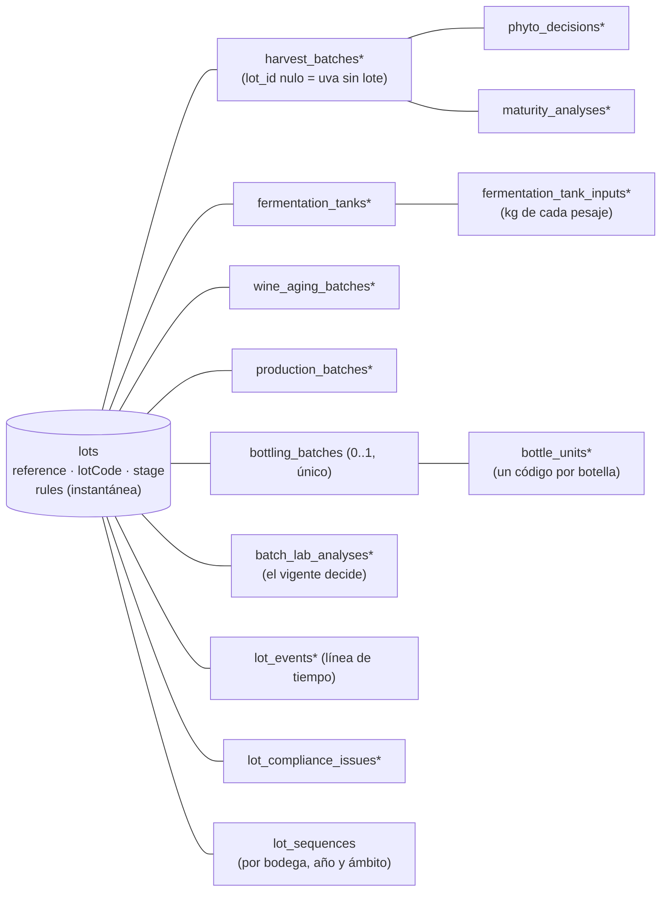

# Trazabilidad confiable: el lote del servidor

> Ola 2 · apertura (O2-BE-1; contrato `plan/contratos/o2-erp-confiable.md` §0–§2, §13, §14, §16, §20; docs-back/01 §9.1 EA-01…EA-08 y SE-07; docs-back/08 §5). Esta página describe lo que ya está en `dev`: el modelo del lote, la instantánea de reglas, la migración de los datos anteriores y los cierres de seguridad. Lo que el contrato publica pero aún no tiene lógica responde **501 `NOT_IMPLEMENTED`** (ver [Rutas](#rutas)).

## Modelo

Antes de la Ola 2 la trazabilidad era una cadena sin raíz (`Terroir → HarvestBatch → FermentationTank → WineAgingBatch | ProductionBatch → BottlingBatch → BatchLabAnalysis`) y el ERP derivaba un "lote" en el cliente (`LotView`). Ahora el **lote es una entidad del servidor** que agrupa la cadena:



| Tabla | Qué guarda |
|---|---|
| `lots` | Referencia interna `{lotPrefix}-L{año}-{NNN}` (desde la creación), código de lote de la etiqueta (`lotCode`, al embotellar), nombre, `productType` (`WINE`/`SINGANI`, nulo hasta decidirse), `stage` calculada, añada, estimación de botellas, formato y grado previstos, fecha objetivo, parcelas previstas, **`rules`** (instantánea) con `rules_origin` (`LOT_CREATION`/`MIGRATION`), descarte con motivo y autor |
| `lot_events` | Línea de tiempo (§11.1): un evento por escritura, en la misma transacción, con `seq` consecutivo por lote (la fila del lote está bloqueada), `occurred_at` (la fecha del hecho) y `recorded_at`, etapa tras el evento, actor (membresía), resumen, datos con unidad, recurso y visibilidad (`PUBLIC`/`INTERNAL`). Las lecturas de fermentación se agrupan en un evento por tanque y día |
| `lot_sequences` | Secuencias por bodega, año y ámbito (`HARVEST`, `LOT_CODE`, `LOT_REFERENCE`) |
| `phyto_decisions` | Dictámenes fitosanitarios (solo inserción; el estado del pesaje es el del último) con autor, informe (`key`) y origen (`ERP`/`MIGRATION`) |
| `maturity_analyses` | Análisis de madurez (Brix, pH, acidez) separados del pesaje; el último por fecha de medición es el vigente y se refleja en el pesaje |
| `fermentation_tank_inputs` | Kilos de cada pesaje que entran a un tanque (`availableKg` = neto − entradas) |
| `bottle_units` | Código de botella (8 caracteres Crockford: 7 aleatorios + control Luhn mod 32), serie, estado (`ACTIVE`/`VOIDED`), sal de la hoja Merkle |
| `lot_compliance_issues` | Incidencias de cumplimiento (`MIGRATION`, `CORRECTION`, `RULES_REEVALUATION`) con `details` ampliados; una abierta bloquea el embotellado |
| `bottle_code_exports` | Cada exportación de códigos (CSV o ZIP): rango de series, opciones del QR, estado (`PENDING`/`READY`/`FAILED`), filas, quién la pidió, clave del ZIP en el almacenamiento privado y caducidad (ver [Códigos de botella](#códigos-de-botella-paso-26)) |
| `lot_dossiers` | Expediente cerrado del lote: `hash`, `canonical` (los bytes hasheados), raíz Merkle y número de códigos, fecha y autor del cierre (ver [Expediente](#expediente-del-lote-y-hash-canónico-paso-28)) |
| `trace_corrections`, `lot_attachments` | Creadas en la apertura para los pasos 2.7 y 2.9 |
| `lot_backfill_pending` | Cola del relleno de la migración (ver [Migración](#migración-de-los-datos-anteriores-26)) |

Columnas nuevas (todas nulas o con valor por defecto) en la cadena actual: `lot_id` en pesajes, tanques, crianzas, destilaciones, embotellados (única: **un embotellado por lote**) y análisis; `created_by_membership_id` (autoría real, `TraceActor`); `terroir_snapshot` del pesaje; `final_volume_liters` del tanque; `start_date`, `container_count` y descarte de la crianza; cortes (`heads/heart/tails/vinasse_liters`, `heart_abv_percent`) y descarte de la destilación; `available_liters`, remanente y `label_design_key` del embotellado; `methanol_mg_100ml_aa`, `conformity`, `conformity_status`, `superseded_at` y `laboratory_report_key` del análisis. Brix, pH y acidez del pesaje pasan a ser **nulos** sin análisis.

Dos restricciones únicas se relajan: el código de vendimia es único **por bodega** (su secuencia es por bodega) y un embotellado admite **varios análisis** (reanálisis: el nuevo sustituye al anterior, sin 409).

Los actores se guardan por su membresía (`*_membership_id`, sin clave foránea, como en la bitácora) y se resuelven a `TraceActor { membershipId, userId, fullName, role }`; `null` = sistema o no registrado (datos anteriores). Las claves foráneas nuevas son `Restrict`; las antiguas `Cascade` pasan a `Restrict` en el cierre de la ola (H2), junto con `lot_id NOT NULL` (salvo en pesajes).

El código vive en `src/modules/lots/`: `domain/` (reglas puras y probadas: D.O., laboratorio, candados, balance, códigos de botella, etapa, fechas en La Paz, JSON canónico, árbol Merkle, contenido del expediente, CSV, ZIP y QR), `lot-records.ts` (crear y bloquear lotes, recalcular la etapa), `bottling-engine.ts` (reglas del embotellado), `bottle-codes.service.ts` y `bottle-code-export.builder.ts` (códigos de botella), `lot-dossier.ts` y `dossier.service.ts` (expediente), `jobs/` (procesadores del worker), `lot-backfill.ts` (relleno), `chain.ts` (destino, D.O. y volumen de la cadena) y `contract/` (rutas del contrato; con 501 las que aún no tienen lógica).

## Instantánea de reglas (CFG-06)

Al crear el lote se guarda `SettingsService.snapshot(wineryId)` (parámetros `appliesAt: 'LOT'`, **leídos de la base**, con la excepción legal de A-31) como `LotRules`:

```ts
{ takenAt, origin: 'LOT_CREATION' | 'MIGRATION',
  singani: { minAltitudeMasl, requiredVarieties, minRestDays },
  wine: { minAgingMonths }, phytosanitary: { requireApproved },
  bottling: { maxLossPercent }, lab: { limits },
  legalExceptions, sources, values }
```

Todas las validaciones del lote usan **esa** instantánea aunque la configuración cambie después: un cambio en el back office solo afecta a los lotes creados después (probado en e2e). La instantánea no se edita nunca. La aptitud D.O. de las **parcelas** (que no pertenecen a un lote) usa los valores **efectivos** de la bodega (`rulesSource: EFFECTIVE_SETTINGS`).

## Etapa del lote (§2.2)

La calcula el servidor a partir de los registros (`deriveLotStage`); ninguna ruta la fija salvo el descarte: `ORIGIN` (sin pesajes) → `HARVEST` → `FERMENTING` (algún tanque) → `AGING` (crianza) o `DISTILLING`/`RESTING` (destilaciones abiertas/cerradas) → `BOTTLED` → `CERTIFIED` (expediente cerrado, paso 2.8) → `ANCHORED` (Ola 3). `REJECTED` (todos los pesajes rechazados y ninguno en un tanque) y `DISCARDED` (con motivo: fuentes abiertas a `DISCARDED` y códigos de botella anulados). `REJECTED`, `DISCARDED` y `CERTIFIED` son terminales: toda escritura → 409 `TRC_LOT_TERMINAL`.

El lote nace en origen (`POST /v1/lots`), desde el pesaje (`newLot`) o desde el tanque (`newLot`). Un pesaje puede registrarse **sin lote** (uva recibida, `GET /v1/harvest-batches?lotId=none`); al llenar un tanque con uva sin lote y sin `lotId`/`newLot`, el servidor crea el lote del tanque (compatibilidad con el ERP actual, que no conoce los lotes).

## Reglas que ya no se pueden eludir

Todas se evalúan en el servidor con la instantánea del lote y el **reloj de la base de datos** (`now()` y el día en America/La_Paz), dentro de una transacción que bloquea la fila del lote (`SELECT … FOR UPDATE`).

| Hallazgo | Antes | Ahora |
|---|---|---|
| **EA-04** dictamen | `phytosanitaryStatus` en el alta del pesaje (autoaprobación); se fermentaba uva rechazada | El alta solo admite `PENDING_INSPECTION` (otro → 422 `TRC_PHYTO_IN_CREATE`). El dictamen va aparte (`POST …/phyto-decisions`, solo inserción; `APPROVED`/`REJECTED` finales; `REJECTED`/`QUARANTINE` con motivo; nada cambia con la uva en un tanque → 409 `TRC_PHYTO_DECISION_FINAL`). Un tanque exige `APPROVED` (o `PENDING` si la instantánea no lo exige; nunca `REJECTED`/`QUARANTINE`) → 422 `TRC_PHYTO_NOT_APPROVED` con un detalle por pesaje. `PATCH …/phyto-status` es un alias que ya no pisa las notas |
| **EA-01** tipo del embotellado | La estrategia se elegía con el `productType` que enviaba el cliente (`WINE` sobre una destilación no miraba el reposo) | El tipo se deriva del origen (crianza → `WINE`, destilación → `SINGANI`); uno distinto → 422 `TRC_PRODUCT_TYPE_MISMATCH`. Candados: `unlockDate ≤ hoy` (reloj de la base) **y** `≤ bottlingDate` → si no, 422 `TRC_LOCK_NOT_RELEASED` con `rule`, `unlockDate` y `daysRemaining`. Crianza: inicio + meses de calendario (≥ mínimo de la instantánea); reposo: fin de la destilación + `minRestDays` de la instantánea (no más 180 fijos); con registros anteriores manda la fecha más tardía entre la calculada y la guardada |
| **EA-02** embotellado ilimitado | Sin balance ni estados terminales | Un embotellado por lote (409 `TRC_LOT_ALREADY_BOTTLED` y restricción única `bottling_batches(lot_id)`); todas las fuentes abiertas entran o se descartan antes (`TRC_BOTTLING_SOURCES_PENDING`); balance de volumen `botellas × cL + remanente ≤ disponible + agua` (`TRC_BOTTLING_EXCEEDS_VOLUME` con `maxBottles`) y merma ≤ `maxLossPercent` (`TRC_BOTTLING_LOSS_ABOVE_TOLERANCE`); alcohol puro embotellado ≤ el del corazón con 0,5 % de tolerancia (`TRC_ALCOHOL_BALANCE_EXCEEDED`); vino sin agua (`TRC_DILUTION_NOT_ALLOWED`); incidencias abiertas bloquean (`TRC_COMPLIANCE_ISSUES_OPEN`). Fuentes a `BOTTLED`, tanques a `TRANSFERRED`, lote a `BOTTLED` y un código por botella, en la misma transacción. `blockchainDataHash` ya no se calcula (el hash válido será el del expediente) |
| **EA-03** D.O. | La destilación solo validaba si llegaba `isDoEligible: true`; la parcela declaraba su aptitud | Aptitud calculada: altitud ≥ mínimo y cepa entre las exigidas (sin mayúsculas, tildes ni espacios repetidos; sin sinónimos, P-7). Parcelas: `isDoEligible` calculado con los valores efectivos y `doEvaluation`; el valor enviado se ignora. Lote singani: la parcela del pesaje (`TRC_DO_TERROIR_NOT_ELIGIBLE`), el destino singani de un tanque y cada destilación evalúan **todos** los pesajes del lote con la instantánea (`TRC_DO_NOT_ELIGIBLE`, un detalle por regla con `expected`/`actual`). `ELIGIBLE_BY_EXCEPTION` cuando solo cumple por un valor bajo el mínimo legal autorizado (A-31). Destino coherente con el tipo del lote (`TRC_DESTINATION_MISMATCH`) |
| **EA-07** secuencias | `count + 1` y sufijo por colisión | `lot_sequences` con `INSERT … ON CONFLICT DO UPDATE … RETURNING` (bloqueo de fila); el valor nunca queda por debajo de lo que ya existe en los datos. Código de vendimia `HARV-{año}-{parcela}-{NNN}` por bodega y año; código de lote `{lotPrefix}-{año}-{WINE\|SINGANI}-{NNN}` por bodega y año, común a los productos; referencia `{lotPrefix}-L{año}-{NNN}` |
| **EA-08** laboratorio | `conformsToSenasagStandards` `true` por defecto; metanol en mg/L comparado con un límite en mg/100 mL | Conformidad calculada contra `rules.lab.limits` con unidades explícitas (`units` en la respuesta). Metanol en mg/L de producto → mg/100 mL de alcohol anhidro (`10 × mgL / grado`); si llegan ambos y difieren > 1 % → 422. Parámetros exigidos: singani (metanol, cobre, grado), vino (acidez volátil, grado); falta uno → `INCOMPLETE` (nunca conforme por omisión); unidad desconocida → `UNIT_UNKNOWN`. Aviso si el grado medido difiere > 0,5 % vol del etiquetado |
| **EA-05** (parte) grafo | Métricas fijas (12,80 %, 0,28 g/L), `isCertified: true` fijo, operadores genéricos | Solo datos registrados (métrica vacía si no hay dato), `isCertified` = expediente cerrado, operador desde la membresía o "No registrado" |
| **SE-07** grafo | `GET /traceability/dag/:id` para cualquier sesión; el pasaporte público aceptaba el id | Solo los miembros de la bodega dueña y el personal de plataforma (ADMIN, OPERATIONS, SUPPORT, SUPERADMIN); cualquier otra sesión → 404. El pasaporte legado solo por código de lote |
| **S-25** plataforma | Escribía con `?wineryId=` (contrato O0 §8) | **Solo lee** la trazabilidad (`@PlatformReadOnly()` en parcelas, vendimia, tanques, crianza, destilación, embotellado, laboratorio y lotes): escrituras → 403 `TRC_PLATFORM_READ_ONLY` |

Otras reglas del contrato activas desde la apertura: fechas no futuras (`TRC_DATE_IN_FUTURE`, 5 min de tolerancia en los instantes) ni anteriores a la etapa previa (`TRC_DATE_BEFORE_PREVIOUS_STAGE`) en pesajes, dictámenes, tanques, lecturas, tratamientos, crianzas, destilaciones y laboratorio; entradas de un solo lote por tanque (`TRC_MIXED_LOTS`), kilos ≤ disponibles y llenado ≤ capacidad; código físico del tanque ocupado hasta limpiarlo (409 `TRC_TANK_CODE_IN_USE`); lecturas y tratamientos solo en tanques activos (409 `TRC_TANK_NOT_ACTIVE`); crianza ≥ mínimo de la instantánea (`TRC_AGING_BELOW_MINIMUM`) con `volumeLiters` obligatorio ≤ lo disponible del tanque; destilación con entrada ≤ lo disponible del tanque y cortes ≤ entrada (`TRC_MASS_BALANCE_EXCEEDED`); parcela usada sin `PATCH` de altitud, cepa ni materia prima (409 `TRC_TERROIR_IN_USE`).

### Errores de reglas

Estado del recurso → **409**; regla de negocio incumplida → **422**; plataforma escribiendo → **403**. El código de la respuesta es el de la primera violación y `details` lleva **todas**, con la forma ampliada del contrato O2 §0 (aditiva sobre la de la Ola 0):

```json
{ "field": "bottlingDate", "message": "Reposo mínimo de 180 días: disponible el 2026-10-13 (faltan 16 días)",
  "code": "TRC_LOCK_NOT_RELEASED", "rule": "trazabilidad.singani.reposoMinimoDias",
  "expected": "2026-10-13", "actual": "2026-09-27",
  "meta": { "sourceId": "…", "kind": "REST", "unlockDate": "2026-10-13", "daysRemaining": 16 } }
```

El filtro global conserva `code`, `rule`, `expected`, `actual` y `meta` (`normalizeErrorDetails`); el resto de campos se descarta como antes. La lista completa de códigos está en `src/shared/exceptions/error-codes.ts` y en `docs/rules/03-formato-respuestas.md`.

## Embotellado seguro: precisiones del paso 2.5

`POST /v1/lots/{id}/bottling[/preview]` y la ruta legada usan el mismo motor (`bottling-engine.ts`). Además de la tabla de arriba:

- **Fuentes sin repetir**: la misma crianza o destilación dos veces en `sources` → 422 `TRC_BOTTLING_SOURCE_INVALID` (contaría dos veces su volumen y su alcohol).
- **`liters` no esconde merma**: como hay un embotellado por lote y cada fuente incluida queda `BOTTLED`, `balance.availableLiters` es siempre el volumen **entero** de las fuentes. Si `liters` pide menos, la diferencia se declara en `leftover` o cuenta como merma (y puede superar la tolerada). El alcohol puro disponible (`balance.pureAlcohol.availableLiters`) es solo el de los litros que se toman. Más litros que los de la fuente → 422 `TRC_VOLUME_EXCEEDS_AVAILABLE`.
- **Tolerancia del balance de alcohol** (S-11): alcohol puro embotellado ≤ alcohol del corazón × 1,005.
- **Etiqueta**: `labelDesignKey` es la `key` de un archivo subido por la propia bodega (`org/{bodega}/…`); ajena o inexistente → 422 `TRC_FILE_NOT_FOUND` (en la vista previa, una violación más). El detalle del embotellado devuelve `labelDesign: { key, url }` con una URL firmada de corta vida.
- **Código de lote**: `{lotPrefix}-{año del embotellado}-{WINE|SINGANI}-{NNN}`; la secuencia (por bodega y año, común a los productos) sale de `lot_sequences` con la fila bloqueada. Probado con embotellados simultáneos de dos bodegas, de tres lotes de la misma bodega (números consecutivos) y del mismo lote (uno entra, el otro 409 `TRC_LOT_ALREADY_BOTTLED`).
- **Rendimiento**: los códigos se insertan por tandas de 5.000 (`generateBottleUnits`); un lote de 5.000 botellas se embotella en una transacción en pocos segundos.

## Códigos de botella (paso 2.6)

Contrato O2 §7. Un código por botella desde el embotellado (8 caracteres Crockford: 7 aleatorios + control Luhn mod 32), con serie `1…N`. Los listan, exportan y anulan **OWNER y ENOLOGIST**; de la plataforma solo listan ADMIN y OPERATIONS (con `?wineryId=`; SUPPORT → 403). La plataforma no exporta ni anula. Los demás roles ven solo los totales del embotellado (`bottleCodes`).

| Ruta | Qué hace |
|---|---|
| `GET /v1/lots/{id}/bottle-codes` | Página por serie (`limit`/`offset`), filtros `status`, `fromSerial`, `toSerial` y búsqueda `q` (fragmento del código tal como se teclea, o la serie exacta). Un código sustituido y su sustituto comparten serie (primero el anulado). La sal de la hoja Merkle no sale por la API |
| `GET /v1/lots/{id}/bottle-codes/export` | CSV por *streaming* (cursor por serie, tandas de 1.000) |
| `POST /v1/lots/{id}/bottle-codes/exports` | Pide el ZIP para la imprenta: `202 { exportId, status: 'PENDING' }` |
| `GET /v1/lots/{id}/bottle-codes/exports/{exportId}` | Estado de la exportación y, con el ZIP listo y sin caducar, `downloadUrl` (URL firmada de 15 min) |
| `POST /v1/bottle-codes/{code}/void` | Anula un código; con `replace: true` emite otro con la misma serie |

Lote sin embotellar → 409 `TRC_LOT_NOT_BOTTLED`. Rango inválido (`fromSerial > toSerial` o fuera de `1…N`) o sin códigos activos → 422 `VALIDATION_ERROR`.

**CSV** (`text/csv; charset=utf-8`, `Content-Disposition: attachment; filename="codigos-{lotCode}-{desde}-{hasta}.csv"`, cabeceras `X-Export-Rows` y `X-Export-Id`):

```
serial,code,codeFormatted,qrUrl,lotCode,lotName,productType,bottlingDate
1,K7M2Q9XA,K7M2-Q9XA,https://app.drinksonchain.com/b/K7M2Q9XA,CVJ-2026-SINGANI-004,Singani Gran Reserva 2026,SINGANI,2026-10-01
```

Una fila por código **activo** del rango (un código anulado no se imprime; de una serie sustituida sale el sustituto), UTF-8 **con BOM**, separador coma, `CRLF` y celdas neutralizadas contra fórmulas, como los demás CSV del backend. `qrUrl` = `{PASSPORT_BASE_URL}/b/{código}`.

**ZIP** (en el almacenamiento privado, clave `exports/bottle-codes/{bodega}/{exportId}.zip`: fuera del prefijo `org/…` de las subidas, así que `GET /v1/uploads/url` no lo firma):

```
codigos.csv                 # el mismo CSV, con las filas del rango
qr/1-K7M2Q9XA.svg           # qr/{serial}-{code}.svg (o .png), uno por código activo
qr/2-P3R8T2W7.svg
```

El QR codifica `qrUrl` con corrección de errores `M`. `qr.imageFormat` es `SVG` (vectorial, lo que conviene a la imprenta) o `PNG` (1 bit, exactamente `sizePx × sizePx`); por defecto `sizePx: 512` y `margin: 4` módulos. Lo genera el worker con la tarea **`trace.bottle-codes.export`**: la petición escribe la fila `PENDING` y el evento del outbox en la misma transacción, el procesador (`jobs/bottle-codes-export.handler.ts`) arma el ZIP y deja la fila `READY` (idempotente; en el último intento fallido, `FAILED`). Como máximo **20.000 códigos por ZIP** (se arma en memoria y el formato ZIP clásico admite 65.535 entradas): un lote mayor se exporta por rangos. Caduca a los **7 días**: `downloadUrl` pasa a `null` y la tarea horaria `trace.bottle-codes.exports-cleanup` borra el archivo (la fila se conserva).

Cada exportación (CSV o ZIP) queda en `bottle_code_exports`, suma en `exportsCount`/`firstExportedAt` de cada código y deja la entrada `BOTTLE_CODES_EXPORTED` en la bitácora **con el rango**, antes de enviar nada.

**Anular** (`{ reason, replace? }`): el código pasa a `VOIDED` (ya anulado → 409 `TRC_BOTTLE_CODE_ALREADY_VOIDED`; de otra bodega, inexistente o con el control mal → 404 `TRC_BOTTLE_CODE_NOT_FOUND`). Con `replace: true` se emite un código nuevo con la **misma serie** (`replaces` / `voided.replacedBy`). Deja el evento `BOTTLE_CODE_VOIDED` en la línea de tiempo (interno, con la serie pero sin el código) y la entrada `BOTTLE_CODE_VOIDED` en la bitácora. Invariante: códigos `ACTIVE` = botellas − bajas sin sustituto. Con el **expediente cerrado** se puede anular pero no sustituir (S-14): `replace: true` → 409 `TRC_DOSSIER_CLOSED`.

## Expediente del lote y hash canónico (paso 2.8)

Contrato O2 §10 y §20. Lo leen todos los miembros (y la plataforma); lo cierran OWNER y ENOLOGIST.

| Ruta | Qué hace |
|---|---|
| `GET /v1/lots/{id}/dossier/preview` | `{ ready, requirements[], hashPreview }` |
| `POST /v1/lots/{id}/dossier/close` | `{ confirm: true }` → `LotDossier`; lote → `CERTIFIED` |
| `GET /v1/lots/{id}/dossier` | `LotDossier` (`OPEN` mientras no se cierra) |
| `GET /v1/lots/{id}/dossier/canonical` | Los bytes canónicos, sin el envoltorio `data`; cabeceras `X-Dossier-Status` (`OPEN`/`CLOSED`) y `X-Dossier-Hash` |

**Requisitos del cierre** (un `ErrorDetail` por cada uno sin cumplir en el 422 `TRC_DOSSIER_NOT_READY`, con `meta.requirement`):

| Requisito | Se cumple cuando | `meta` extra |
|---|---|---|
| `BOTTLED` | El lote tiene su embotellado | — |
| `LAB_CONFORMING` | El análisis vigente (el último sin sustituir ni anular) es `CONFORMING`; ausente, incompleto o no conforme no cumplen | `labStatus` |
| `BOTTLE_CODES_READY` | Hay códigos activos, cada serie `1…N` tiene código y ninguna tiene dos activos | — |
| `NO_OPEN_COMPLIANCE_ISSUES` | Sin incidencias de cumplimiento abiertas | `issueIds` |
| `NO_OPEN_SOURCES` | Sin crianzas ni destilaciones abiertas | `sourceIds` |

**Cierre** (con la fila del lote bloqueada): expediente ya cerrado → 409 `TRC_DOSSIER_CLOSED` (`meta.closedAt`, `meta.hash`); lote `REJECTED` o `DISCARDED` → 409 `TRC_LOT_TERMINAL`; requisitos → 422. Después calcula el contenido canónico y su SHA-256, guarda `lot_dossiers`, el lote pasa a `CERTIFIED` y deja el evento `DOSSIER_CLOSED` (público) en la línea de tiempo, la entrada `DOSSIER_CLOSED` en la bitácora y el evento **`lot.certified`** en el outbox (cola `chain`; payload `{ lotId, wineryId, lotCode, hash, bottleMerkleRoot, bottleCount, closedAt }`). El procesador de hoy solo lo registra: el anclaje llega en la Ola 3.

Tras el cierre, las escrituras del lote responden 409 `TRC_LOT_TERMINAL` (`lockLot(…, { writable: true })`). Las que el contrato marca con `TRC_DOSSIER_CLOSED` (laboratorio, correcciones) deben llamar antes a **`assertDossierOpen(tx, lotId)`** (`lot-dossier.ts`). Lo único que el lote sigue admitiendo es anular códigos sin sustituto; el expediente no cambia nunca más.

### Lo que se guarda (`lot_dossiers`)

| Columna | Contenido |
|---|---|
| `lot_id` | Clave: un expediente por lote. La fila se crea al cerrar (sin fila = `OPEN`) |
| `schema` | `doc-dossier/1` |
| `status` | `CLOSED` |
| `hash` | SHA-256 (hexadecimal en minúsculas) de los bytes UTF-8 de `canonical`. Algoritmo: `sha256/jcs-rfc8785` |
| `canonical` | El JSON canónico, tal cual: sus bytes UTF-8 son lo que se hasheó y lo que devuelven `GET …/dossier/canonical` y el pasaporte público |
| `bottle_count`, `bottle_merkle_root` | Número de hojas y raíz Merkle de los códigos de botella. Algoritmo: `sha256-merkle/serial-code-salt` |
| `closed_at`, `closed_by_membership_id` | Fecha (reloj de la base, leído con el lote bloqueado) y autor del cierre |

### Forma canónica `doc-dossier/1`

JSON canónico **RFC 8785 (JCS)**, UTF-8: propiedades ordenadas por unidades de código UTF-16, sin espacios, cadenas y números con la serialización de ECMAScript (`domain/jcs.ts`, probado con los ejemplos de la RFC). Reglas del contenido (`domain/dossier.ts`):

- Las **medidas** (columnas decimales) van como cadenas de escala fija, con la escala de su columna: kilos `"18400.000"`, litros de tanque y crianza `"12100.00"`, litros de destilación y embotellado `"1500.000"`, grados `"40.00"`, Brix y pH `"23.50"`, densidad `"1.0850"`. Los enteros (botellas, cL, meses, añada) son números.
- Los **documentos guardados como JSON** (instantánea de reglas, conformidad del laboratorio, valores `before`/`after` de las correcciones) van tal cual se guardaron.
- Instantes en ISO 8601 UTC con milisegundos; fechas de calendario `YYYY-MM-DD`.
- Listas ordenadas por fecha e id (comparación binaria en la aplicación, no la intercalación de la base).
- Personas como `{ membershipId, role }` (o `null`): sin nombres ni correos. Tampoco van textos libres (notas, motivos; de una corrección de `notes` queda solo el campo), ni URL o claves de archivos, ni los códigos de botella.

```jsonc
{
  "schema": "doc-dossier/1",
  "closedAt": "2026-10-01T15:04:05.123Z",           // null en la vista previa
  "closedBy": { "membershipId": "…", "role": "OWNER" },
  "winery": { "id": "…", "lotPrefix": "CVJ", "tradeName": "Destilería Cinti Viejo" },
  "lot": { "id", "reference", "lotCode", "name", "productType", "harvestYear",
           "createdAt", "createdBy", "bottledAt" },
  "rules": { /* instantánea completa (LotRules), tal como se guardó */ },
  "harvests": [{ "id", "code", "intakeDate", "harvestYear", "grossWeightKg", "tareWeightKg",
                 "netWeightKg", "temperatureAtIntakeC", "phytosanitaryStatus",
                 "terroir": { "id", "parcelName", "altitudeMasl", "varietyName",
                              "rawMaterialType", "takenAt" },   // tal como era al pesar
                 "recordedAt", "recordedBy",
                 "maturityAnalyses": [{ "id", "brixDegrees", "ph", "acidityGl", "measuredAt",
                                        "recordedAt", "recordedBy", "source", "voidedAt" }],
                 "phytoDecisions": [{ "id", "decision", "decidedAt", "recordedAt", "decidedBy",
                                      "inspectionReportSha256", "source", "voidedAt" }] }],
  "tanks": [{ "id", "tankCode", "material", "capacityLiters", "volumeFilledLiters",
              "finalVolumeLiters", "destinationType", "status", "startDate", "endDate",
              "recordedAt", "recordedBy",
              "inputs": [{ "harvestBatchId", "kg" }],
              "readings": [{ "id", "recordedAt", "temperatureCelsius", "specificGravity", "phValue" }],
              "treatments": [{ "id", "treatmentType", "additiveName", "dosageAppliedGPerHl",
                               "totalAppliedG", "regulatoryAuthCode", "appliedAt" }] }],
  "agings": [{ "id", "fermentationTankId", "containerType", "containerMaterial", "containerCount",
               "barrelUseCycle", "volumeLiters", "plannedMonths", "startDate", "unlockDate",
               "status", "discardedAt", "recordedAt", "recordedBy" }],
  "distillations": [{ "id", "fermentationTankId", "processType", "equipmentIdentifier",
                      "processStartDate", "processEndDate", "inputVolumeLiters", "headsLiters",
                      "heartLiters", "tailsLiters", "vinasseLiters", "heartAbvPercent",
                      "restUntil", "status", "discardedAt", "recordedAt", "recordedBy" }],
  "bottling": { "id", "lotCode", "productType", "bottlingDate", "packagingFormatCl",
                "totalBottlesPackaged", "finalAlcoholAbv", "waterDilutionLiters", "bottleType",
                "leftover": { "liters", "disposition" },
                "balance": { "availableLiters", "waterDilutionLiters", "bottledLiters",
                             "leftoverLiters", "lossLiters", "lossPercent",
                             "pureAlcohol": { "availableLiters", "bottledLiters" } },
                "recordedAt", "recordedBy" },
  "labAnalyses": [{ "id", "laboratoryName", "certificationCode", "analysisRequestDate",
                    "testPerformedAt", "actualAlcoholAbv", "totalAlcoholAbv",
                    "totalAcidityTartaricGl", "volatileAcidityAceticGl", "freeSulfurDioxideMgL",
                    "totalSulfurDioxideMgL", "reducingSugarsGl", "totalDryExtractGl",
                    "sugarFreeDryExtractGl", "overpressureBar", "methanolContentMgL",
                    "methanolMg100mlAa", "copperContentMgL", "conformityStatus",
                    "conformity": { /* LabConformity guardada */ },
                    "current", "supersededAt", "recordedAt", "recordedBy" }],
  "corrections": [{ "id", "target": { "type", "id" }, "kind",
                    "changes": [{ "field", "before", "after" }], "createdAt", "createdBy" }],
  "attachments": [{ "kind", "sha256" }],
  "bottleCodes": { "count": 2950, "merkleRoot": "…", "algorithm": "sha256-merkle/serial-code-salt" }
}
```

El `balance` del expediente se recalcula con los registros vigentes y el volumen entero de las fuentes embotelladas. Las propiedades sin dato van con `null` (nunca se omiten), así la forma es estable.

**Vista previa**: con el expediente abierto, `GET …/dossier/canonical` devuelve el mismo documento con `closedAt` y `closedBy` en `null`, y `hashPreview` es su SHA-256. No cambia mientras no cambien los registros del lote (sirve a la UI para detectar cambios); la huella definitiva incluye además la fecha y el autor del cierre. Con el expediente cerrado, `hashPreview` es la huella definitiva.

### Raíz Merkle de los códigos de botella

El expediente es público y los códigos son el antifalsificación de la etiqueta, así que no van en claro (supuesto técnico de §20, P-3). `domain/merkle.ts`:

1. Hojas: los códigos **activos al cerrar**, ordenados por serie. `hoja = SHA-256("{serie}:{código}:{sal}")` sobre el texto UTF-8, con la sal de la botella (`bottle_units.salt`: 16 bytes aleatorios en hexadecimal, 32 caracteres) tal cual está guardada.
2. Cada nivel empareja de izquierda a derecha: `padre = SHA-256(izquierdo ‖ derecho)` sobre los 32 bytes de cada resumen.
3. Un nodo sin pareja al final de un nivel **sube tal cual** (no se duplica).
4. La raíz, en hexadecimal en minúsculas. Sin hojas, `SHA-256("")`.

**Para el pasaporte público** (`PublicBottlePassport.bottle.merkleProof`): `bottleMerkleProof(client, lotId, code)` (`lot-dossier.ts`) devuelve `{ salt, path: { side: 'L' | 'R', hash }[], merkleRoot }`, o `null` si el expediente no está cerrado o el código no entró en la raíz (anulado antes del cierre). `side` es el lado del hermano: `L` → `SHA-256(hermano ‖ actual)`; `R` → `SHA-256(actual ‖ hermano)`; se comprueba con `verifyMerkleProof(hoja, path, raíz)`. Las hojas de un expediente cerrado son los códigos activos hoy más los anulados **después** del cierre (tras el cierre no se emiten códigos nuevos); `closedDossierLeaves` las reconstruye y comprueba que reproducen la raíz guardada antes de dar una prueba. Para que ese orden sea exacto, el cierre y la anulación leen el reloj de la base con el lote ya bloqueado (`lockedClock`, `clock_timestamp()`).

**Cómo verifica un tercero**: descarga los bytes (`GET /v1/lots/{id}/dossier/canonical`, o el del pasaporte público), calcula su SHA-256 y lo compara con `hash`; con la serie, el código y la sal de una botella calcula la hoja y sigue `path` hasta `bottleCodes.merkleRoot`, que está dentro de esos mismos bytes.

## Migración de los datos anteriores (§2.6)

1. **Expandir** (`20260928090000_o2_lotes_expand`): tablas nuevas y columnas nulas; la migración **encola** cada pesaje existente en `lot_backfill_pending`.
2. **Relleno** (`LotBackfillRunner`, al arrancar la API y sin bloquear el arranque; `LOT_BACKFILL_ON_BOOT=false` lo desactiva): cada pesaje en su propia transacción con `FOR UPDATE SKIP LOCKED` (varias instancias se reparten la cola), hasta 5 intentos con `last_error`. Por pesaje (`backfillHarvestChain`, idempotente: un pesaje con lote no se toca):
   - **Un lote por pesaje** (la regla de `LotView`), id **UUID v5 de `lot:{harvestBatchId}`** en el espacio de nombres de los mocks (`6b2f4c1e-…`), nombre = código de lote si está embotellado o `'{variedad} {año}'`, `productType` derivado (destilación o tanque a singani → `SINGANI`; crianza o tanque a vino → `WINE`; si no, nulo), referencia con la secuencia nueva y `lotCode` del embotellado.
   - **Instantánea** con `origin: 'MIGRATION'` tomada al migrar.
   - **Dictamen**: cada estado distinto de `PENDING_INSPECTION` genera un `PhytoDecision` `MIGRATION` con `certifiedByMemberId` como autor. Brix, pH y acidez generan el primer `MaturityAnalysis` (salvo 0/0/0, que en los datos anteriores significaba "sin análisis").
   - **Entradas de tanque**: el neto del pesaje; con varios tanques del mismo pesaje, repartido por volumen llenado (así no se cuenta dos veces).
   - Crianza con `start_date` (su fecha de alta en La Paz); cortes de la destilación desde `additionalParams` y el grado del corazón desde `initialAlcoholPercentage`.
   - **Laboratorio**: conformidad recalculada con la instantánea (el `conformsToSenasagStandards` guardado queda como histórico).
   - **Códigos de botella** para los embotellados existentes y `qrBatchUrl` reescrita a `{PASSPORT_BASE_URL}/b/{lotCode}`.
   - Línea de tiempo con los hechos a sus fechas y una entrada de bitácora `LOT_MIGRATED` (actor sistema).
   - **Revisión de integridad**: D.O. del lote singani, dictamen de la uva en tanques, candado a la fecha del embotellado, balance de volumen y alcohol, agua en vino, volumen de la fuente, salidas del tanque por encima de su volumen, un segundo embotellado del mismo lote y fuentes abiertas en un lote embotellado. Lo que no cumple **no se borra ni se corrige solo**: queda como `ComplianceIssue` `MIGRATION` visible en el lote (y bloquea embotellar hasta corregirlo o descartar el lote).
3. Un registro anterior que aún no tenga lote (p. ej. si el relleno falló) se rellena **al vuelo** en cuanto una escritura lo necesita (`ensureHarvestLot`).
4. **Contraer** (cierre de la ola, H2): `lot_id NOT NULL` salvo en pesajes, `Restrict` en las claves antiguas y retirada de lo legado (§16.2).

Probado sobre una copia con la semilla de demostración anterior a la migración (Postgres 16): 12 pesajes → 12 lotes, 15.400 códigos de botella, 95 eventos, 10 dictámenes, 11 análisis de madurez, 3 análisis de laboratorio conformes y 4 incidencias en los datos que no cumplían (ver [Semilla](#semilla)). La e2e `traceability-o2` repite el relleno sobre datos anteriores creados a mano (incidencias `TRC_DO_NOT_ELIGIBLE` y `TRC_BOTTLING_EXCEEDS_VOLUME`) y comprueba que una segunda pasada no toca nada.

### Semilla

La semilla determinista (`pnpm seed`) rellena sus lotes con la misma función y aplica **correcciones de realismo** (`src/seed/corrections.ts`) a los fixtures de los mocks 0.3.x que incumplían las reglas nuevas, sin falsear datos:

| Registro | Corrección | Por qué |
|---|---|---|
| CVJ-2026-SINGANI-002 | Agua 620 L → 630 L | 2.140 × 75 cL = 1.605 L con solo 1.600 L disponibles (980 L de corazón + 620 L) |
| Destilación AL-02 de marzo de 2026 (TK-02) | Se retira | El tanque ya se destiló entero en 2025 y su lote se embotelló en febrero de 2026 |
| Tanque TK-07 | Se retira | Lleno con un pesaje en cuarentena |
| Crianza de CVJ-2026-WINE-003 | `READY` → `BOTTLED` | Ya estaba embotellada |

Con ellas la semilla no genera incidencias. Una base que ya tenía la semilla anterior conserva esos registros y los muestra como incidencias de la migración (así se comporta con datos reales). Los mocks v2 (O2-PK-1) deben adoptar las mismas correcciones y el id de lote `uuidv5('lot:{harvestBatchId}')`.

## Rutas

Implementadas en la apertura (con su OpenAPI y validadas contra él en e2e): `GET/POST /v1/lots`, `GET/PATCH /v1/lots/{id}`, `POST /v1/lots/{id}/discard`; `POST /v1/lots/{id}/bottling/preview` y `POST /v1/lots/{id}/bottling` (mismo motor que la ruta legada; sin `sources`, todas las fuentes abiertas del lote con todo su volumen); `POST/GET /v1/harvest-batches/{id}/phyto-decisions` y `…/maturity-analyses`; `GET /v1/harvest-batches?lotId=none`; y las rutas actuales con las reglas nuevas y los campos aditivos (`lotId`, `inputs`, `lock`, `balance`, `bottleCodes`, `conformity`, `units`…). `GET /v1/public/wineries` también responde (O2-WEB-1).

Con lógica desde los pasos 2.6 y 2.8: las cinco rutas de [códigos de botella](#códigos-de-botella-paso-26) y las cuatro del [expediente](#expediente-del-lote-y-hash-canónico-paso-28).

Publicadas con **501 `NOT_IMPLEMENTED`** (el `details[0].meta.step` dice el paso de la Etapa 2 que las trae): transiciones del tanque (2.3), descarte de crianza y cierre/descarte de destilación (2.4), laboratorio por lote y correcciones (2.7), línea de tiempo, grafo, balance, panel, reportes y adjuntos (2.9) y pasaporte público (2.10).

## Configuración

| Variable | Uso |
|---|---|
| `PASSPORT_BASE_URL` | Base del QR: `{PASSPORT_BASE_URL}/b/{código}` (OP-06). Por defecto `APP_URL_MARKETPLACE`; si tampoco, `http://localhost:3005` |
| `LOT_BACKFILL_ON_BOOT` | `false` desactiva el relleno al arrancar (por defecto activo) |
| `STORAGE_DRIVER`, `S3_*`, `STORAGE_LOCAL_PATH` | También en el **worker**: guarda ahí los ZIP de códigos de botella (los crea al primer trabajo; mal configurado, falla la exportación, no el arranque). En `deploy/dev/compose.yml` y `docker-compose.yml` el worker ya recibe los mismos valores que la API |
| `JOB_ATTEMPTS` | Intentos de `trace.bottle-codes.export` antes de dejar la exportación `FAILED` (por defecto 5) |
